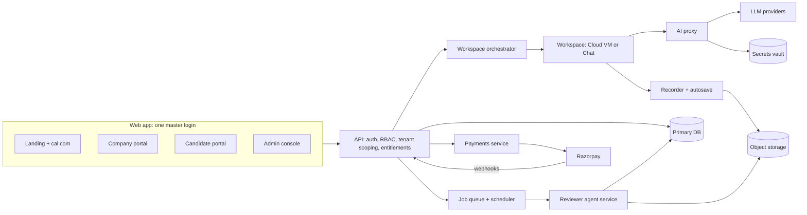
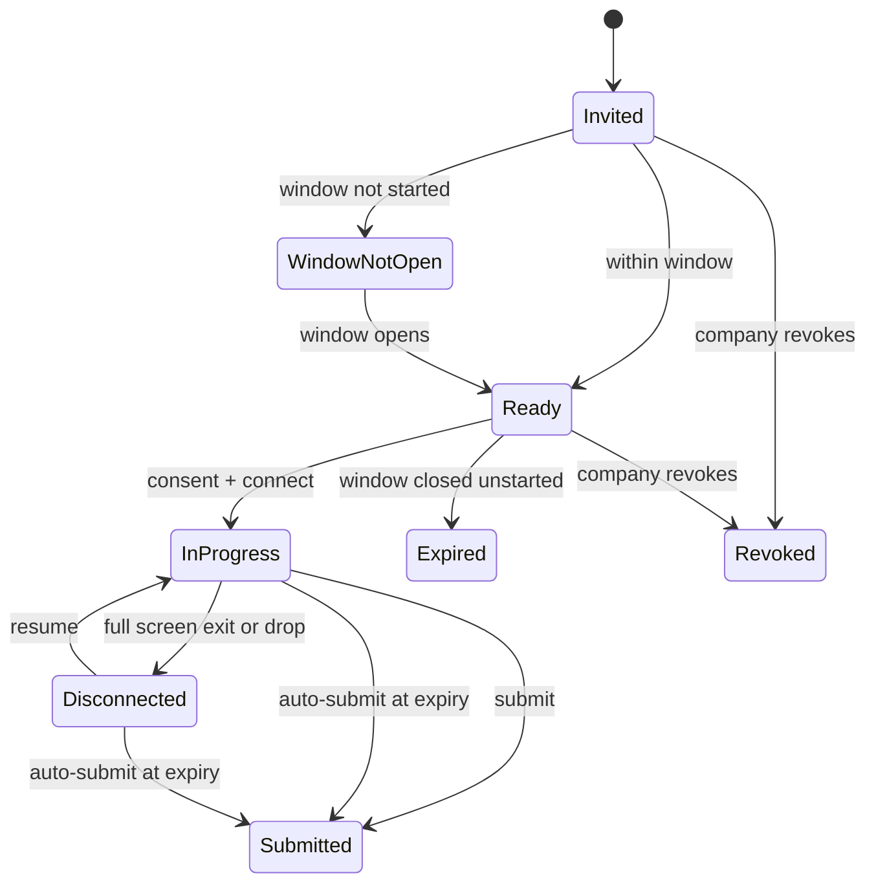
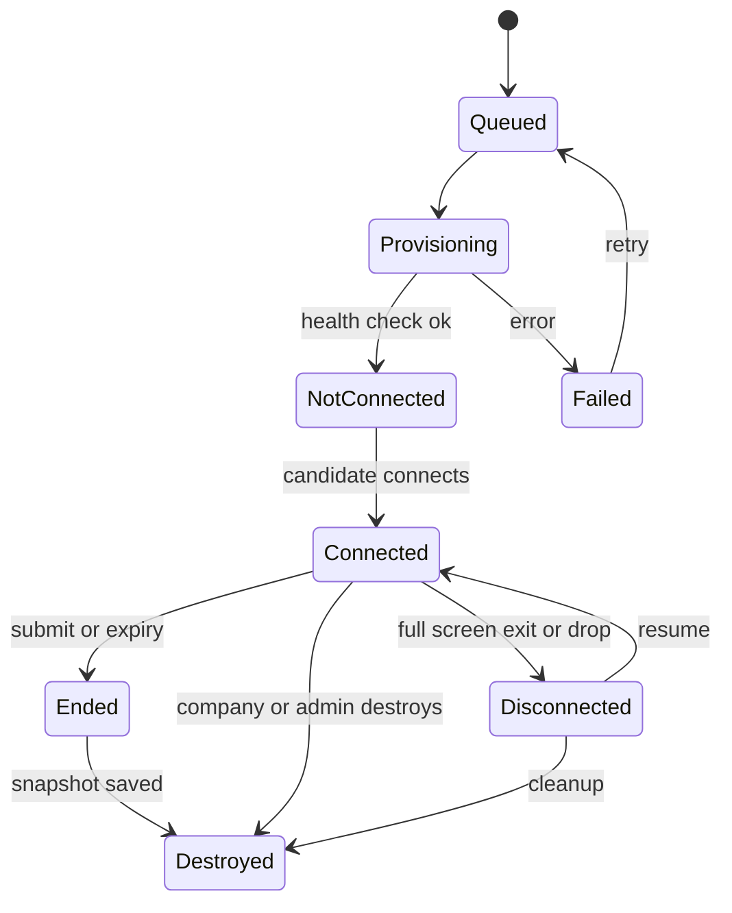

# HelloSmart.ai: Product and Engineering Spec (AGENTS.md)

> **Audience:** developers and AI coding agents building the HelloSmart MMP.
> **Source:** generated from `HelloSmart_Business_Requirements.xlsx` (all open questions resolved). Requirement IDs (`CO-`, `CA-`, `AD-`, `SP-`, `NF-`, `EX-`) match that workbook one to one.
> **Status:** v0.2, MMP scope. Sections marked **(proposed)** are engineering suggestions derived from the requirements, not business decisions; change them if the repo says otherwise.

---

## 0. How to use this document

### 0.1 Order of authority
If two parts of this file disagree, the higher one wins:
1. **Section 8: Business rules (BR-xx)**: invariants that must never be violated.
2. **Section 14: Decision log**: accepted product decisions.
3. **Section 9: Feature requirements**: IDs with acceptance criteria.
4. **Sections 5, 6, 10, 13 (proposed)**: architecture, data model, flows and API. Follow them unless you have a stated reason; record deviations in the PR.

If still ambiguous, **do not guess on anything touching security, tenancy, consent, recording, payments or retention**. Ask, or leave a `TODO(question)` and flag it in the PR.

### 0.2 Priority and phase semantics
| Field | Values | Meaning |
|---|---|---|
| Priority | `Must` / `Should` / `Could` | Must = needed to sell the MMP. Should = important, follows quickly. Could = nice to have. |
| Phase | `MMP` / `Phase 2` / `Phase 3` | **Build only `MMP` unless told otherwise.** Design so Phase 2/3 fits later (extension points, feature flags), but do not build it now. |

### 0.3 Rules for AI coding agents
**Do**
- Reference requirement IDs in branch names, commit messages, PR titles and test names (for example `feat(CA-008): force full screen on cloud connect`, `test(BR-01): cross-tenant read returns 404`).
- Scope **every** database query, cache key, file path and job by `org_id`. Add a cross-tenant test for every new endpoint.
- Enforce authorization, entitlements, timing windows and caps **on the server**. UI checks are cosmetic.
- Treat all candidate input, AI transcripts and submission artifacts as **untrusted data** (they go to graders; see BR-18).
- Write append-only audit entries for the actions listed in BR-31.
- Make webhooks and jobs **idempotent**.
- Keep feature flags per org for gated features (see BR-05, BR-29).
- Add or update tests with every change; tests are part of done (Section 16).

**Do not**
- Do not add a public self-signup or a public template catalog (BR-02, BR-04).
- Do not build Local mode, Browser workspace, live monitoring, Stripe, Reviewer role, ATS or VPC deployment (Phase 2/3).
- Do not put provider API keys, platform keys or secret values in code, logs, API responses, workspaces, client bundles or test fixtures (BR-13, BR-16).
- Do not give candidates real cloud credentials; use mocks or LocalStack (BR-33).
- Do not store card data (BR-30).
- Do not auto-reject candidates based on agent scores or integrity events; these are evidence for a human (BR-20).
- Do not make destructive operations (delete candidate, destroy workspace, delete data) without confirmation plus an audit entry.

**Ask first when**
- A change alters tenancy, auth, consent text, recording scope, retention or payment flows.
- A new third-party service or dependency is needed.
- A requirement marked "Counsel to confirm" would be hard-coded (retention period, consent wording).

---

## 1. Product summary

- **Product:** HelloSmart.ai, an AI-native hiring platform. Companies assess candidates by having them do **real work, with AI tools, in a controlled workspace**. Independent AI **reviewer agents** monitor and score the work against the company's own rubric; humans make the final call.
- **Category:** AI-native work simulation for hiring. Tagline: "Hire by doing."
- **Business model (MMP):** sales-assisted and "behind the curtain". Prospect books a meeting via cal.com, HelloSmart quotes and provisions the company on the standard multi-tenant route. Own-domain routing, white label and custom templates are **paid add-ons**. Templates built for a company are **private to that company**.
- **Primary loop to ship:** template, assessment, candidate session, agent review, company result, plus quoting and payment collection.

---

## 2. Scope

| Area | In MMP | Later |
|---|---|---|
| Workspace modes | Cloud VM, Chat | Local (Phase 2), Browser (Phase 2) |
| Auth | Email + password, Google SSO, Microsoft SSO, one master login with RBAC | ATS/SSO enterprise extras (Phase 3) |
| Company roles | Company Admin only | Reviewer role (Phase 2) |
| AI keys | Company's own provider keys; Platform Admin can manually allocate a capped platform key | Self-serve managed credits (Phase 2) |
| Reviewer agents | Post-session review, independent agents, aggregator | Live monitoring (Phase 2), re-run tooling polish (Phase 2) |
| Payments | Razorpay: email links, in-app, recurring, one-time, custom codes, GST invoices | Stripe (Phase 2), refunds/credit notes (Phase 2) |
| Routing / branding | Logo + default "Powered by hellosmart.ai"; own domain and white label as gated add-ons | VPC / dedicated instance (Phase 3) |
| Review | Scores, notes, override, finalize, versioned edits, release toggle | Compare/shortlist, export (Phase 2) |
| Integrations | cal.com webhook | ATS, public API/webhooks (Phase 3) |
| Org creation | Platform Admin only | Self-serve (revisit after 10-15 paying customers) |

---

## 3. Glossary

| Term | Meaning |
|---|---|
| **Org** | A customer company (tenant). |
| **Template** | Versioned, reusable blueprint of a task (scenario, resources, environment, env slots, AI defaults, reviewers, timing). Built by HelloSmart, **assigned privately** to orgs. |
| **Assessment** | An org's configured copy of a template (name, AI policy, timing, rubric, caps). Pins a template version. Called a "task" in the UI. |
| **Assignment** | A candidate assigned to an assessment. |
| **Workspace / Session** | One candidate's provisioned run of an assignment (Cloud VM or Chat). |
| **Rubric item / Reviewer agent** | A scoring dimension implemented as an independent agent that reads the work and cites evidence. |
| **AI proxy** | The only path by which workspace AI calls reach providers; enforces policy, caps, logging. |
| **Entitlements** | Per-org limits and flags: X templates, Y candidates, Z days, plus feature flags. |
| **Time-bound** | Candidate gets N minutes from first connect. |
| **Window-bound** | Candidate may start only between date A and date B. |
| **Add-on** | Paid extra: own domain routing, white label, custom template build, AI credits, etc. |

---

## 4. Actors, authentication and RBAC

### 4.1 Roles
| Role | Phase | Created by | Portal after login |
|---|---|---|---|
| `platform_admin` | MMP | Seeded / another platform admin | Admin console |
| `platform_staff` (sales/support) | Phase 2 | Platform admin | Admin console (restricted) |
| `company_admin` | MMP | Platform admin | Company portal |
| `company_reviewer` | Phase 2 | Company admin | Company portal (restricted) |
| `candidate` | MMP | Company admin (single/bulk) | Candidate portal |
| `reviewer_agent` | MMP | System actor, no login | n/a |

### 4.2 Authentication rules
- **One master login URL for all roles**; server redirects by role. White-label customers get a branded login route on their custom domain (add-on).
- Methods: email + password, Google SSO, Microsoft SSO. SSO matches an **existing user by verified email** and **never creates an org or user** (BR-04).
- Passwords hashed (argon2 or bcrypt); forgot-password via expiring single-use link; throttling/lockout on repeated failures.
- `platform_admin` requires **MFA**.
- Candidates: account-created email with secure link; **forced password reset on first login**; link expires, single-use, can be resent.
- A `candidate` session must never reach company or admin routes (BR-25).

### 4.3 Permission matrix (MMP unless noted)
`Y` = allowed, `-` = denied, `P2` = Phase 2.

| Capability | platform_admin | company_admin | company_reviewer | candidate |
|---|---|---|---|---|
| Create/suspend orgs, set entitlements and flags | Y | - | - | - |
| Create any account type | Y | candidates only | - | - |
| Build/clone/assign templates | Y | - | - | - |
| Browse/preview own org's templates | Y | Y | P2 | - |
| Create/edit/publish assessments, rubric, timing, AI policy | Y (support) | Y | - | - |
| Manage candidates (CRUD, bulk, resend) | Y (support) | Y | - | - |
| Manage AI provider keys | Y (platform keys) | Y (own keys) | - | - |
| View submissions, progress, transcripts | Y | Y | P2 | own only (after release) |
| Score, note, override, finalize, release | - | Y | P2 | - |
| View active workspaces, destroy | all orgs | own org | - | - |
| Analytics | platform-wide | own org | P2 | - |
| Branding, org name | Y | Y | - | - |
| Billing: view quotes/invoices, pay, redeem code | Y (issue quotes) | Y | - | - |
| Connect to workspace, submit | - | dry-run only | - | Y (own assignments) |
| View own results | - | - | - | Y (if released) |
| Agent library, agent health, re-run | Y | - | - | - |
| Audit log | global | own org (P2) | - | - |

---

## 5. System architecture (proposed)

### 5.1 Components and responsibilities
| Component | Responsibility |
|---|---|
| **API** | Auth, RBAC, tenant scoping, entitlement checks, CRUD, timing enforcement, audit log. Single source of truth for rules in Section 8. |
| **Workspace orchestrator** | Warm pool / snapshot clone, repo + seed load, env/secret injection, service start, health check, recorder + proxy wiring, destroy, orphan cleanup. |
| **Workspace** | Cloud VM (terminal, IDE, services) or Chat (AI chat + provided files). Holds **only a short-lived session token**, never real keys. |
| **AI proxy** | Validates session token, checks AI ON/OFF, model allowlist, caps, RPM; fetches real key from vault; forwards; logs prompt and response. |
| **Recorder / autosave** | Captures terminal history, file diffs, git snapshots, chat transcript, activity events; persists state continuously (RPO <= 30 s). |
| **Reviewer agent service** | Runs one agent per rubric item independently; sanitizes inputs; emits scored, evidence-cited results; aggregator flags disagreement. |
| **Payments service** | Quotes, payment links, checkout, subscriptions, webhooks, invoices, entitlement changes. Gateway behind an abstraction. |
| **Job queue / scheduler** | Auto-submit at expiry, cleanup, retention deletion, reminders, dunning, agent runs, email sends. |
| **Secrets vault** | Provider keys and env secrets, encrypted at rest. |

### 5.2 Technology choices
The BRD does not mandate a stack. Fill this in at repo setup and keep it current:

| Concern | Choice (fill in) |
|---|---|
| Language / framework | _TBD_ |
| Primary DB | _TBD (relational recommended: strong tenancy constraints)_ |
| Queue / scheduler | _TBD_ |
| Object storage | _TBD_ |
| Secrets vault / KMS | _TBD_ |
| VM / container runtime for workspaces | _TBD_ (must support warm pool + snapshot clone + egress control) |
| Email provider | _TBD_ (SPF, DKIM, DMARC required) |
| Payments | Razorpay (MMP) |
| Booking | cal.com (embed + webhook) |

---

## 6. Domain model (proposed)

All tenant-owned tables carry `org_id` and are scoped by it. Use soft deletes where noted. Timestamps are UTC; store IANA timezone separately where users configure windows.

### 6.1 Identity and tenancy
| Entity | Key fields | Notes |
|---|---|---|
| `Organization` | id, name, slug, status (`provisioned`/`trial`/`active`/`suspended`), plan_id, logo_url, white_label (bool), custom_domain, retention_days (default 90), created_by | Created only by platform admin. |
| `Entitlement` | org_id, max_templates (X), max_candidates (Y), trial_ends_at (Z days), pending_invite_multiplier (default 2), flags {cloud, chat, local, browser, white_label, custom_domain, managed_ai_credits, extra_agents}, retention_min/max | Enforced server-side (BR-05). |
| `User` | id, email (verified), name, role, org_id (null for platform), auth_providers[], status, must_reset_password, mfa_enabled, last_login_at | One row per person per org. |
| `Plan` / `AddOn` | id, name, price, currency, interval, limits, features | Maintained by platform admin. |

### 6.2 Templates and assessments
| Entity | Key fields | Notes |
|---|---|---|
| `Template` | id, name, mode, tags[], description, owner=platform | Not public. |
| `TemplateVersion` | template_id, version (semver), manifest (json), repo_ref (pinned commit), seed_ref, image_ref, status (`draft`/`tested`/`published`) | Immutable once published. |
| `TemplateAssignment` | template_id, org_id | The privacy boundary (BR-02). |
| `Assessment` | id, org_id, template_version_id, name, brief_overrides, workspace_mode (`cloud`/`chat`), ai_policy, env_refs, timing, status (`draft`/`published`/`closed`/`archived`), dry_run_passed_at, release_results_default=false | Pins version (BR-03). |
| `RubricItem` (reviewer agent config) | id, assessment_id, agent_id, name, goal, signals[], mode (`post_session`; `live` in Phase 2), scale, level_anchors, weight, red_flags[], version | Weights sum to 100. |

`ai_policy` shape: `{ enabled, provider_key_id | platform_allocation_id, allowed_models[], cap_per_candidate{unit,value}, cap_per_assessment{unit,value}, rpm, on_cap: "warn_then_block" }`.
`timing` shape: `{ type: "duration"|"window"|"both", duration_minutes, window_start_utc, window_end_utc, tz, pause_timer_on_disconnect (default false) }`.

### 6.3 Candidates, sessions and evidence
| Entity | Key fields | Notes |
|---|---|---|
| `Candidate` | user_id, org_id, name, email, status, counted_against_cap_at (null until first launch), deleted_at | Soft delete. |
| `Assignment` | id, org_id, assessment_id, candidate_id, status, invited_at, first_connect_at, deadline_at, extended_minutes, submitted_at, auto_submitted | |
| `Workspace` | id, org_id, assignment_id, mode, status, runtime_ref, started_at, last_activity_at, ended_at, snapshot_ref | |
| `Consent` | assignment_id, mode, text_version, accepted_at, ip, user_agent | Required before connect (BR-12). |
| `ActivityEvent` | workspace_id, type (`connect`,`disconnect`,`resume`,`fullscreen_exit`,`tab_hidden`,`idle`,`file_change`,`terminal_cmd`,`git_snapshot`), payload, at | Evidence only. |
| `AiMessage` / `AiUsageEvent` | workspace_id, role, content_ref, model, tokens_in/out, cost, status, at | Written by the proxy. |
| `Submission` | assignment_id, artifacts_ref, final_snapshot_ref, submitted_at, auto_submitted | |

### 6.4 AI keys
| Entity | Key fields | Notes |
|---|---|---|
| `ProviderKey` | id, org_id, provider, ciphertext (vault ref), last4, is_default, status, last_tested_at | Never returned in full (BR-16). |
| `PlatformKeyAllocation` | org_id, platform_key_ref, cap, created_by | MMP interim for Chat workspace (BR-17). |

### 6.5 Review
| Entity | Key fields | Notes |
|---|---|---|
| `AgentRun` | submission_id, agent_id, agent_version, status, started_at, finished_at, tokens, cost, error | |
| `AgentScore` | run_id, rubric_item_id, score, rationale, evidence[] (refs), confidence, flags[] | Evidence is mandatory. |
| `Review` | submission_id, status, current_version, overall_score, notes, finalized_at, finalized_by, released_at | |
| `ReviewVersion` | review_id, version, item_scores[], overall, notes, editor_id, at | Every post-finalize edit adds a version (BR-20). |

### 6.6 Commercial
| Entity | Key fields | Notes |
|---|---|---|
| `Lead` | name, email, company, calcom_booking_id, utm, stage, owner | Stages: lead, meeting_booked, meeting_held, quoted, paid, provisioned. |
| `Quote` / `QuoteLine` | quote_id, org_id or lead_id, status, currency, tax (GST), valid_until, type (`one_time`/`recurring`); lines: sku (`plan`/`addon`/`custom_template`/`ai_credits`), qty, unit_price | |
| `PaymentCode` | code, quote_id, kind (`price`/`discount`), max_uses, uses, expires_at | "Custom code" decision. |
| `Payment` | quote_id, gateway, gateway_ref (unique), status, amount, raw_event_ref | Idempotent on gateway_ref. |
| `Subscription` | org_id, plan_id, status (`active`/`past_due`/`cancelled`), renews_at | |
| `Invoice` | number, quote_id, pdf_ref, gst_details | |

### 6.7 Cross-cutting
| Entity | Key fields | Notes |
|---|---|---|
| `AuditLog` | id, actor_id, actor_role, org_id, action, entity, before, after, ip, at | **Append-only.** |
| `EmailLog` | to, template, status, provider_id, at | Bounce handling. |

---

## 7. State machines

### 7.1 Status models
| Object | States (in order) | Notes |
|---|---|---|
| Org / trial | `provisioned` > `trial_active` > `trial_expired` or `paid_active` > `suspended` | Entitlements set by platform admin. |
| Assessment | `draft` > `dry_run_passed` > `published` > `closed` > `archived` | Publish blocked until dry run passes. |
| Assignment | `invited` > `window_not_open` > `ready` > `in_progress` > `disconnected` (resumable) > `submitted`; side exits `expired`, `revoked` | `expired` = never started before window closed. Timeout mid-work = `submitted` (auto). |
| Workspace | `queued` > `provisioning` > `not_connected` > `connected` > `disconnected` > `ended` > `destroyed` | Add `failed` with retry (proposed). |
| Review | `pending` > `agents_running` > `agent_report_ready` > `human_review` > `finalized` > `released` | Release optional, off by default. |
| Quote / payment | `draft` > `sent` > `viewed` > `accepted` > `paid`; side exits `expired`, `failed`, `refunded` | Subscriptions: `active`, `past_due`, `cancelled`. |
| Deal | `lead` > `meeting_booked` > `meeting_held` > `quoted` > `paid` > `provisioned` | |

---

## 8. Business rules (invariants)

Each rule lists where it is enforced. Every rule needs at least one automated test.

### Tenancy, access and provisioning
- **BR-01 Tenant isolation.** Every query, cache key, file path, job and log is scoped by `org_id`. Cross-org reads return 404. Automated cross-tenant tests are required for every endpoint. *(NF: Strict tenant isolation)*
- **BR-02 Template privacy.** Templates are visible only to orgs in `TemplateAssignment`. There is **no public catalog or marketplace**.
- **BR-03 Version pinning.** An assessment pins a `TemplateVersion`. Editing a master template never changes a live assessment. Published versions are immutable.
- **BR-04 Org creation.** Only a platform admin creates orgs and company admins. SSO and password login never create orgs or users. No public self-signup in MMP.
- **BR-05 Entitlements.** X templates, Y candidates, Z days and feature flags are set per org by platform admin and enforced server-side on every relevant action.
- **BR-06 Candidate cap.** A candidate counts **once**, at first workspace launch (`counted_against_cap_at`). Pending (not yet launched) invites are capped separately at `pending_invite_multiplier` x cap (default 2, configurable).
- **BR-07 Trial expiry.** At cap or expiry, block new assessments, candidates and workspace launches with a clear message and Contact/Pay CTA. Running sessions finish. Existing data stays readable.
- **BR-24 Candidate onboarding.** Company creates candidates (single or bulk); an account-created email with a single-use expiring link is sent automatically; first login forces password reset; email can be resent.
- **BR-25 Route isolation.** Candidate sessions can never reach company or admin routes; company users can never reach admin routes.

### Timing and sessions
- **BR-08 Timing is server-enforced.** Supports duration, window and both. Store UTC; keep the configured IANA timezone. The client countdown is cosmetic; the server decides access and expiry. Auto-submit at expiry.
- **BR-09 Timer on disconnect.** The timer **keeps running** while disconnected. `pause_timer_on_disconnect` exists per assessment and defaults to **false**. The consent screen states this.
- **BR-10 Full screen (Cloud).** Connecting requests full screen. Exiting full screen **disconnects** the session (not destroy), logs `fullscreen_exit`, and shows a resume overlay. Browsers cannot prevent exit; detect it via the Fullscreen API events and react.
- **BR-11 No work loss.** Files, terminal history, editor state, chat transcript and drafts persist continuously (RPO <= 30 s) and are restored on resume. Resume is allowed until time or window ends.
- **BR-12 Consent.** Connect is disabled until mode-specific consent is accepted; store text version, timestamp, IP and user agent. Consent must say what is recorded, whether AI is on/off, and that the timer keeps running if disconnected.
- **BR-22 Destroy.** Destroying a workspace first **snapshots state**, notifies the candidate and writes an audit entry. Company can destroy its own org's workspaces any time; platform admin can destroy any.
- **BR-23 Cost control.** Idle, expired and orphaned workspaces are destroyed automatically. Hard spend limits exist per session and per org.
- **BR-33 No real cloud credentials for candidates.** Infra tasks use mock/LocalStack. If real cloud is ever needed it requires an isolated sandbox account with budget limits and auto-cleanup (not MMP).

### AI, keys and policy
- **BR-13 AI proxy is the only path.** Workspaces hold only a short-lived, per-session token scoped to one workspace. They never receive real provider keys. All AI calls are policy-checked, capped and logged by the proxy.
- **BR-14 AI OFF.** When OFF: remove the assistant from the workspace and block egress to known AI domains on cloud workspaces. (Local mode cannot enforce this; relevant in Phase 2: label it in the report.)
- **BR-15 Caps.** Per-candidate and per-assessment caps (tokens or currency) and requests-per-minute. At cap: warn, then block; candidate sees a clear message and remaining budget.
- **BR-16 Key handling.** Keys are encrypted at rest in a vault, shown only as last 4, never returned in full by any API, never logged. Support test-connection, rotate, delete, default.
- **BR-17 Key source in MMP.** Company's own key (including trial). Platform admin may manually allocate a capped platform key to an org as a quoted add-on so the Chat workspace works. Self-serve managed credits are Phase 2.

### Review and results
- **BR-18 Independent agents.** One agent per rubric item, run independently. Every score must cite evidence (artifact, transcript or timeline reference). An aggregator builds the report and **flags disagreement**. Grader inputs are sanitized; maintain an adversarial prompt-injection test suite; suspected gaming marks scores low-confidence for human review.
- **BR-19 Live monitoring (Phase 2).** When built, monitors observe and flag but **never interrupt** the candidate.
- **BR-20 Human in the loop.** Agent scores are evidence, not decisions. Humans score, override and finalize. Original agent scores are never overwritten. Edits after finalization create a new `ReviewVersion` (editor, timestamp, previous values retained). Do not auto-reject on scores or integrity events.
- **BR-21 Result visibility.** Candidates see nothing by default. A per-assessment or per-candidate release toggle (default OFF) exposes overall and per-dimension scores and shared notes.

### Privacy, data and governance
- **BR-26 Candidate deletion.** Soft delete with confirmation; active workspaces destroyed; data handled per retention policy; supports erasure requests (GDPR / India DPDP).
- **BR-27 Retention.** Default **90 days after the assessment closes** for recordings, transcripts and artifacts; configurable per org within platform limits; deletion jobs log every deletion. *(Counsel to confirm the period per market.)*
- **BR-31 Audit log (append-only)** for: config changes, key changes, entitlement changes, score overrides and edits, workspace destroys, result releases, impersonation, deletions, admin actions, payment/entitlement changes.
- **BR-32 Human oversight and transparency.** Hiring AI is treated as high-risk (EU AI Act; NYC LL144 may apply): keep human oversight, logging, transparency and explanation by cited evidence. *(Counsel to confirm.)*

### Branding and commercial
- **BR-28 Branding.** "Powered by hellosmart.ai" shows by default in a corner of the candidate portal and reports. It can be removed or replaced only when the white-label entitlement is active.
- **BR-29 Add-ons are gated.** Own domain, white label, Local/Browser modes (Phase 2), extra agents, extended retention and managed credits stay locked until the entitlement is active (paid or granted by platform admin).
- **BR-30 Payments.** Behind a gateway abstraction; Razorpay in MMP. Webhooks: verify signature, **idempotent on `gateway_ref`**. Never store card data. Payment success updates entitlements automatically; recurring failure follows retries (dunning), grace period, then downgrade or suspend. Issue GST-compliant invoices and receipts.
- **BR-34 Email.** SPF, DKIM and DMARC configured; handle bounces; branded sender only with white label.

---

## 9. Feature requirements

Each item is a trackable task. Checkbox = not yet built. Format: **ID** requirement `Priority · Phase`, then acceptance criteria and notes.

### 9.0 Coverage summary

| Area | Total | Must | Should | Could | MMP | Phase 2 | Phase 3 |
|---|---|---|---|---|---|---|---|
| Company (Company Admin; Reviewer in Phase 2) | 58 | 45 | 12 | 1 | 50 | 7 | 1 |
| Candidate | 23 | 17 | 6 | 0 | 18 | 5 | 0 |
| Platform Admin (HelloSmart internal) | 29 | 21 | 8 | 0 | 25 | 4 | 0 |
| Sales motion, provisioning and payments | 22 | 15 | 6 | 1 | 18 | 3 | 1 |
| Non-functional, security and compliance | 18 | 13 | 5 | 0 | 15 | 1 | 2 |
| **Total** | **150** | **111** | **37** | **2** | **126** | **20** | **4** |

### 9.1 Company (Company Admin; Reviewer in Phase 2)

#### Authentication

- [ ] **CO-001** Sign in with email and password `Must · MMP`
  - *Acceptance:* Passwords hashed (argon2/bcrypt); forgot-password via emailed expiring link; lockout or throttling after repeated failures; session expiry configurable.
- [ ] **CO-002** Sign in with Google SSO `Must · MMP`
  - *Acceptance:* Company user can authenticate with Google; account is matched on verified email; no new org is created by SSO.
  - *Note:* SSO only works for users already created by Platform Admin / Company Admin.
- [ ] **CO-003** Sign in with Microsoft SSO `Must · MMP`
  - *Acceptance:* Company user can authenticate with Microsoft (Entra ID / personal); matched on verified email.
- [ ] **CO-004** Master login with role-based routing `Must · MMP`
  - *Acceptance:* After login the user lands in the correct portal (company dashboard) based on role; candidates and admins use the same login page. One login URL for all roles; white-label customers get a branded login route on their custom domain (add-on).
  - *Note:* Decision accepted (Open Q11).
#### Account

- [ ] **CO-005** Company account is provisioned by HelloSmart after sales call `Must · MMP`
  - *Acceptance:* Org, first Company Admin and trial are created by Platform Admin; Company Admin receives invite email and sets a password or uses SSO.
  - *Note:* Decision accepted (Open Q12): no public self-signup in MMP; revisit after 10-15 paying customers.
- [ ] **CO-006** Manage organization name and profile `Must · MMP`
  - *Acceptance:* Company Admin can edit org name; change is reflected on candidate portal, emails and reports; change is audit-logged.
- [ ] **CO-007** Company team members and roles `Should · Phase 2`
  - *Acceptance:* Company Admin can invite Reviewer / Admin users; Reviewers cannot change settings, keys or billing.
  - *Note:* Decision accepted (Open Q6): MMP has Company Admin users only; Reviewer role arrives in Phase 2.
#### Trial

- [ ] **CO-008** Trial period with X templates, Y candidate cap, Z days `Must · MMP`
  - *Acceptance:* Entitlements are set by Platform Admin per org; enforced server-side; banner shows usage and days left (e.g. 2 of 3 templates, 4 of 10 candidates, 9 days left).
  - *Note:* Suggested defaults: 3 templates, 10 candidates, 14 days.
- [ ] **CO-009** Trial limits enforced with clear messaging `Must · MMP`
  - *Acceptance:* At cap or expiry, new assessments, candidates or workspace launches are blocked with a message and 'Contact us / Pay' CTA; existing data stays readable. A candidate counts once against the cap at first workspace launch; pending (not yet launched) invites are capped at 2x the cap, configurable by Platform Admin.
  - *Note:* Decision accepted (Open Q1). The 2x pending-invite multiplier is an assumption.
- [ ] **CO-010** Trial upgrade to paid plan `Must · MMP`
  - *Acceptance:* On payment success, entitlements switch to the purchased plan with no data loss.
  - *Note:* Links to Sales_Payments module.
#### Candidates

- [ ] **CO-011** Add a single candidate (Create) `Must · MMP`
  - *Acceptance:* Name and email required; email format and uniqueness within the org validated; counts against candidate cap rules.
- [ ] **CO-012** Bulk upload candidates `Must · MMP`
  - *Acceptance:* CSV/XLSX with name and email; downloadable template; per-row validation; duplicates skipped and reported; downloadable error report; row limit stated (e.g. 500).
- [ ] **CO-013** Automatic account-created email with link `Must · MMP`
  - *Acceptance:* On creation, candidate receives email with secure link; first login forces password reset; link expires and can be resent.
  - *Note:* Email must come from HelloSmart domain; branded sender is a white-label add-on.
- [ ] **CO-014** View, search and filter candidates (Read) `Must · MMP`
  - *Acceptance:* List with name, email, assigned assessments, status; search by name/email; filter by assessment and status; pagination.
- [ ] **CO-015** Edit candidate (Update) `Must · MMP`
  - *Acceptance:* Name editable; email editable until activation, after which change triggers re-verification.
- [ ] **CO-016** Delete candidate (Delete) `Must · MMP`
  - *Acceptance:* Soft delete with confirmation; active workspaces destroyed; submissions retained or erased according to the retention setting; audit-logged.
  - *Note:* Supports erasure requests under GDPR / DPDP.
- [ ] **CO-017** Resend invite / reset candidate access `Should · MMP`
  - *Acceptance:* One-click resend of invite; reset password link; action audit-logged.
#### Tasks and templates

- [ ] **CO-018** Browse templates available to my company only `Must · MMP`
  - *Acceptance:* Template catalog shows only templates provisioned for this org; no public or cross-company templates.
  - *Note:* Templates are built behind the curtain by HelloSmart.
- [ ] **CO-019** Preview a template `Must · MMP`
  - *Acceptance:* Shows scenario, deliverables, tech stack tags, workspace mode, estimated duration, default AI policy and default reviewer agents.
- [ ] **CO-020** Create an assessment from a template with a task name `Must · MMP`
  - *Acceptance:* Company names the assessment; it pins the template version; edits never alter the master template.
  - *Note:* Three levels: Template > Assessment > Session.
- [ ] **CO-021** Edit candidate-facing brief and deliverables `Should · MMP`
  - *Acceptance:* Company can adjust title, description, instructions and deliverables within the template's editable fields.
- [ ] **CO-022** Choose workspace mode `Must · MMP`
  - *Acceptance:* MMP options: Cloud VM and Chat. Local and Browser are shown as locked 'coming soon' options and unlock in Phase 2 subject to the org's entitlements; selection drives consent and provisioning.
  - *Note:* Decision accepted (Open Q10).
- [ ] **CO-023** Configure environment variables and secrets `Must · MMP`
  - *Acceptance:* Required slots declared by the template; company fills values; values encrypted, masked in UI and injected only into the session.
- [ ] **CO-024** Dry-run preview as candidate before publishing `Should · MMP`
  - *Acceptance:* Company launches a test session of the assessment; publish is blocked until a dry-run has passed.
  - *Note:* Prevents broken tasks from reaching candidates.
- [ ] **CO-025** Publish and deploy to candidates `Must · MMP`
  - *Acceptance:* Company selects candidates; publishing provisions access and sends assignment email; lifecycle Draft > Published > Closed > Archived.
- [ ] **CO-026** Assign candidates to an assessment in bulk `Must · MMP`
  - *Acceptance:* Multi-select or filter by list; assignments respect caps; each candidate sees only their assigned tasks.
- [ ] **CO-027** Clone, close and archive assessments `Should · Phase 2`
  - *Acceptance:* Clone copies configuration; closing stops new starts; archive hides from the default list.
#### Timing

- [ ] **CO-028** Time-bound assessment `Must · MMP`
  - *Acceptance:* Duration in minutes/hours starts at the candidate's first connect; countdown visible; auto-submit at expiry.
- [ ] **CO-029** Window-bound assessment `Must · MMP`
  - *Acceptance:* Company sets start and end date-time with timezone; workspace is not accessible outside the window.
- [ ] **CO-030** Combined window plus duration `Must · MMP`
  - *Acceptance:* e.g. start any time within 7 days, then 4 hours; both rules enforced server-side.
- [ ] **CO-031** Extend time or window for a candidate; revoke access `Should · MMP`
  - *Acceptance:* Company can grant an extension or revoke; both are audit-logged and shown to the candidate.
#### AI providers

- [ ] **CO-032** Add AI provider API keys in settings `Must · MMP`
  - *Acceptance:* Providers such as Anthropic and OpenAI; keys stored encrypted in a vault, shown masked (last 4); test-connection; rotate and delete; set a default key.
  - *Note:* Decision accepted (Open Q7): own key in MMP, including trial. Keys are never exposed to candidates or workspaces.
#### AI controls

- [ ] **CO-033** AI assistant ON/OFF per assessment `Must · MMP`
  - *Acceptance:* Toggle at assessment level; when OFF the assistant is removed and AI domains are blocked in cloud workspaces.
  - *Note:* AI-off cannot be fully enforced in local mode; label this in consent and report.
- [ ] **CO-034** Select provider/key and allowed models per assessment `Must · MMP`
  - *Acceptance:* Company picks key source (own key) and a model allowlist; all AI calls pass through the HelloSmart AI proxy.
- [ ] **CO-035** Usage caps per candidate and per assessment `Must · MMP`
  - *Acceptance:* Caps in tokens or currency plus requests-per-minute; behaviour at cap configurable (warn then block); candidate sees remaining budget.
- [ ] **CO-036** Use HelloSmart AI credits instead of own key `Should · Phase 2`
  - *Acceptance:* Company can select managed credits where purchased; usage metered and shown.
  - *Note:* Decision accepted (Open Q7): MMP uses the company's own key; self-serve managed credits are Phase 2. Pricing and markup set by Platform Admin.
- [ ] **CO-037** AI usage and cost visibility `Should · MMP`
  - *Acceptance:* Per-assessment and org-wide tokens/cost by candidate and model.
#### Rubrics / Reviewer agents

- [ ] **CO-038** Define a custom rubric as reviewer agents `Must · MMP`
  - *Acceptance:* Each rubric item has name, goal, signals watched, scale with level anchors, weight, red flags; weights total 100%.
  - *Note:* Rubrics run as independent monitoring and review agents.
- [ ] **CO-039** Start from default rubric of the template or the agent library `Must · MMP`
  - *Acceptance:* Company can accept, edit, add or remove items; changes are versioned per assessment.
- [ ] **CO-040** Choose agent mode `Should · Phase 2`
  - *Acceptance:* Post-session review (default) or live monitoring (observe and flag, never interrupt the candidate).
#### Submissions and progress

- [ ] **CO-041** See all submissions and progress `Must · MMP`
  - *Acceptance:* Table per assessment: candidate, status (Invited, Ready, Connected, In progress, Submitted, Expired), time used, last activity, score.
- [ ] **CO-042** Submission detail view `Must · MMP`
  - *Acceptance:* Shows deliverables/artifacts, activity timeline, AI conversation transcript, final snapshot and per-agent reports with cited evidence.
#### Workspaces

- [ ] **CO-043** See active workspaces `Must · MMP`
  - *Acceptance:* List with candidate, assessment, mode, status, started time, time left; auto-refresh.
- [ ] **CO-044** Destroy a workspace at any time `Must · MMP`
  - *Acceptance:* Confirmation dialog; workspace state is snapshotted first; candidate is notified; action audit-logged; session marked accordingly.
#### Review and results

- [ ] **CO-045** Provide scores per rubric item and overall `Must · MMP`
  - *Acceptance:* Reviewer enters score per dimension and overall; can accept or override agent scores; overrides keep the original and are audit-logged.
  - *Note:* Human-in-the-loop is required for AI-assisted hiring decisions.
- [ ] **CO-046** Add custom notes `Must · MMP`
  - *Acceptance:* Free-text note at dimension level and overall; visible to company users, optionally shared with candidate.
- [ ] **CO-047** Edit scores after finalization with versioned history `Must · MMP`
  - *Acceptance:* Authorized company users can edit finalized results; each edit creates a new version keeping previous scores, notes, editor and timestamp; original agent scores are never overwritten; released results update only if already released.
  - *Note:* Decision accepted (Open Q8).
- [ ] **CO-048** Release results to candidates `Must · MMP`
  - *Acceptance:* Per-assessment or per-candidate toggle; when ON the candidate sees scores and shared notes.
  - *Note:* Default OFF.
- [ ] **CO-049** Compare candidates and shortlist `Should · Phase 2`
  - *Acceptance:* Side-by-side score comparison; mark Shortlisted/Rejected.
- [ ] **CO-050** Export report `Should · Phase 2`
  - *Acceptance:* PDF per candidate and CSV per assessment.
#### Analytics

- [ ] **CO-051** Analytics per assessment `Must · MMP`
  - *Acceptance:* Invited, started, completed, expired; completion rate and drop-off; avg time; score distribution; per-rubric averages; AI usage; agent agreement.
- [ ] **CO-052** Overall analytics across assessments `Must · MMP`
  - *Acceptance:* Org-level rollups with date filter; usage against plan entitlements.
#### Settings

- [ ] **CO-053** Central settings page `Must · MMP`
  - *Acceptance:* Sections: Organization, Branding, AI providers, Team, Notifications, Billing, Data retention.
#### Branding

- [ ] **CO-054** Upload logo for candidate portal, emails and reports `Must · MMP`
  - *Acceptance:* PNG/SVG with size limits; shown in a default location on the candidate portal and reports.
- [ ] **CO-055** Default 'Powered by hellosmart.ai' mark in a corner `Must · MMP`
  - *Acceptance:* Shown on candidate portal and reports by default; can only be removed or replaced when white-label entitlement is active.
  - *Note:* White label is a paid add-on.
#### Billing

- [ ] **CO-056** View quotes, invoices and pay in-app `Must · MMP`
  - *Acceptance:* Company Admin sees pending quotes and invoices, can pay online, download receipts and manage a recurring subscription.
  - *Note:* See Sales_Payments sheet.
#### Governance

- [ ] **CO-057** Organization audit log `Should · Phase 2`
  - *Acceptance:* Records config changes, key changes, overrides, destroys, result releases with user and timestamp.
#### Integrations

- [ ] **CO-058** ATS integration and API/webhooks `Could · Phase 3`
  - *Acceptance:* Greenhouse, Lever, Workday or generic webhook for candidate create and result push.

### 9.2 Candidate

#### Access

- [ ] **CA-001** Access via emailed link `Must · MMP`
  - *Acceptance:* Link opens set-password page; password reset is forced on first login; link is single-use and expiring.
- [ ] **CA-002** Sign in from the master login with RBAC `Must · MMP`
  - *Acceptance:* Same login page as other roles; role Candidate lands on the candidate portal; candidates cannot reach company or admin routes.
- [ ] **CA-003** Forgot / reset password; change password `Must · MMP`
  - *Acceptance:* Emailed reset link; password policy enforced.
#### Dashboard

- [ ] **CA-004** See assigned workspaces (tasks) `Must · MMP`
  - *Acceptance:* Cards/list with task name, company, mode, time rules and status.
  - *Note:* Statuses: Invited, Window not open, Ready, Not connected, Connected, In progress, Disconnected (resumable), Submitted, Expired.
- [ ] **CA-005** Workspace connect state `Must · MMP`
  - *Acceptance:* Each workspace shows 'Connected' or 'Not connected' with a Connect/Resume button.
#### Pre-flight

- [ ] **CA-006** Task brief, rules and timing before connect `Must · MMP`
  - *Acceptance:* Shows brief, deliverables, duration/window, AI policy (on/off, caps) and what is recorded.
#### Consent

- [ ] **CA-007** Mode-based consent before connecting `Must · MMP`
  - *Acceptance:* Consent text depends on mode (Cloud: activity, AI transcript and screen recording as configured; Local: agent install, terminal/file/git capture; Chat; Browser: page and action logging). Connect is disabled until consent is given.
  - *Note:* Store consent version, timestamp and IP.
#### Cloud workspace

- [ ] **CA-008** Force full-screen when connecting in Cloud mode `Must · MMP`
  - *Acceptance:* Workspace requests full screen on connect; session is only active while full screen.
  - *Note:* Browsers cannot truly prevent exit; the system detects it and reacts.
- [ ] **CA-009** Exit from full screen disconnects the session `Must · MMP`
  - *Acceptance:* On exit the workspace disconnects, an overlay asks the candidate to resume, and the event is logged for reviewers. The timer keeps running while disconnected. An assessment-level setting 'Pause timer on disconnect' exists and is OFF by default. The consent screen warns the candidate.
  - *Note:* Decision accepted (Open Q2).
- [ ] **CA-010** All work is saved so the candidate can continue `Must · MMP`
  - *Acceptance:* Files, terminal history, editor state, chat transcript and drafts are persisted continuously (target RPO <= 30 s) and restored on resume.
- [ ] **CA-011** Reconnect and resume `Must · MMP`
  - *Acceptance:* Candidate can reconnect until the timer or window ends; state is restored; each disconnect/resume is logged.
#### Timing

- [ ] **CA-012** Workspace access follows time-bound or window-bound rules `Must · MMP`
  - *Acceptance:* Before window opens or after it closes, Connect is disabled with a clear message; time-bound sessions auto-submit at expiry.
  - *Note:* Enforced server-side, not just in the UI.
- [ ] **CA-013** Countdown timer and warnings `Must · MMP`
  - *Acceptance:* Always visible; warnings at set thresholds (e.g. 15 and 5 minutes).
#### Local mode

- [ ] **CA-014** Runnable locally `Should · Phase 2`
  - *Acceptance:* Candidate gets a one-line command or small desktop agent; pulls the task environment (devcontainer/Docker); status flips to Connected (Local) when the agent checks in; AI calls go through the HelloSmart proxy.
  - *Note:* Decision accepted (Open Q10): Phase 2. Cloud-first; local is an opt-in assessment setting.
#### Non-tech modes

- [ ] **CA-015** Chat workspace for non-technical roles `Must · MMP`
  - *Acceptance:* AI chat using the company's key (or a platform key allocated by Platform Admin), with files/documents provided; full transcript captured.
  - *Note:* Decision accepted (Open Q7, Q10).
- [ ] **CA-016** Browser workspace `Should · Phase 2`
  - *Acceptance:* Sandboxed remote browser with mock tools; monitor agent logs pages and actions.
  - *Note:* Decision accepted (Open Q10): Phase 2.
#### AI assistant

- [ ] **CA-017** Use AI assistant when enabled `Must · MMP`
  - *Acceptance:* Assistant available only if ON for the assessment; shows remaining budget; blocks at cap with a clear message.
#### Submission

- [ ] **CA-018** Submit work `Must · MMP`
  - *Acceptance:* Confirmation dialog; final snapshot saved; session closed; candidate cannot re-enter after submit unless the company reopens.
- [ ] **CA-019** Provisioning failure handling `Should · MMP`
  - *Acceptance:* If a workspace fails to start, the candidate sees a support route and is compensated with extra time automatically.
#### Results

- [ ] **CA-020** View results when provisioned by the company `Must · MMP`
  - *Acceptance:* Only visible if the company released them; shows overall and per-dimension scores and shared notes.
#### Profile and privacy

- [ ] **CA-021** Profile and data rights `Should · Phase 2`
  - *Acceptance:* Candidate can see what data is held, and request correction or deletion; request routed to company/admin.
  - *Note:* GDPR / DPDP.
#### Accessibility

- [ ] **CA-022** Accessible UI and accommodation requests `Should · Phase 2`
  - *Acceptance:* WCAG 2.2 AA target; candidate can request extra time; company can grant it.
#### Integrity

- [ ] **CA-023** Integrity events logged `Should · Phase 2`
  - *Acceptance:* Full-screen exit, tab visibility change and long idle recorded as timeline events for reviewers; not auto-failing.
  - *Note:* Evidence, not verdict.

### 9.3 Platform Admin (HelloSmart internal)

#### Access control

- [ ] **AD-001** Platform Admin master login with MFA `Must · MMP`
  - *Acceptance:* MFA mandatory; session timeout; IP/device logging.
#### Accounts

- [ ] **AD-002** Create all types of accounts `Must · MMP`
  - *Acceptance:* Platform Admin can create orgs, Company Admins, Candidates, and internal staff; sends invite emails.
- [ ] **AD-003** Role-based access control matrix `Must · MMP`
  - *Acceptance:* Defined roles (Platform Admin, Sales, Support, Company Admin, Reviewer, Candidate) with permission sets; least privilege enforced server-side.
- [ ] **AD-004** Enable/disable/suspend orgs and users `Must · MMP`
  - *Acceptance:* Suspension blocks login and workspace launch; reversible; audit-logged.
- [ ] **AD-005** Impersonate/support-view a company (read-only) `Should · Phase 2`
  - *Acceptance:* Time-limited, reason required, fully audit-logged.
#### Trial and entitlements

- [ ] **AD-006** Provision trial with X templates, Y candidates, Z days per org `Must · MMP`
  - *Acceptance:* Values set at provisioning and editable later; usage counters visible.
- [ ] **AD-007** Per-org entitlement overrides and feature flags `Must · MMP`
  - *Acceptance:* Toggle workspace modes, white label, custom domain, extra agents, retention days, AI credits.
#### Pricing and plans

- [ ] **AD-008** Maintain pricing plans and features `Must · MMP`
  - *Acceptance:* Plan catalog with price, billing interval, included limits and feature set; change history; new plans do not alter existing contracts silently.
- [ ] **AD-009** Add-on catalog `Must · MMP`
  - *Acceptance:* Add-ons: white label, custom routing/domain, custom template build, local mode, extended retention, extra agents, AI credits packs.
#### Templates

- [ ] **AD-010** Build and manage task templates `Must · MMP`
  - *Acceptance:* Create manifest (scenario, resources, environment, env slots, AI defaults, reviewers, timing); versioned; draft > tested > published.
  - *Note:* Built behind the curtain by HelloSmart.
- [ ] **AD-011** Templates are private per company `Must · MMP`
  - *Acceptance:* Each template is assigned to specific org(s); no public marketplace; org users can never see another org's templates.
  - *Note:* Key business rule.
- [ ] **AD-012** Clone a base template into a company-specific copy `Must · MMP`
  - *Acceptance:* Clone, customize and assign to one org; lineage tracked.
- [ ] **AD-013** Build resources and golden images `Must · MMP`
  - *Acceptance:* Codebase at pinned commit, seed data, services, env slots; automated smoke test must pass before publish.
#### Agents

- [ ] **AD-014** Maintain reviewer agent library `Must · MMP`
  - *Acceptance:* Define agents (prompt/config, model, version, enabled flag); version and roll back.
- [ ] **AD-015** Monitor each independent agent's performance and health `Must · MMP`
  - *Acceptance:* Dashboard per agent: success/failure rate, latency, queue depth, cost per review, score consistency and inter-agent agreement, drift; alerts on thresholds.
- [ ] **AD-016** Re-run or force a review `Should · Phase 2`
  - *Acceptance:* Admin can re-run an agent on a submission; both runs are retained.
- [ ] **AD-017** Prompt-injection and gaming safeguards for graders `Must · MMP`
  - *Acceptance:* Grader inputs sanitized; adversarial test suite; flags suspicious submissions for human review.
#### Workspaces

- [ ] **AD-018** Oversee all workspaces across orgs `Must · MMP`
  - *Acceptance:* Global list with org, candidate, mode, status, age, resource usage and cost; filters and search.
- [ ] **AD-019** Force-destroy any workspace; orphan and idle cleanup `Must · MMP`
  - *Acceptance:* Auto-destroy at session end/expiry; orphan detection job; spend alerts.
- [ ] **AD-020** Capacity and warm pool management `Should · Phase 2`
  - *Acceptance:* Configure pool size and VM sizes; capacity alerts.
#### Routing and branding

- [ ] **AD-021** Configure custom routing/domain for an org `Should · MMP`
  - *Acceptance:* Enter custom domain, DNS verification, automatic SSL; candidate links and emails use it; only if entitlement is active.
  - *Note:* Paid add-on.
- [ ] **AD-022** Configure white label for an org `Should · MMP`
  - *Acceptance:* Remove 'Powered by' mark, custom colors/logo, custom email sender domain; only if entitlement is active.
  - *Note:* Paid add-on.
#### AI credits

- [ ] **AD-023** Manually allocate a platform AI key and cap to an org (MMP interim) `Must · MMP`
  - *Acceptance:* Admin assigns a platform-held key with a token/currency cap per org and per assessment; usage visible; billed as a quoted line item; revocable.
  - *Note:* Decision accepted (Open Q7): interim route so the Chat workspace works before self-serve credits ship.
- [ ] **AD-024** Manage HelloSmart-managed AI credits `Should · Phase 2`
  - *Acceptance:* Platform keys held in vault; per-org credit allocation, usage and caps; markup configuration.
#### Analytics

- [ ] **AD-025** Platform-wide analytics `Should · MMP`
  - *Acceptance:* Orgs, trials, conversion, usage, workspace cost, agent cost, revenue.
#### Support

- [ ] **AD-026** Extend trial, candidate window or re-provision a session `Must · MMP`
  - *Acceptance:* Admin tools with reason and audit log.
#### Governance

- [ ] **AD-027** Global audit log `Must · MMP`
  - *Acceptance:* Immutable log of admin actions, config and data access.
- [ ] **AD-028** Data retention and deletion policy controls `Must · MMP`
  - *Acceptance:* Default retention is 90 days after the assessment closes for recordings, transcripts and artifacts; configurable per org within limits set by Platform Admin; automatic deletion jobs; every deletion logged.
  - *Note:* Decision accepted (Open Q9). Counsel to confirm the period per market.
#### Communications

- [ ] **AD-029** Manage email templates `Should · MMP`
  - *Acceptance:* Invite, password reset, assignment, reminders, payment; variables and preview.

### 9.4 Sales motion, provisioning and payments

#### Landing and booking

- [ ] **SP-001** Landing page with product pitch and category `Must · MMP`
  - *Acceptance:* States category (AI-native work simulation), vision, how it works and use cases; single primary CTA 'Book a meeting'.
- [ ] **SP-002** cal.com meeting booking `Must · MMP`
  - *Acceptance:* Embedded cal.com booking; UTM and source captured; booking confirmation email.
- [ ] **SP-003** Booking webhook creates a lead in admin `Should · MMP`
  - *Acceptance:* cal.com webhook creates/updates a lead with name, email, company and time.
#### Deal pipeline

- [ ] **SP-004** Track deal stages in admin `Should · MMP`
  - *Acceptance:* Stages: Lead, Meeting booked, Meeting held, Quoted, Paid, Provisioned; owner and notes.
#### Provisioning

- [ ] **SP-005** Provision the customer directly on the standard HelloSmart route `Must · MMP`
  - *Acceptance:* Admin creates org on the multi-tenant app route (e.g. app.hellosmart.ai/{org}) in minutes; no separate infrastructure.
  - *Note:* Default delivery model.
- [ ] **SP-006** Customer-specific custom templates `Must · MMP`
  - *Acceptance:* Templates prepared for a company are assigned to that company only; custom template build is quoted as a line item.
  - *Note:* Private templates; HelloSmart works behind the curtain.
#### Add-ons

- [ ] **SP-007** Own routing / custom domain as a paid add-on `Must · MMP`
  - *Acceptance:* Add-on on the quote; once paid, admin enables custom domain; absent payment, feature stays locked.
  - *Note:* Decision accepted (Open Q3): routing = own domain and portal routing. Separate instance/VPC is an Enterprise quote.
- [ ] **SP-008** White label and branding as a paid add-on `Must · MMP`
  - *Acceptance:* Add-on on the quote; unlocks removal of 'Powered by' and custom branding.
#### Quoting

- [ ] **SP-009** Quote builder `Must · MMP`
  - *Acceptance:* Line items (platform plan, candidate pack, custom templates, white label, custom routing, AI credits), discounts, tax (GST), currency, validity date, one-time vs recurring.
- [ ] **SP-010** Send quote and track acceptance `Must · MMP`
  - *Acceptance:* Quote is emailed with a secure link; status Sent, Viewed, Accepted, Expired.
#### Payments

- [ ] **SP-011** Email payment collection `Must · MMP`
  - *Acceptance:* Admin emails a payment link for a quote/invoice; link opens a hosted checkout; status updates automatically.
- [ ] **SP-012** In-app payment `Must · MMP`
  - *Acceptance:* Company Admin sees quoted amounts in Billing and pays in-app (card, UPI, netbanking depending on gateway).
- [ ] **SP-013** Recurring payments `Must · MMP`
  - *Acceptance:* Monthly or annual subscriptions with auto-renew, failed-payment retries (dunning), cancel and plan change.
- [ ] **SP-014** One-time payments `Must · MMP`
  - *Acceptance:* Setup fees and custom template builds are billed as one-time charges.
- [ ] **SP-015** Custom payment code `Should · MMP`
  - *Acceptance:* Admin can generate a code tied to a custom quote/price or discount; company redeems it in-app or via the email link; single-use or limited-use; expiry.
  - *Note:* Decision accepted (Open Q4): custom code = custom quote/coupon code.
- [ ] **SP-016** Automatic entitlement changes on payment `Must · MMP`
  - *Acceptance:* Payment success unlocks plan limits and add-ons; failure after grace period downgrades or suspends.
- [ ] **SP-017** Invoices, receipts and tax `Must · MMP`
  - *Acceptance:* GST-compliant invoice PDF; receipts emailed; history in Billing.
- [ ] **SP-018** Payment gateway integration `Must · MMP`
  - *Acceptance:* MMP: Razorpay (cards, UPI, netbanking, subscriptions, GST invoices) with webhook signature verification; no card data stored by HelloSmart. Built behind a payment abstraction so other gateways can be added.
  - *Note:* Decision accepted (Open Q5).
- [ ] **SP-019** Stripe gateway for international customers `Should · Phase 2`
  - *Acceptance:* Stripe checkout, subscriptions and webhooks behind the same payment abstraction; multi-currency pricing.
  - *Note:* Decision accepted (Open Q5).
- [ ] **SP-020** Refunds and credit notes `Should · Phase 2`
  - *Acceptance:* Admin can refund fully or partially and issue credit notes with an audit trail.
#### Reporting

- [ ] **SP-021** Revenue and payment reporting for admin `Should · Phase 2`
  - *Acceptance:* MRR, collections, outstanding quotes, add-on revenue, services share of revenue.
  - *Note:* Keep services under about 20-30% of revenue.
#### Enterprise

- [ ] **SP-022** Dedicated instance / VPC deployment `Could · Phase 3`
  - *Acceptance:* Quoted individually; only for enterprise customers; not part of MMP build.

### 9.5 Non-functional, security and compliance

#### Security

- [ ] **NF-001** Strict tenant isolation `Must · MMP`
  - *Acceptance:* Every query and file is org-scoped; automated tests prove no cross-org reads; templates and submissions never leak.
- [ ] **NF-002** Secrets and API keys in a vault `Must · MMP`
  - *Acceptance:* Encrypted at rest, never returned in full, never present in workspaces; short-lived session tokens only.
- [ ] **NF-003** Encryption in transit and at rest `Must · MMP`
  - *Acceptance:* TLS everywhere; encrypted storage and backups.
- [ ] **NF-004** Workspace sandboxing and egress control `Must · MMP`
  - *Acceptance:* Workspaces isolated; outbound traffic restricted (e.g. AI domains blocked when AI is OFF); no real cloud credentials for candidates (use mock/LocalStack).
- [ ] **NF-005** AI proxy as the single path for AI calls `Must · MMP`
  - *Acceptance:* All candidate AI calls are logged, capped, and policy-checked; candidates never see real provider keys.
- [ ] **NF-006** Rate limiting, abuse protection, secure session management `Must · MMP`
  - *Acceptance:* Login and API throttling; CSRF/XSS protections; secure cookies.
#### Privacy and compliance

- [ ] **NF-007** Consent, notice and retention `Must · MMP`
  - *Acceptance:* Consent captured before any recording; default 90-day retention, configurable per org; erasure on request.
  - *Note:* GDPR, India DPDP Act.
- [ ] **NF-008** Human-in-the-loop for AI scoring `Must · MMP`
  - *Acceptance:* AI scores are evidence for a human reviewer; overrides retained; decisions explainable by cited evidence.
  - *Note:* EU AI Act treats hiring AI as high-risk; NYC LL144 bias audit may apply. Confirm with counsel.
- [ ] **NF-009** Fairness monitoring `Should · Phase 3`
  - *Acceptance:* Track score distributions and adverse-impact indicators where data is lawfully available.
- [ ] **NF-010** SOC 2 / ISO 27001 readiness `Should · Phase 3`
  - *Acceptance:* Controls, logging and policies aligned to start an audit when enterprise demand appears.
#### Reliability

- [ ] **NF-011** Workspace launch time `Should · MMP`
  - *Acceptance:* p95 launch < 60 seconds from Connect (warm pool or snapshot clone).
- [ ] **NF-012** Availability `Should · MMP`
  - *Acceptance:* 99.5% monthly for candidate and company portals at MMP.
- [ ] **NF-013** No work loss `Must · MMP`
  - *Acceptance:* Autosave RPO <= 30 s; resume restores state after browser crash or disconnect.
#### Cost control

- [ ] **NF-014** Automatic VM cleanup and spend limits `Must · MMP`
  - *Acceptance:* Idle, expired and orphaned VMs destroyed automatically; hard per-session and per-org spend limits.
#### Observability

- [ ] **NF-015** Logging, metrics and alerts `Must · MMP`
  - *Acceptance:* Central logs, error tracking, workspace and agent dashboards, on-call alerts.
#### Usability

- [ ] **NF-016** Accessibility and browser support `Should · Phase 2`
  - *Acceptance:* WCAG 2.2 AA target; latest Chrome, Edge, Safari, Firefox (full-screen API support required for Cloud mode).
#### Email

- [ ] **NF-017** Deliverability `Must · MMP`
  - *Acceptance:* SPF, DKIM, DMARC configured; bounce handling; branded sender on white label.
#### Extensibility

- [ ] **NF-018** Template manifest as a versioned schema `Must · MMP`
  - *Acceptance:* New roles can be added by authoring a manifest and rubric without platform code changes.
  - *Note:* Core to the 'all niche roles' strategy.

---

## 10. Key technical flows (proposed)

### 10.1 Workspace launch (candidate clicks Connect)
Target p95 < 60 s. Heavy work is done before this point (golden image at template publish; dry run at assessment publish).
1. Authenticate; confirm role `candidate` and that the assignment belongs to this candidate.
2. Check consent exists for the current text version (BR-12); else reject.
3. Check timing on the server: window open, time remaining, not revoked, not already submitted (BR-08).
4. Check org entitlements and caps. If `counted_against_cap_at` is null, count the candidate now and set it (BR-06).
5. Create `Workspace` (`queued`). Take a VM from the warm pool or clone the template snapshot (Cloud), or create a chat session (Chat).
6. Pull the repo at the pinned commit, load seed data, inject env vars and secrets scoped to this session (expire at session end).
7. Start services and run a health check; on failure retry, then follow the provisioning-failure flow (EX-09).
8. Start the AI proxy session: issue a short-lived token bound to the workspace and policy snapshot (BR-13).
9. Start the recorder and autosave.
10. Set the workspace `connected`, assignment `in_progress`; start or continue the timer; return connection details.
11. Client enters full screen (Cloud). On exit the client posts a disconnect event; server sets `disconnected`, keeps state (BR-10).

### 10.2 AI proxy request
1. Validate the session token (workspace, expiry).
2. Reject if AI is OFF, model not in allowlist, RPM exceeded, or cap reached (return a structured error the UI can show). At 80% of cap, send a warning signal.
3. Resolve the key (org provider key or platform allocation) from the vault; never expose it.
4. Forward to the provider; stream the response back.
5. Persist prompt, response, model, tokens, cost (`AiMessage`, `AiUsageEvent`). Update cap counters atomically.
6. On provider failure return a degraded-mode error, log, and notify company/admin (EX-03).

### 10.3 Submission and review pipeline
1. Submit (candidate) or auto-submit (job at expiry): save final snapshot, destroy workspace, create `Submission`, set review `pending`.
2. Enqueue one `AgentRun` per rubric item. Each run reads sanitized artifacts, AI transcript and activity timeline; outputs score, rationale and evidence refs.
3. Aggregator compiles the report, computes weighted overall, flags disagreement and low-confidence items. Review becomes `agent_report_ready`, then `human_review`.
4. Notify company. Reviewer scores or overrides, adds notes, finalizes (BR-20). Edits create versions.
5. Optional release to candidate (BR-21).
Target: agent report ready < 15 min after submit. Failed agents auto-retry, then alert admin (EX-16).

### 10.4 Bulk candidate import
1. Upload CSV/XLSX (name, email); stated row limit (for example 500).
2. Validate per row: email format, duplicates in file and in org, pending-invite cap (BR-06).
3. Import valid rows; skip invalid ones; return a downloadable error report (EX-11).
4. For each created candidate, queue the account-created email with the single-use link (BR-24).

### 10.5 Quote to payment to entitlement
1. Platform admin builds a quote (plan, candidate pack, custom templates, add-ons, discount, GST, one-time or recurring) and sends it, or issues a payment code.
2. Company pays via emailed link or in-app Billing (Razorpay checkout; subscription for recurring).
3. Webhook: verify signature, dedupe on `gateway_ref`, mark `Payment` paid, generate GST invoice, email receipt.
4. Entitlement service applies plan limits and unlocks add-ons (BR-29); trial org becomes `active`.
5. Platform admin completes manual add-on setup if any (own domain DNS + SSL, white label).
6. Renewal failure: retries, grace period, then downgrade or suspend (EX-13).

### 10.6 Scheduled jobs
| Job | Behavior |
|---|---|
| Expiry / auto-submit | At deadline, submit current state and destroy workspace. |
| Orphan and idle cleanup | Destroy workspaces with no active assignment or past idle threshold. |
| Retention deletion | Delete recordings, transcripts, artifacts past org retention; log each deletion. |
| Reminders | Window-opening and time-remaining emails. |
| Dunning | Retry failed recurring payments; apply grace then downgrade or suspend. |
| Trial expiry | Flip orgs to `trial_expired`; send notice. |

---

## 11. End-to-end user flow

Condensed from the workbook's `User_Flow` sheet. Actor key: **P** prospect/company contact, **PA** platform admin, **CA** company admin, **C** candidate, **SYS** system and reviewer agents.

### A. Acquire

1. **P:** Lands on hellosmart.ai, reads the category pitch ('Hire by doing') and clicks Book a meeting. **SYS:** Captures UTM / source.
   - Status after: `Visitor`. Requirements: SP-001
2. **P:** Picks a slot on the embedded cal.com page. **PA:** Sees the new lead in the admin pipeline. **SYS:** cal.com sends confirmation; webhook creates the lead.
   - Status after: `Lead: meeting booked`. Requirements: SP-002, SP-003, SP-004
3. **P:** Joins the discovery call. **PA:** Runs the call: target roles, task needs, AI policy, add-ons wanted (own routing, white label, custom templates) and trial limits X / Y / Z.
   - Status after: `Meeting held`. Requirements: SP-004

### B. Provision

4. **PA:** Creates the org on the standard HelloSmart route, sets trial entitlements (X templates, Y candidates, Z days) and feature flags. **SYS:** Org and trial created; usage counters start.
   - Status after: `Org provisioned; trial active`. Requirements: SP-005, AD-006, AD-007
5. **PA:** Builds or clones templates for this company only and assigns them; smoke test must pass before publish. **SYS:** Templates are visible to this org only; resources and golden image built.
   - Status after: `Templates assigned (private)`. Requirements: AD-010, AD-011, AD-013, SP-006
6. **P:** Receives the invite email. **PA:** Creates the Company Admin account. **SYS:** Sends invite from the HelloSmart domain.
   - Status after: `Company Admin invited`. Requirements: AD-002, CO-005

### C. Onboard

7. **CA:** Signs in with email + password, Google or Microsoft SSO on the master login; lands on the company dashboard. **SYS:** RBAC redirect by role; trial banner shows usage and days left.
   - Status after: `Logged in`. Requirements: CO-001, CO-002, CO-003, CO-004, CO-008
8. **CA:** Sets organization name and uploads logo. 'Powered by hellosmart.ai' shows by default in a corner. **SYS:** Branding applied to candidate portal, emails and reports.
   - Status after: `Org profile ready`. Requirements: CO-006, CO-054, CO-055
9. **PA:** Optional: manually allocates a platform key with a cap (interim add-on). **CA:** Adds AI provider API key(s) in Settings, sets default and optional org cap. **SYS:** Key encrypted in the vault, masked, connection tested.
   - Status after: `AI provider connected`. Requirements: CO-032, AD-023

### D. Configure assessment

10. **CA:** Opens Tasks, browses the company's private templates and previews one. **SYS:** Only this org's templates are listed.
   - Status after: `Template chosen`. Requirements: CO-018, CO-019
11. **CA:** Creates an assessment: task name, brief edits, workspace mode (Cloud or Chat in MMP; Local and Browser locked). **SYS:** Pins the template version.
   - Status after: `Assessment: Draft`. Requirements: CO-020, CO-022
12. **CA:** Sets AI ON/OFF, provider and key, allowed models, per-candidate and per-assessment caps. **SYS:** Policy stored; the AI proxy enforces it at runtime.
   - Status after: `AI policy set`. Requirements: CO-033, CO-035
13. **CA:** Fills environment variables and secret slots. **SYS:** Values encrypted; injected only into the session.
   - Status after: `Environment ready`. Requirements: CO-023
14. **CA:** Chooses timing: time-bound, window-bound, or both, with timezone. **SYS:** Rules enforced server-side.
   - Status after: `Timing set`. Requirements: CO-028, CO-029, CO-030
15. **CA:** Defines the rubric as reviewer agents: items, level anchors, weights totalling 100%, red flags. **SYS:** Agent configuration versioned per assessment.
   - Status after: `Rubric set`. Requirements: CO-038
16. **CA:** Runs a dry run as a test candidate and fixes any issue. **SYS:** Provisions a test workspace and records the dry-run result.
   - Status after: `Dry-run passed`. Requirements: CO-024

### E. Add candidates

17. **CA:** Adds candidates: single add or bulk CSV/XLSX (name + email); reviews the row error report. **SYS:** Validates, de-duplicates and applies cap rules (counts at first launch; pending invites up to 2x cap).
   - Status after: `Candidates created`. Requirements: CO-011, CO-012, CO-009
18. **C:** Receives the account-created email with a secure link. **SYS:** Sends the email automatically; link expires and can be resent.
   - Status after: `Candidate invited`. Requirements: CO-013
19. **CA:** Publishes the assessment and assigns candidates. **C:** Sees the assignment. **SYS:** Creates assignments; per-candidate status becomes Invited, Window not open or Ready.
   - Status after: `Assessment: Published`. Requirements: CO-025, CO-026

### F. Candidate session

20. **C:** Opens the link and sets a new password (forced reset), or signs in on the master login; RBAC routes to the candidate portal. **SYS:** Candidate cannot reach company or admin routes.
   - Status after: `Candidate logged in`. Requirements: CA-001, CA-002
21. **C:** Sees the dashboard of assigned workspaces with status (Connected or Not connected) and opens one.
   - Status after: `Ready`. Requirements: CA-004, CA-006
22. **C:** Reads the brief, rules, timing and AI policy, and accepts the mode-based consent. **SYS:** Stores consent version, timestamp and IP; enables Connect.
   - Status after: `Consent given`. Requirements: CA-007
23. **C:** Clicks Connect inside the allowed time. Cloud mode goes full screen. **SYS:** Checks window and time server-side; takes a VM from the warm pool or clones the snapshot; pulls the pinned repo and seed data; injects secrets; starts services, AI proxy and recorder; starts the timer.
   - Status after: `Connected; in progress`. Requirements: CA-008, CA-012, NF-011
24. **C:** Works on the task, uses the AI assistant if enabled, sees remaining budget and countdown. **SYS:** AI proxy checks policy and caps and logs prompts; recorder captures activity; autosave runs continuously (target <= 30 s).
   - Status after: `In progress`. Requirements: CA-017, CA-013, CA-010, NF-005
25. **C:** If full screen is exited or the connection drops, resumes from the overlay; timer keeps running. **SYS:** Disconnects the workspace, logs the event, restores saved state on resume.
   - Status after: `Disconnected (resumable) then In progress`. Requirements: CA-009, CA-011
26. **C:** Submits, or time or window expiry auto-submits. **SYS:** Saves the final snapshot, destroys the workspace, queues the submission for review.
   - Status after: `Submitted`. Requirements: CA-018

### G. Review and results

27. **SYS:** Reviewer agents run independently on artifacts, transcript and activity; each score cites evidence; an aggregator flags disagreement; injection checks run.
   - Status after: `Agent report ready`. Requirements: AD-017, CO-042
28. **PA:** Monitors agent health (latency, failures, cost, agreement) and can re-run an agent. **SYS:** Raises alerts on thresholds.
   - Status after: `Agents healthy`. Requirements: AD-015, AD-016
29. **CA:** Is notified, opens Submissions and progress, and reads the detail (artifacts, timeline, AI transcript, agent reports).
   - Status after: `Human review`. Requirements: CO-041, CO-042
30. **CA:** Enters or overrides scores per dimension and overall, adds custom notes and finalizes; later edits create versions. **SYS:** Keeps original agent scores and every edit version with an audit log.
   - Status after: `Finalized`. Requirements: CO-045, CO-046, CO-047
31. **CA:** Optionally releases results (default OFF). **C:** Sees overall and per-dimension scores and shared notes. **SYS:** Result visibility follows the release toggle.
   - Status after: `Released`. Requirements: CO-048, CA-020

### H. Monitor and analytics

32. **CA:** Watches active workspaces; destroys one at any time; extends time or revokes access. **C:** Is notified if a workspace is destroyed or time is extended. **SYS:** Snapshots state before destroy; audit-logged.
   - Status after: `Workspace destroyed / extended`. Requirements: CO-043, CO-044, CO-031
33. **CA:** Views analytics per assessment and org-wide (completion, drop-off, score distribution, AI cost).
   - Status after: `Insights`. Requirements: CO-051, CO-052
34. **PA:** Oversees all workspaces, spend and orphans across orgs; force-destroys; manages capacity. **SYS:** Auto-destroys idle, expired and orphaned VMs.
   - Status after: `Costs controlled`. Requirements: AD-018, AD-019, NF-014

### I. Commercial

35. **P:** Opens the quote. **PA:** Builds the quote: plan, candidate pack, custom templates, add-ons (own routing, white label), discounts, GST, recurring or one-time; emails it or issues a custom payment code. **SYS:** Tracks quote status Sent, Viewed, Accepted.
   - Status after: `Quoted`. Requirements: SP-009, SP-010, SP-015
36. **P:** Pays through the emailed link or in-app Billing (Razorpay: card, UPI, netbanking); sets up recurring if quoted. **CA:** Sees quotes and invoices in Billing. **SYS:** Webhook confirms payment; GST invoice and receipt are issued.
   - Status after: `Paid`. Requirements: SP-011, SP-012, SP-013, SP-017, SP-018, CO-056
37. **PA:** Enables own domain and/or white label if purchased (DNS verification, SSL). **SYS:** Entitlements upgrade automatically: trial becomes paid plan; add-ons unlock.
   - Status after: `Paid plan active; add-ons live`. Requirements: SP-016, CO-010, AD-021, AD-022, SP-007, SP-008
38. **SYS:** Renewals run; failed payments retry (dunning), then grace, then downgrade or suspend.
   - Status after: `Active / Past due / Suspended`. Requirements: SP-013, SP-016

### J. Close-out

39. **PA:** Sets or overrides retention; handles support and erasure tools. **C:** May request correction or deletion of own data. **SYS:** Deletes recordings, transcripts and artifacts after the retention period (default 90 days); logs everything.
   - Status after: `Data deleted per policy`. Requirements: AD-028, NF-007, CA-021, CO-016

---

## 12. Exception and edge flows

| ID | Scenario | Trigger | System response | Actor action | Resulting status | Requirements |
|---|---|---|---|---|---|---|
| EX-01 | Trial candidate cap reached | Company adds or launches beyond Y candidates (or pending invites exceed 2x). | Blocks the action; keeps existing data readable; shows Contact us / Pay CTA. | Company pays or asks Platform Admin to raise the cap. | Blocked until entitlement changes | CO-009 |
| EX-02 | Trial expired | Z days elapse. | Blocks new assessments, candidates and workspace launches; running sessions finish; data stays readable. | Company pays; Admin can extend trial. | Trial expired | CO-009, AD-026, CO-010 |
| EX-03 | AI key invalid, revoked or provider outage | Provider rejects calls during a session. | AI assistant shows a degraded message; session continues; event logged; company and admin notified. | Company rotates the key in Settings. | AI degraded | CO-032, NF-005 |
| EX-04 | AI cap reached for a candidate | Token or currency cap hit. | Warns first, then blocks AI; candidate sees a clear message; work continues without AI. | Company may raise the cap for that candidate. | AI blocked, session active | CO-035, CA-017 |
| EX-05 | Full-screen exit (Cloud) | Candidate leaves full screen. | Disconnects workspace, logs the event, shows resume overlay; timer keeps running (default). | Candidate resumes. | Disconnected (resumable) | CA-009, CA-011 |
| EX-06 | Browser crash or network drop | Connection lost. | State already autosaved; resume restores files, terminal, chat and drafts. | Candidate reconnects before time or window ends. | Disconnected (resumable) | CA-010, CA-011 |
| EX-07 | Candidate tries to start outside the window | Clicks Connect before start or after end. | Connect disabled; message states the window; enforced server-side. | Candidate waits or asks company for an extension. | Window not open / Expired | CA-012, CO-031 |
| EX-08 | Time runs out mid-work | Duration or window ends. | Auto-submits the current state, destroys the workspace, queues review. | None. | Submitted (auto) | CO-028, CA-018 |
| EX-09 | Workspace provisioning fails | VM or services do not start. | Retries; if still failing shows a support route and adds compensating time automatically; alerts Admin. | Candidate contacts support; Admin re-provisions. | Re-provisioned | CA-019, AD-018 |
| EX-10 | Company destroys an active workspace | Company Admin clicks Destroy. | Snapshots state first, notifies the candidate, logs the action, marks the session. | Company may extend time or reopen. | Workspace destroyed | CO-044 |
| EX-11 | Bulk upload has errors | Invalid emails, duplicates or over the cap. | Valid rows import; invalid rows are skipped and returned in a downloadable error report. | Company fixes and re-uploads. | Partial import | CO-012 |
| EX-12 | Invite link expired or lost | Candidate opens an expired link. | Shows a clear message and a request-new-link action; does not reveal account details. | Company resends the invite. | Invite resent | CO-013, CO-017 |
| EX-13 | Recurring payment fails | Gateway declines the renewal. | Retries (dunning), emails the company, grace period, then downgrade or suspend. | Company updates payment method in Billing. | Past due / Suspended | SP-013, SP-016 |
| EX-14 | Paid add-on not purchased | Company tries to use own domain or white label without entitlement. | Feature stays locked with a request-quote prompt. | Company contacts sales; Admin quotes. | Locked | SP-007, SP-008 |
| EX-15 | Suspected prompt injection or gaming | Submission tries to manipulate the grader. | Inputs sanitized; submission flagged; scores marked low-confidence for human review. | Reviewer decides. | Flagged for review | AD-017, CO-045 |
| EX-16 | Reviewer agent fails | Agent errors or times out. | Auto-retry, then alert Admin; report shows the missing dimension; human review still possible. | Admin re-runs the agent. | Partial agent report | AD-015, AD-016 |
| EX-17 | Candidate deletion or erasure request | Company or candidate requests deletion. | Destroys workspaces, deletes personal data and recordings per policy, logs the request. | Company Admin or Platform Admin confirms. | Candidate erased | CO-016, CA-021, AD-028 |

---

## 13. API surface (proposed)

Base path `/api/v1`. JSON. Org is derived from the session, never from a client-supplied `org_id` (BR-01). All mutating routes write audit entries where BR-31 applies. Roles: **PA** platform admin, **CA** company admin, **C** candidate, **Public** unauthenticated, **Svc** signed service/webhook.

### Auth

| Method | Path | Role | Requirements |
|---|---|---|---|
| POST | `/auth/login` | Public | CO-001 |
| GET | `/auth/oauth/google` | Public | CO-002 |
| GET | `/auth/oauth/microsoft` | Public | CO-003 |
| POST | `/auth/password/forgot` | Public | CA-003 |
| POST | `/auth/password/reset` | Public | CA-001, CA-003 |
| GET | `/me` | Any | CO-004 |

### Company: org, keys, billing

| Method | Path | Role | Requirements |
|---|---|---|---|
| GET/PATCH | `/org` | CA | CO-006 |
| POST | `/org/logo` | CA | CO-054 |
| GET | `/org/entitlements` | CA | CO-008 |
| GET/POST | `/org/ai-keys` | CA | CO-032 |
| POST | `/org/ai-keys/{id}/test` | CA | CO-032 |
| POST | `/org/ai-keys/{id}/rotate` | CA | CO-032 |
| DELETE | `/org/ai-keys/{id}` | CA | CO-032 |
| GET | `/billing/quotes` | CA | CO-056 |
| GET | `/billing/invoices` | CA | SP-017 |
| POST | `/billing/quotes/{id}/checkout` | CA | SP-012 |
| POST | `/billing/codes/redeem` | CA | SP-015 |
| POST | `/billing/subscription/cancel` | CA | SP-013 |

### Company: candidates

| Method | Path | Role | Requirements |
|---|---|---|---|
| GET/POST | `/candidates` | CA | CO-011, CO-014 |
| POST | `/candidates/bulk` | CA | CO-012 |
| GET | `/candidates/bulk/{id}/errors` | CA | CO-012 |
| PATCH/DELETE | `/candidates/{id}` | CA | CO-015, CO-016 |
| POST | `/candidates/{id}/resend-invite` | CA | CO-017 |

### Company: templates and assessments

| Method | Path | Role | Requirements |
|---|---|---|---|
| GET | `/templates` | CA | CO-018 |
| GET | `/templates/{id}` | CA | CO-019 |
| POST | `/assessments` | CA | CO-020 |
| GET/PATCH | `/assessments/{id}` | CA | CO-021, CO-022, CO-033, CO-035 |
| PUT | `/assessments/{id}/timing` | CA | CO-028, CO-029, CO-030 |
| PUT | `/assessments/{id}/rubric` | CA | CO-038 |
| PUT | `/assessments/{id}/env` | CA | CO-023 |
| POST | `/assessments/{id}/dry-run` | CA | CO-024 |
| POST | `/assessments/{id}/publish` | CA | CO-025 |
| POST | `/assessments/{id}/assignments` | CA | CO-026 |
| PATCH | `/assignments/{id}` | CA | CO-031 |

### Company: monitoring and review

| Method | Path | Role | Requirements |
|---|---|---|---|
| GET | `/submissions` | CA | CO-041 |
| GET | `/submissions/{id}` | CA | CO-042 |
| GET | `/workspaces` | CA | CO-043 |
| POST | `/workspaces/{id}/destroy` | CA / PA | CO-044 |
| PUT | `/submissions/{id}/review` | CA | CO-045, CO-046 |
| POST | `/submissions/{id}/review/finalize` | CA | CO-045 |
| PUT | `/submissions/{id}/review/edit` | CA | CO-047 |
| POST | `/submissions/{id}/release` | CA | CO-048 |
| GET | `/analytics/assessments/{id}` | CA | CO-051 |
| GET | `/analytics/org` | CA | CO-052 |

### Candidate

| Method | Path | Role | Requirements |
|---|---|---|---|
| GET | `/candidate/assignments` | C | CA-004 |
| GET | `/candidate/assignments/{id}` | C | CA-006 |
| POST | `/candidate/assignments/{id}/consent` | C | CA-007 |
| POST | `/candidate/assignments/{id}/connect` | C | CA-008, CA-012 |
| POST | `/candidate/workspaces/{id}/events` | C | CA-009, CA-023 |
| POST | `/candidate/workspaces/{id}/resume` | C | CA-011 |
| POST | `/candidate/workspaces/{id}/submit` | C | CA-018 |
| GET | `/candidate/assignments/{id}/result` | C | CA-020 |

### AI proxy (workspace to proxy, session token)

| Method | Path | Role | Requirements |
|---|---|---|---|
| POST | `/ai-proxy/v1/messages` | Workspace token | NF-005, CA-017 |

### Platform admin

| Method | Path | Role | Requirements |
|---|---|---|---|
| POST/PATCH | `/admin/orgs` | PA | AD-002, AD-004 |
| PUT | `/admin/orgs/{id}/entitlements` | PA | AD-006, AD-007 |
| POST | `/admin/users` | PA | AD-002 |
| GET/POST/PATCH | `/admin/plans` | PA | AD-008, AD-009 |
| POST | `/admin/templates` | PA | AD-010 |
| POST | `/admin/templates/{id}/versions` | PA | AD-013 |
| POST | `/admin/templates/{id}/clone` | PA | AD-012 |
| PUT | `/admin/templates/{id}/assignments` | PA | AD-011 |
| GET/POST/PATCH | `/admin/agents` | PA | AD-014 |
| GET | `/admin/agents/health` | PA | AD-015 |
| POST | `/admin/submissions/{id}/rerun` | PA | AD-016 |
| GET | `/admin/workspaces` | PA | AD-018 |
| POST | `/admin/workspaces/{id}/destroy` | PA | AD-019 |
| PUT | `/admin/orgs/{id}/domain` | PA | AD-021 |
| PUT | `/admin/orgs/{id}/white-label` | PA | AD-022 |
| PUT | `/admin/orgs/{id}/ai-allocation` | PA | AD-023 |
| POST | `/admin/orgs/{id}/extend-trial` | PA | AD-026 |
| GET/POST | `/admin/leads` | PA | SP-004 |
| POST | `/admin/quotes` | PA | SP-009, SP-010 |
| POST | `/admin/payment-links` | PA | SP-011 |
| POST | `/admin/payment-codes` | PA | SP-015 |
| PUT | `/admin/orgs/{id}/retention` | PA | AD-028 |
| GET | `/admin/analytics` | PA | AD-025 |
| GET | `/admin/audit` | PA | AD-027 |
| GET/PUT | `/admin/email-templates` | PA | AD-029 |

### Webhooks

| Method | Path | Role | Requirements |
|---|---|---|---|
| POST | `/webhooks/calcom` | Svc (signed) | SP-003 |
| POST | `/webhooks/razorpay` | Svc (signed) | SP-018 |

---

## 14. Decision log

All open questions are resolved and implemented in this spec.

- **D1. Does the candidate cap count at invite or at workspace launch?** (Accepted)
  - *Decision:* Candidate counts once against the cap at first workspace launch. Pending (not yet launched) invites are capped separately at 2x the cap; the 2x multiplier is my assumption and is configurable by Platform Admin.
  - *Affected:* CO-009, CO-011
- **D2. Does the timer keep running while a candidate is disconnected after exiting full screen?** (Accepted)
  - *Decision:* Timer keeps running while disconnected. An assessment-level 'Pause timer on disconnect' setting exists and is OFF by default. The consent screen warns the candidate before connecting.
  - *Affected:* CA-009, CA-011, CA-007
- **D3. Does 'routing' mean the company's own domain, or AI-model routing?** (Accepted)
  - *Decision:* Routing = company's own domain and portal routing, sold as a paid add-on. Separate instance/VPC stays an Enterprise quote in Phase 3.
  - *Affected:* SP-007, AD-021, SP-022
- **D4. What does 'custom code' mean in payments?** (Accepted)
  - *Decision:* Custom code = custom quote/coupon code that applies an agreed price or discount; single- or limited-use with expiry.
  - *Affected:* SP-015
- **D5. Which payment gateway(s) for MMP?** (Accepted)
  - *Decision:* Razorpay in the MMP (cards, UPI, netbanking, subscriptions, GST invoices). Stripe added in Phase 2 behind the same payment abstraction.
  - *Affected:* SP-018, SP-019
- **D6. Can Company Reviewers exist in MMP or only Company Admins?** (Accepted)
  - *Decision:* MMP has Company Admin users only (created by Platform Admin). The Reviewer role arrives in Phase 2.
  - *Affected:* CO-007
- **D7. Who pays for AI usage in a trial: company key or HelloSmart credits?** (Accepted)
  - *Decision:* Companies, including trial users, bring their own key in the MMP. RESOLUTION OF A CONFLICT: the Chat workspace needs a key, and your original brief said chat uses HelloSmart credits. So Platform Admin can manually allocate a platform key with a cap to an org as a quoted add-on (interim). Self-serve managed credits are Phase 2.
  - *Affected:* CO-032, CO-036, AD-023, CA-015
- **D8. Can a company edit scores after finalizing, and is that audit-logged?** (Accepted)
  - *Decision:* Yes. Every edit after finalization creates a new version; original agent scores, prior versions, editor and timestamp are retained.
  - *Affected:* CO-047, CO-045
- **D9. What are default retention periods for recordings and transcripts?** (Accepted)
  - *Decision:* Default 90 days after the assessment closes, configurable per org within limits set by Platform Admin. Counsel to confirm the period per market.
  - *Affected:* AD-028, NF-007, CO-016
- **D10. Which workspace modes are in the MMP build?** (Accepted)
  - *Decision:* MMP = Cloud VM and Chat. Local and Browser appear as locked 'coming soon' options and ship in Phase 2.
  - *Affected:* CO-022, CA-015, CA-014, CA-016
- **D11. Is the master login one URL for all roles?** (Accepted)
  - *Decision:* One master login URL for all roles with RBAC redirect. White-label customers get a branded login route on their custom domain (add-on).
  - *Affected:* CO-004, CA-002
- **D12. Assumption: companies are created by Platform Admin after the sales call; no public self-signup.** (Accepted)
  - *Decision:* Platform Admin creates every org. Self-serve is revisited after the first 10-15 paying customers.
  - *Affected:* CO-005

---

## 15. Non-goals for the MMP

- Public self-signup or self-serve onboarding.
- A public or cross-company template marketplace.
- Local mode and Browser workspace (Phase 2); live monitoring (Phase 2).
- Reviewer role inside companies (Phase 2); compare/shortlist and exports (Phase 2).
- Stripe and refunds/credit notes (Phase 2); self-serve managed AI credits (Phase 2).
- ATS integrations, public API and webhooks for customers, SOC 2 / ISO audits, fairness monitoring dashboards (Phase 3; design the data so they can be added).
- Dedicated instance / VPC deployments (Phase 3, quoted per customer).

---

## 16. Definition of done and required tests

A change is done when all apply:
- Requirement ID(s) referenced and acceptance criteria met.
- Authorization, entitlement and timing rules enforced **server-side**, with tests.
- No secrets in code, logs, responses or fixtures.
- Audit entries written where BR-31 applies; destructive actions confirmed in the UI.
- Accessibility basics checked on candidate and company screens (WCAG 2.2 AA target; Phase 2 for full audit).
- Docs/migrations updated; feature flags added for gated functionality.

**Required automated tests (minimum):**
| Area | Test |
|---|---|
| Tenancy (BR-01, BR-02) | Org A cannot read, list, update or delete any Org B resource; templates not assigned to an org are invisible. |
| Entitlements (BR-05, BR-06, BR-07) | Cap counted at first launch only; pending-invite limit; trial expiry blocks new work but not running sessions. |
| Timing (BR-08, BR-09) | Connect denied before window and after expiry; duration starts at first connect; timer continues while disconnected; auto-submit fires once. |
| Full screen (BR-10, BR-11) | Exit event disconnects and persists state; resume restores files, terminal and chat. |
| Consent (BR-12) | Connect rejected without consent for the current text version. |
| AI proxy (BR-13 to BR-16) | No key ever appears in workspace env, responses or logs; ON/OFF, allowlist, caps and RPM enforced; token cannot be reused across workspaces. |
| Review (BR-18, BR-20, BR-21) | Scores require evidence; originals preserved on override; post-finalize edits create versions; results hidden until released. |
| Payments (BR-30) | Webhook signature verified; duplicate webhook is a no-op; payment success changes entitlements; failure follows dunning and grace. |
| Branding/add-ons (BR-28, BR-29) | "Powered by" cannot be removed without the entitlement; locked add-ons return a clear error. |
| Deletion/retention (BR-26, BR-27) | Deletion job removes artifacts after retention and logs it; candidate delete destroys workspaces. |
| Grader safety (BR-18) | Adversarial injection suite does not change scores; suspicious inputs flagged. |

**Operational targets (NF):** workspace launch p95 < 60 s; autosave RPO <= 30 s; availability 99.5% monthly for portals; agent report ready < 15 min after submit; centralized logs, metrics and alerts.

---

## 17. Repository conventions (fill in at repo setup)

| Item | Value |
|---|---|
| Install / build / test / lint commands | _TBD_ |
| Branch and commit convention | Conventional Commits; include requirement ID, e.g. `feat(CO-012): bulk upload candidates` |
| Migrations | _TBD_ (every migration reviewed for `org_id` and indexes) |
| Local dev environment | _TBD_ (seed one org, one company admin, one candidate, one template) |

**Environment variables (proposed names; never commit values):**
`APP_BASE_URL`, `DATABASE_URL`, `QUEUE_URL`, `OBJECT_STORE_BUCKET`, `VAULT_ADDR` / `KMS_KEY_ID`, `SESSION_SECRET`, `GOOGLE_OAUTH_CLIENT_ID`, `GOOGLE_OAUTH_CLIENT_SECRET`, `MS_OAUTH_CLIENT_ID`, `MS_OAUTH_CLIENT_SECRET`, `RAZORPAY_KEY_ID`, `RAZORPAY_KEY_SECRET`, `RAZORPAY_WEBHOOK_SECRET`, `CALCOM_WEBHOOK_SECRET`, `EMAIL_PROVIDER_API_KEY`, `EMAIL_FROM_DOMAIN`, `WORKSPACE_RUNTIME_*`.

**Seed data for tests:** one platform admin (MFA test mode), two orgs (to prove isolation), one private template assigned to org A only, one Cloud and one Chat assessment, three candidates in assorted states.

---

## 18. Change control

- The workbook `HelloSmart_Business_Requirements.xlsx` is the business source; this file is the engineering view. When a requirement changes, update the workbook first, then regenerate or edit this file and bump the version at the top.
- New Phase 2/3 items must not be started without product sign-off; if one blocks an MMP item, raise it as a question rather than building it.
