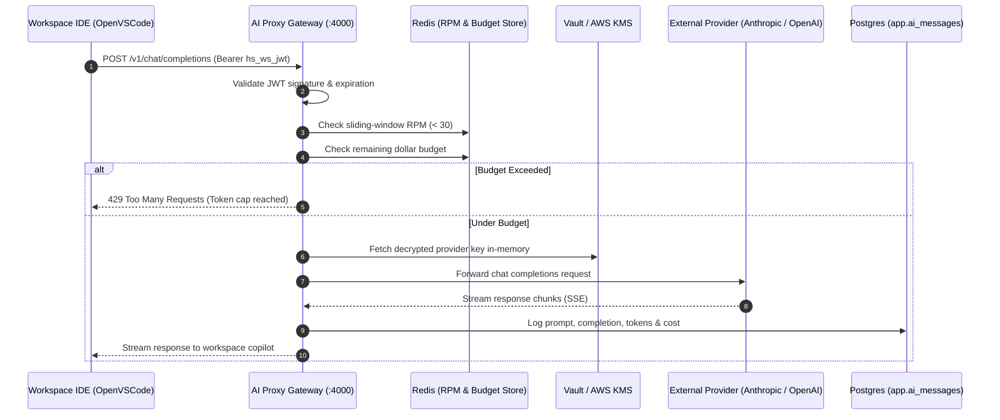

<RoleBadge roles={["sde", "ai"]} />

# AI Proxy Gateway Architecture

The **HelloSmart AI Proxy Gateway** (port 4000) is the sole sanctioned egress point for all artificial intelligence calls originating from candidate workspaces and virtual assistant machines (BR-13, BR-14, BR-15).

---

## 1. Gateway Security Invariants

1. **Short-Lived Workspace Session Token (BR-13)**: Workspaces receive a 15-minute rotating JWT signed by the control plane. They never hold real provider keys.
2. **AI OFF Enforcement (BR-14)**: When an assessment disables AI tools, the gateway drops requests with `403 Forbidden`, and container iptables firewalls drop outbound traffic to external LLM provider endpoints.
3. **Sliding-Window Rate Limiting (BR-15)**: Requests are constrained to an RPM limit (default 30 RPM) using Redis sorted sets.
4. **Token & Dollar Budget Caps (BR-15)**: Every token consumed is tracked against session limits ($2.00 default for Short tasks). At 80%, a warning banner is delivered to the candidate; at 100%, requests are blocked with RFC 7807 `429 Too Many Requests`.
5. **Prompt/Response Telemetry (BR-18)**: Complete transcripts are persisted to `app.ai_messages` for automated reviewer agent analysis.

---

## 2. Gateway Request Flow

---

## 3. OpenAPI Contract Reference
The AI Proxy exposes a standard OpenAI-compatible interface documented in [ai-proxy-v1.yaml](file:///d:/Work's/Infinitica/hellosmart/packages/contracts/openapi/ai-proxy-v1.yaml).
