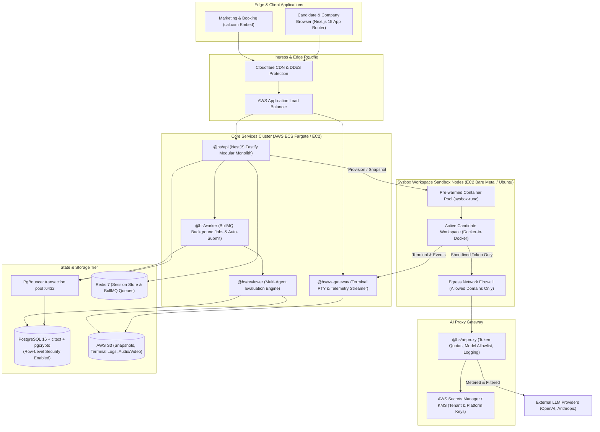

<RoleBadge roles={["sde", "ai", "qa", "mgmt"]} />

# System Architecture Blueprint

HelloSmart is designed for **deterministic multi-tenancy, rapid workspace provisioning (under 15 seconds), and strict AI egress isolation**.

---

## 1. High-Level Component Topology

---

## 2. Key Subsystem Responsibilities

### Core Monolith (`apps/api`)
Handles authentication, multi-tenant RBAC, assessment configuration, rubric management, candidate invites, and commercial payment webhooks. Sets PostgreSQL context per transaction (`set_config('app.org_id')`) to enforce database RLS.

### Sysbox Workspace Orchestrator
Maintains pre-warmed Linux containers running `sysbox-runc`. When a candidate clicks "Connect":
1. Clones a pre-warmed snapshot in under 5 seconds.
2. Injects the assessment template repository commit and seed files.
3. Injects a short-lived workspace session token (never real API keys).
4. Connects the container's virtual TTY to `@hs/ws-gateway` for web terminal streaming.

### AI Proxy (`services/ai-proxy`)
Acts as the single gatekeeper between candidate workspaces and external AI providers (BR-13):
- **Egress Firewall**: Blocks network calls to unknown endpoints and blocks AI provider domains when AI is configured OFF (BR-14).
- **Token Quota Enforcer**: Enforces per-candidate and per-assessment token/dollar limits (BR-15).
- **Audit Logging**: Saves complete prompt and completion transcripts to S3 and Postgres for reviewer agents to evaluate.

### Background Job Workers (`apps/worker`)
Same image as `@hs/api`, command `node dist/worker.js`. BullMQ on Redis (`hs:{env}:ops`). Product jobs (auto-submit, cleanup, retention) are not registered yet; a repeating ping job plus `/api/v1/health/ready` keep the process observable.

### Connection pooling and HTTP scale
- **PgBouncer** (`transaction` mode, `max_prepared_statements = 200`) sits in front of Postgres. App and worker use port 6432. Migrations use Postgres 5432.
- Client `PG_POOL_MAX` defaults to 5. PgBouncer `default_pool_size` is 20.
- **Caddy** load-balances API replicas (`least_conn`) and health-checks `/api/v1/health/ready`.
- Redis is a direct client (sessions, throttles, BullMQ). No Redis proxy.

### Observability
Pino JSON on stdout, OTLP to the Compose collector, Loki (7 days), Tempo, Prometheus Blackbox, Grafana, Dozzle for live tail. See [Observability kit](/docs/operations/observability).
