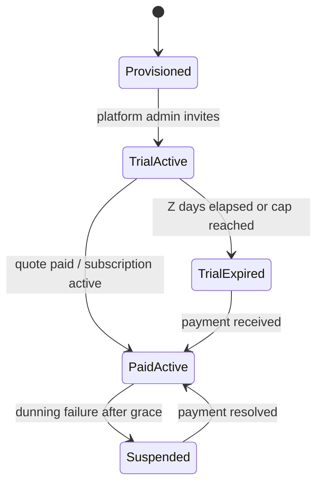
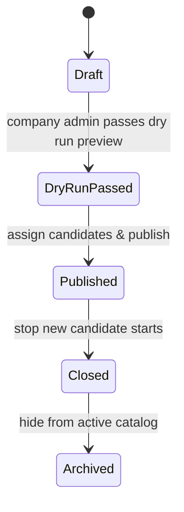
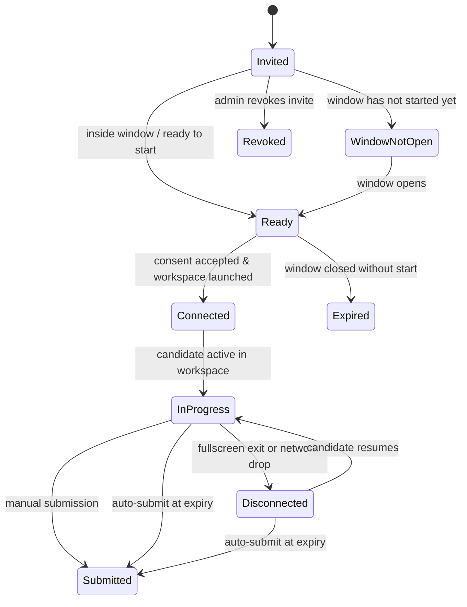
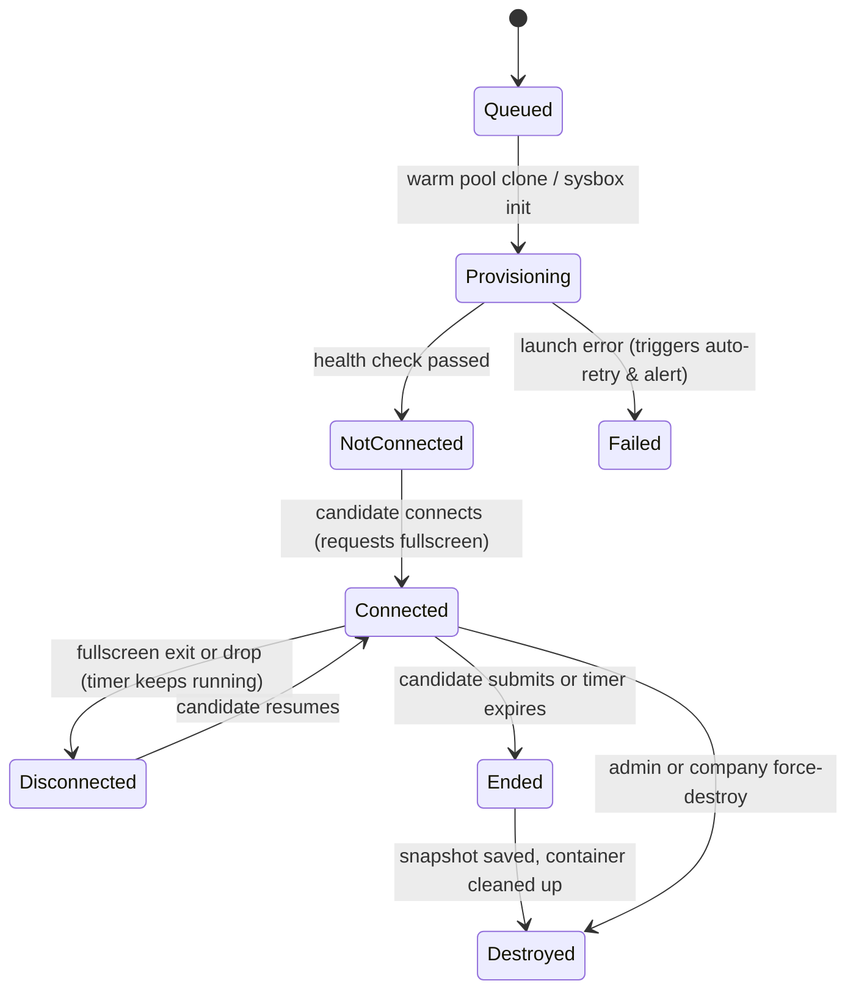
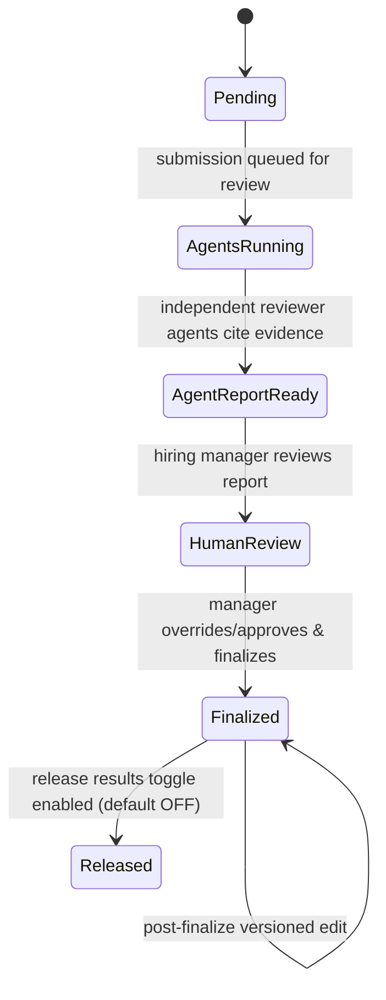
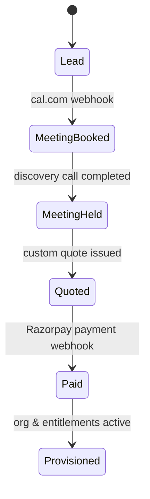

<RoleBadge roles={["sde", "ai", "qa", "mgmt"]} />

# Lifecycle and Status Models

Every core domain entity in HelloSmart moves through a strictly defined state machine. Enforced server-side.

---

## Status Models Summary

| Object | Statuses (in order) | Notes |
|---|---|---|
| Org / trial | Provisioned > Trial active > Trial expired / Paid active > Suspended | Entitlements (X templates, Y candidates, Z days) set by Platform Admin. |
| Assessment | Draft > Dry-run passed > Published > Closed > Archived | Publish blocked until dry run passes. |
| Candidate assignment | Invited > Window not open > Ready > Connected > In progress > Disconnected (resumable) > Submitted / Expired / Revoked | Disconnected is reached when the candidate exits full screen. |
| Workspace | Queued > Provisioning > Not connected > Connected > Disconnected > Ended > Destroyed | Destroy can be triggered by company, admin, expiry or cleanup job. |
| Review | Pending > Agents running > Agent report ready > Human review > Finalized > Released to candidate | Release is optional and off by default. |
| Quote / payment | Draft > Sent > Viewed > Accepted > Paid / Expired / Failed > Refunded | Recurring subscriptions add Active, Past due, Cancelled. |
| Deal | Lead > Meeting booked > Meeting held > Quoted > Paid > Provisioned | Tracked in Platform Admin. |

---

---

## State Transition Diagrams

### 1. Organization & Trial Lifecycle

### 2. Assessment (Task) Lifecycle

### 3. Candidate Assignment Lifecycle

### 4. Workspace Container Lifecycle

### 5. Review & Scoring Lifecycle

### 6. Commercial Deal & Payment Lifecycle

