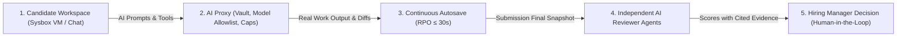

<RoleBadge roles={["sde", "ai", "qa", "mgmt"]} />

# HelloSmart.ai — Business Requirements Document (BRD)

> **Document Context:** Single source of truth for what the product is, who it is for, and what it must do. Directly transcribed from `HelloSmart_Business_Requirements.xlsx` (Version 0.2, MMP Scope).

| | |
|---|---|
| **Product** | HelloSmart.ai: AI-native hiring platform |
| **Document** | Business Requirements Document, single source of truth for what the product is and must do |
| **Version** | 0.2 (all open questions resolved) |
| **Scope** | Minimum Marketable Product (MMP), with Phase 2 and Phase 3 items identified |
| **Date** | 22 October 2026 |
| **Source** | `HelloSmart_Business_Requirements.xlsx`; this document is a direct reading of that workbook |
| **Total requirements** | 150 |

> **How to read this document.** Each requirement has an ID (`CO-`, `CA-`, `AD-`, `SP-`, `NF-`), a **priority** (Must, Should, Could) and a **phase** (MMP, Phase 2, Phase 3). *Must* means needed to sell the MMP; *Should* means important and following quickly; *Could* means nice to have. Where this document and the workbook differ, update the workbook first.

---

## 1. Executive Summary

HelloSmart.ai is an AI-native hiring platform. Companies assess candidates by having them do real work, with AI tools, inside a controlled workspace. Independent AI reviewer agents monitor the work and score it against the company's own rubric.

**Pitch:** Hire by doing: watch candidates do the real job, with AI, and get an evidence-backed score for every rubric dimension.

**Category:** AI-native work simulation for hiring (also described as: proof-of-work hiring, job simulation, work-sample assessment).

**Vision:** Make demonstrated work, not claims, the standard for hiring in the AI era, for every role in every company.

**Mission:** Give every hiring team a fair, realistic and evidence-backed way to see how a candidate really works with AI, and give every candidate a chance to prove it.

**MMP goal:** Be sellable to the first design-partner customers: one end-to-end loop of template, assessment, candidate session, agent review and company result, plus quoting and payment collection.

---

## 2. Product Overview

### 2.1 Problem

Resume screens and puzzle-style tests no longer predict performance, because AI is now part of the job. Hiring managers cannot see how a candidate directs AI, verifies output and recovers from mistakes. Existing assessment tools are engineering-centric, generic, or self-serve and shallow for niche roles.

### 2.2 Solution

A role-agnostic platform with (1) private, company-specific task templates, (2) provisioned workspaces (Cloud VM, Local, Chat, Browser), (3) an AI proxy that controls provider keys, ON/OFF and caps, and (4) reviewer agents that monitor and review the work and produce cited evidence for human decision-makers.

### 2.3 How it works

- 1) Prospect books a meeting via cal.com.
- 2) HelloSmart quotes, collects payment and provisions the company on the platform.
- 3) Company configures a task from its private templates (timing, AI policy, rubrics) and adds candidates.
- 4) Candidates connect to a provisioned workspace and do the work.
- 5) Reviewer agents score; the hiring team adds scores and notes and decides.

### 2.4 Target customers

Companies hiring for technical and non-technical niche roles: startups, mid-size firms, staffing agencies and enterprises that want a bespoke, defensible assessment.

### 2.5 Differentiators

- Role-agnostic via a template and rubric authoring engine
- Templates are private to each company
- Real work with AI tools, not trivia
- Rubrics run as independent monitoring agents
- Optional local mode, white labelling and custom routing
- Human-in-the-loop with an audit trail

### 2.6 Business model and go-to-market

Sales-assisted and behind the curtain: landing page, cal.com booking, discovery call, quote, payment, provisioning on the standard HelloSmart route. Own-domain routing, white label and custom templates are paid add-ons. Self-serve signup is not in MMP; revisit after the first 10-15 paying customers.

### 2.7 MMP success metrics

- Time from signed quote to provisioned org &lt; 1 business day
- Candidate workspace launch success rate >= 95%
- Assessment completion rate >= 70%
- Reviewer-agent report ready &lt; 15 min after submit
- First paid pilots closed
- Zero cross-tenant data exposure

---

### 2.8 High-Level Work Simulation Loop

