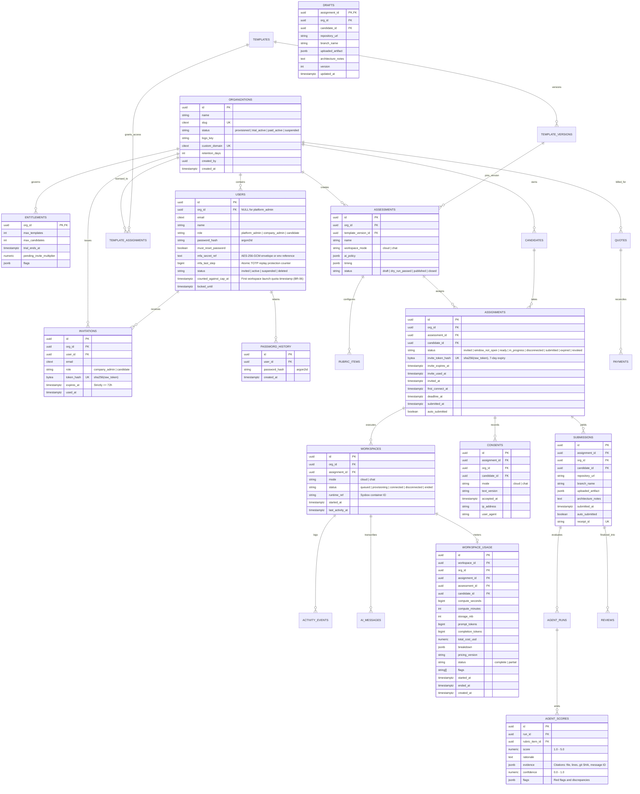
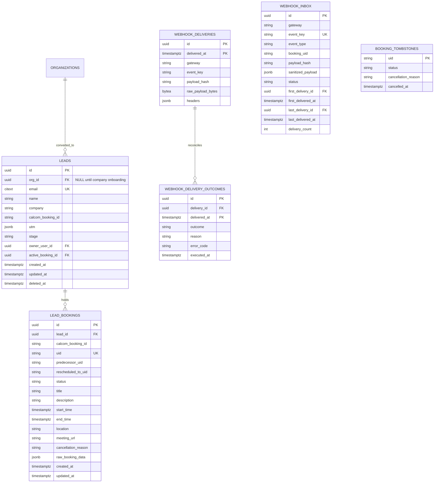
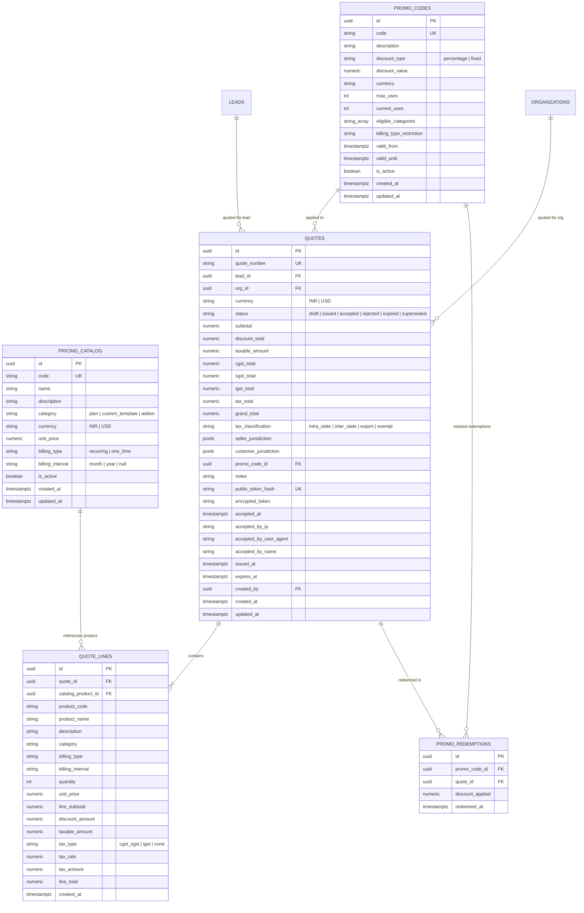

<RoleBadge roles={['sde', 'qa']} />

# Database Visualization & ER Schema

HelloSmart uses **PostgreSQL 16** with `citext` and `pgcrypto` extensions. Multi-tenancy is enforced strictly at the database kernel level through **Row-Level Security (RLS)** policies on all tenant tables (BR-01).

---

## 1. Complete Entity-Relationship (ER) Diagram



---

## 2. PostgreSQL Row-Level Security (RLS) Mechanics

Every table containing tenant data implements the following security pattern:

```sql
-- 1. Enable and FORCE Row-Level Security
ALTER TABLE app.assessments ENABLE ROW LEVEL SECURITY;
ALTER TABLE app.assessments FORCE ROW LEVEL SECURITY;

-- 2. Define strict tenant isolation policy
CREATE POLICY tenant_isolation ON app.assessments
  USING (org_id = app.current_org_id() OR app.is_platform())
  WITH CHECK (org_id = app.current_org_id() OR app.is_platform());
```

`app.is_platform()` enforces dual-factor authorization (migration `0005_platform_role`): it requires both `current_setting('app.is_platform', true) = 'true'` AND authenticated database session role `SESSION_USER IN ('hs_platform', 'hs_migrator')`. Connections authenticated as `hs_app` evaluate to `false` even if an attacker attempts to set `app.is_platform = true`, neutralizing forged-context escalation attacks at the database kernel level.

### Context Injection on Every Transaction

Before running any application query, the NestJS Fastify API sets the current organization context in the PostgreSQL transaction:

```sql
SELECT set_config('app.org_id', '7f8a9b0c-1234-4567-89ab-cdef01234567', true);
```

When `app.current_org_id()` is evaluated by PostgreSQL, any rows belonging to other organizations are **automatically filtered out at the kernel query planner level**.

---

## 3. Tamper-Evident Audit Ledger (`audit.events`)

For SOC 2 Type II compliance and BR-31 invariants, the audit log uses a **cryptographic SHA-256 hash chain** and enforces **Row-Level Security** (migration `0004_rls_access_paths`):

```sql
ALTER TABLE audit.events ENABLE ROW LEVEL SECURITY;
ALTER TABLE audit.events FORCE ROW LEVEL SECURITY;

CREATE POLICY tenant_isolation ON audit.events
  FOR ALL
  USING (org_id = app.current_org_id() OR app.is_platform())
  WITH CHECK (org_id = app.current_org_id() OR app.is_platform());
```

| Column       | Type                                  | Description                                  |
| ------------ | ------------------------------------- | -------------------------------------------- | --- | ------------- |
| `id`         | `bigint GENERATED ALWAYS AS IDENTITY` | Sequential monotonic ID                      |
| `at`         | `timestamptz`                         | Immutable UTC timestamp                      |
| `actor_id`   | `uuid`                                | User ID or System Actor                      |
| `actor_role` | `text`                                | `platform_admin`, `company_admin`, etc.      |
| `action`     | `text`                                | E.g. `workspace.destroy`, `candidate.create` |
| `prev_hash`  | `bytea`                               | SHA-256 digest of previous audit row         |
| `hash`       | `bytea`                               | `SHA256(prev_hash                            |     | row_payload)` |

Because each row's hash includes the previous row's hash, **no row can be modified, deleted, or back-dated without invalidating the entire subsequent audit chain**. `hs_app` only has `INSERT` and `SELECT` privileges; `UPDATE` and `DELETE` are blocked both by permission grants and by the `audit.trg_events_immutable` trigger.

---

## 4. Pre-Login Stored Functions & Safe Elevation

Pre-login operations (login lookup and invitation acceptance) cannot supply a verified `org_id` context because the user is not yet authenticated. Instead of elevating permissions in Node.js application code via `withPlatform`, HelloSmart uses pinned, audited `SECURITY DEFINER` routines (migration `0004_rls_access_paths`):

1. **`app.find_user_for_login(p_email)`**:
   Returns authentication credentials (`id`, `org_id`, `email`, `name`, `role`, `password_hash`, `must_reset_password`, `mfa_secret_ref`, `status`, `failed_logins`, `locked_until`, `org_name`, `org_status`, `logo_key`) without exposing sensitive user table columns to unauthenticated RLS context. Pinned to `search_path = pg_catalog, app, public`. Excludes soft-deleted accounts (`deleted_at IS NULL`).
2. **`app.find_user_by_id(p_user_id)`**:
   Securely resolves a user record by primary key across tenant boundaries after authentication, pinned to `search_path = pg_catalog, app, public`.
3. **`app.find_invitation_by_token_hash(p_token_hash)`** (alias `app.lookup_invitation`):
   Returns public invitation metadata (email, role, organization name) for the invite acceptance UI, without granting access to the underlying `app.invitations` table. Requires an unexpired, unconsumed invitation with exact 32-byte SHA-256 token hash.
4. **`app.accept_invitation(p_token_hash, p_password_hash, p_ip, p_user_agent, p_request_id)`**:
   Atomically burns the invitation token, marks the user status as `active`, sets the password hash, and records an immutable audit log entry in `audit.events` inside a single database transaction. Eliminates any need for the API to execute `set_config('app.is_platform', 'true')` in client code.
5. **`app.consume_totp_step(p_user_id, p_step)`** (migration `0007_mfa_hardening`):
   Atomically consumes a TOTP time-step (`mfa_last_step`) using conditional update (`WHERE mfa_last_step IS NULL OR mfa_last_step < p_step`). Guarantees concurrent TOTP replay protection across distributed API nodes with zero race conditions.
6. **`app.get_user_mfa_last_step(p_user_id)`**:
   Returns the last consumed time-step counter for verification and security audit inspection.
7. **`app.upgrade_user_mfa_secret(p_user_id, p_encrypted_secret)`**:
   Enables opportunistic zero-downtime migration of legacy plaintext Base32 secrets or envelopes encrypted with previous keys to the active AES-256-GCM encryption key upon successful login.
8. **`app.set_mfa_enrollment_pending` / `app.confirm_mfa_enrollment`** (migration `0008_mfa_enrollment`):
   Stores a pending encrypted TOTP secret during platform-admin MFA setup, then promotes it to `mfa_secret_ref` after the user confirms an authenticator code.
9. **`app.mfa_backup_codes` table** (migration `0008_mfa_enrollment`):
   Stores SHA-256 hashes of one-time backup codes; `app.consume_mfa_backup_code` marks a code used at login when the authenticator app is unavailable.
10. **`app.get_mfa_enrollment_pending(p_user_id)`** (migration `0009_mfa_enrollment_pending_read`):
    Reads pending MFA setup material under `SECURITY DEFINER` so platform-admin rows remain visible when RLS would otherwise hide `org_id IS NULL` users.

### Principle of Least Privilege

All `SECURITY DEFINER` routines revoke `EXECUTE` privileges from `PUBLIC` and grant execute permissions exclusively to the non-owner application role `hs_app`:

```sql
REVOKE EXECUTE ON FUNCTION app.find_user_for_login(citext) FROM PUBLIC;
GRANT EXECUTE ON FUNCTION app.find_user_for_login(citext) TO hs_app;
```

---

## 5. Candidate Quota & Pending Invite Multiplier Tracking (migration `0015_candidate_cap_tracking`)

Under **BR-06**, candidate quotas and pending invite limits are enforced via two targeted indexes and an atomic timestamp column:

1. **`app.users.counted_against_cap_at`**:
   `timestamptz NULL` recording when a candidate user first launches a workspace session. Uncounted candidates consume a candidate quota slot only upon first workspace launch (`recordCandidateFirstLaunch`). Once counted, subsequent assignment launches within the same organization do not consume additional quota slots.

2. **Candidate Cap Tracking Index (`users_candidate_cap_idx`)**:

   ```sql
   CREATE INDEX IF NOT EXISTS users_candidate_cap_idx
     ON app.users (org_id, counted_against_cap_at)
     WHERE role = 'candidate' AND deleted_at IS NULL;
   ```

   Provides efficient tenant-scoped index scans to count active, launched candidates against `app.entitlements.max_candidates`.

3. **Pending Assignment Counting Index (`assignments_pending_counting_idx`)**:
   ```sql
   CREATE INDEX IF NOT EXISTS assignments_pending_counting_idx
     ON app.assignments (org_id, status, invite_expires_at, first_connect_at)
     WHERE status IN ('invited', 'window_not_open', 'ready') AND first_connect_at IS NULL;
   ```
   Accelerates Model A pending assignment evaluation: `FLOOR(max_candidates * pending_invite_multiplier)`. Excludes launched, expired, or completed assignments at the query planner level.

---

## 6. Sales Lead Pipeline & Cal.com Webhooks (Stream 9)

In accordance with BR-04 and commercial requirements, inbound prospect bookings from Cal.com are ingested without exposing tenant or platform secrets.



### Table Specifications:

- `app.webhook_deliveries`: Monthly range-partitioned ledger capturing exact raw wire bytes and allowlisted headers. Append-only.
- `app.webhook_delivery_outcomes`: Co-partitioned with `webhook_deliveries` on `delivered_at`, enforcing composite foreign key and immutable outcome logging.
- `app.webhook_inbox`: Canonical state engine enforcing event key uniqueness (`gateway, event_key`) and immutability triggers.
- `app.booking_tombstones`: Fast-lookup registry ensuring out-of-order cancellations prevent delayed reschedules from resurrecting cancelled bookings.
- `app.leads`: Sales lead pipeline table with RFC-standard ASCII email check constraint, sales owner org validation, and soft-delete enforcement.
- `app.lead_bookings`: Lineage tracking table with composite foreign key ensuring `active_booking_id` can only reference bookings belonging to the same lead.

## 7. Pricing Catalog, Promo Codes & Commercial Quotes (Stream 9)



### Table Specifications:

- `app.pricing_catalog`: Centralized product catalog for subscription plans, custom templates, and one-time add-ons.
- `app.promo_codes`: Promotional discount codes with concurrency caps, expiration windows, currency validation, and category restrictions.
- `app.quotes`: Commercial quotations linked to leads or organizations with full 18% Indian GST calculations (CGST/SGST/IGST), 14-day default expiry, and SHA-256 token hashing.
- `app.quote_lines`: Immutable line item snapshots capturing unit prices, line discounts, and reconciled tax breakdowns at quote issuance.
- `app.promo_redemptions`: Audit ledger tracking promotional code redemptions per quote.
- `app.workspaces`: Candidate runtime sessions for an assignment. Disconnect time is stored here so BR-09 pause math uses the server clock.
- `app.activity_events`: Append-style connect, disconnect, resume, and fullscreen-exit events with client IP.
- `app.submissions`: Final artifact snapshot. `auto_submitted` is true when the deadline worker closed the assignment.
- `app.jobs`: Database queue for transactional email and other background work, with `run_after` for exponential backoff.
- `app.email_logs`: Delivery ledger (`sent`, `failed`, `bounced`) with provider message id. Passwords and raw tokens are not stored.
