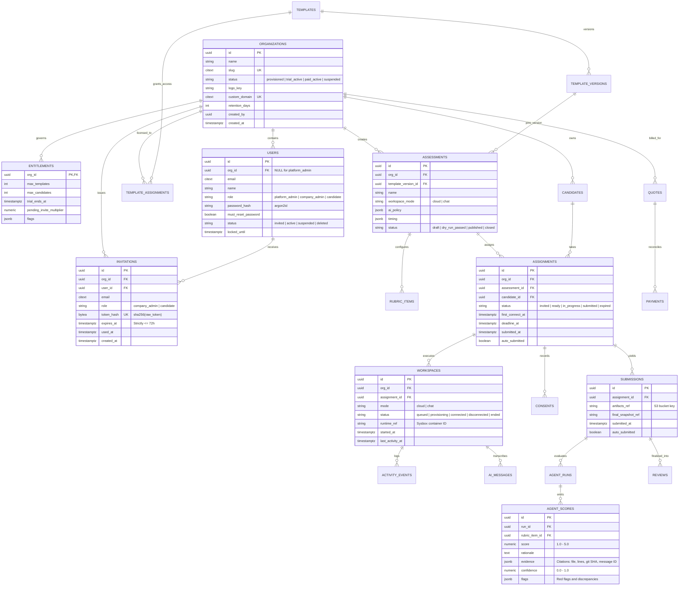

<RoleBadge roles={["sde", "qa"]} />

# Database Visualization & ER Schema

HelloSmart uses **PostgreSQL 16** with `citext` and `pgcrypto` extensions. Multi-tenancy is enforced strictly at the database kernel level through **Row-Level Security (RLS)** policies on all tenant tables (BR-01).

---

## 1. Complete Entity-Relationship (ER) Diagram



---

## 2. PostgreSQL Row-Level Security (RLS) Mechanics

Every table containing tenant data implements the following security pattern:

```sql
-- 1. Enable and FORCE Row-Level Security
ALTER TABLE app.assessments ENABLE ROW LEVEL SECURITY;
ALTER TABLE app.assessments FORCE ROW LEVEL SECURITY;

-- 2. Define strict tenant isolation policy
CREATE POLICY tenant_isolation ON app.assessments
  USING (org_id = app.current_org_id() OR app.is_platform())
  WITH CHECK (org_id = app.current_org_id() OR app.is_platform());
```

### Context Injection on Every Transaction
Before running any application query, the NestJS Fastify API sets the current organization context in the PostgreSQL transaction:

```sql
SELECT set_config('app.org_id', '7f8a9b0c-1234-4567-89ab-cdef01234567', true);
```

When `app.current_org_id()` is evaluated by PostgreSQL, any rows belonging to other organizations are **automatically filtered out at the kernel query planner level**.

---

## 3. Tamper-Evident Audit Ledger (`audit.events`)

For SOC 2 Type II compliance and BR-31 invariants, the audit log uses a **cryptographic SHA-256 hash chain**:

| Column | Type | Description |
|---|---|---|
| `id` | `bigint GENERATED ALWAYS AS IDENTITY` | Sequential monotonic ID |
| `at` | `timestamptz` | Immutable UTC timestamp |
| `actor_id` | `uuid` | User ID or System Actor |
| `actor_role` | `text` | `platform_admin`, `company_admin`, etc. |
| `action` | `text` | E.g. `workspace.destroy`, `candidate.create` |
| `prev_hash` | `bytea` | SHA-256 digest of previous audit row |
| `hash` | `bytea` | `SHA256(prev_hash || row_payload)` |

Because each row's hash includes the previous row's hash, **no row can be modified, deleted, or back-dated without invalidating the entire subsequent audit chain**.
