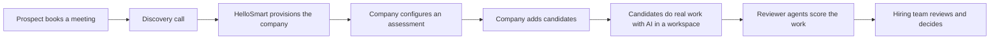

<RoleBadge roles={["sde", "ai", "qa", "mgmt"]} />

### 1.1 What HelloSmart is

HelloSmart.ai lets a company see a candidate **do a day of the real job** before hiring them. The candidate works in a realistic environment, uses AI tools the way they would on the job, and the work is scored by independent AI reviewer agents against a rubric the company defines. The hiring team reads the evidence, adds their own scores and notes, and decides.

**Category:** AI-native work simulation for hiring, also described as proof-of-work hiring, job simulation or work-sample assessment.

**One-line pitch:** Hire by doing: watch candidates do the real job, with AI, and get an evidence-backed score for every rubric dimension.

### 1.2 The problem

Resume screens and puzzle-style tests no longer predict performance, because AI is now part of the job. Hiring managers cannot see how a candidate directs AI, verifies its output and recovers from its mistakes. Existing assessment tools are engineering-centric, generic, or self-serve and shallow for niche roles.

### 1.3 The solution

A role-agnostic platform with four parts:

1. **Private, company-specific task templates** that describe the real work.
2. **Provisioned workspaces** where candidates do the work (Cloud VM and Chat at launch; Local and Browser in Phase 2).
3. **An AI proxy** that controls provider keys, AI on/off and usage caps.
4. **Reviewer agents** that monitor and review the work and produce cited evidence for human decision-makers.

### 1.4 The product loop

### 1.5 Who it is for

Companies hiring for technical and non-technical niche roles: startups, mid-size firms, staffing agencies and enterprises that want a bespoke, defensible assessment.

### 1.6 What makes it different

- Role-agnostic through a template and rubric authoring engine.
- Templates are private to each company.
- Real work with AI tools, not trivia.
- Rubrics run as independent monitoring agents.
- Optional local mode, white labelling and custom routing.
- Human-in-the-loop with an audit trail.

### 1.7 Vision and mission

**Vision:** Make demonstrated work, not claims, the standard for hiring in the AI era, for every role in every company.

**Mission:** Give every hiring team a fair, realistic and evidence-backed way to see how a candidate really works with AI, and give every candidate a chance to prove it.

### 1.8 What ships first (the MMP)

The first release is a **Minimum Marketable Product**: sellable to the first design-partner customers. It delivers one complete loop (template, assessment, candidate session, agent review, company result) plus quoting and payment collection.

**Success metrics for the MMP**

- Time from signed quote to provisioned org under 1 business day
- Candidate workspace launch success rate of at least 95%
- Assessment completion rate of at least 70%
- Reviewer-agent report ready within 15 minutes of submission
- First paid pilots closed
- Zero cross-tenant data exposure

---