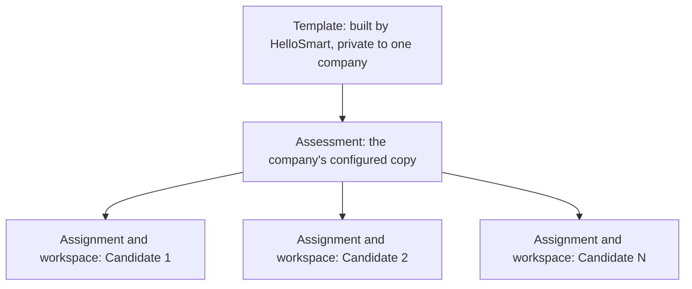
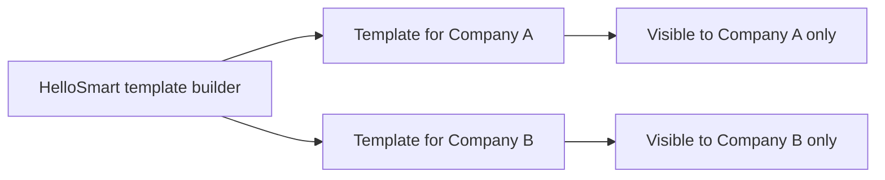

<RoleBadge roles={["sde", "ai", "qa", "mgmt"]} />

Learn these eight ideas and the rest of the product follows.

### 2.1 Template, assessment, assignment, workspace

| Concept | What it is | Who owns it |
|---|---|---|
| **Template** | A versioned, reusable blueprint of a task: scenario, resources, environment, environment-variable slots, AI defaults, reviewer agents, timing. | HelloSmart builds it, then assigns it to one company. |
| **Assessment** | A company's configured copy of a template: its name, AI policy, caps, timing and rubric. It is called a "task" in the product screens. It is pinned to one template version, so later fixes to the template never change a live assessment. | The company. |
| **Assignment** | One candidate assigned to one assessment. | The company. |
| **Workspace (session)** | One candidate's provisioned run of an assignment: a Cloud VM or a Chat workspace. | The system, per candidate. |

**Example template.** "System Design: design and build rate limiting and a real-time token usage dashboard for a multi-tenant API gateway", tagged Go, Redis, Terraform and AWS. The template holds the scenario and brief, the starter codebase, seed data, the services needed (such as Redis), the environment spec and the default rubric.

### 2.2 Private templates

Templates prepared for a company are for that company alone. There is no public catalog and no marketplace. A company only ever sees the templates assigned to it.

### 2.3 Rubrics and reviewer agents

A **rubric** is a set of scoring dimensions. In HelloSmart each rubric item runs as an independent **reviewer agent** that reads the candidate's work and scores it, citing evidence for every score. Examples of rubric items: "Latency management and perceived performance", "Architectural research", "Communication with the coding agent".

### 2.4 The AI proxy

Every AI request a candidate makes goes through the **AI proxy**. The workspace holds only a short-lived session token and never sees a real provider key. The proxy checks the rules (AI on or off, allowed models, caps, rate limits), forwards the request, and logs the conversation for the reviewers.

### 2.5 Entitlements

**Entitlements** are the limits and feature switches of a company: how many templates, how many candidates, how many days (the trial's X, Y and Z), plus switches for paid extras such as white label or own domain.

### 2.6 Time-bound and window-bound

- **Time-bound:** the candidate gets a set amount of time from the moment they first connect.
- **Window-bound:** the candidate can start only between two dates.
- **Combined:** for example, "start any time within 7 days, then you have 4 hours."

### 2.7 Add-ons

Extras sold on top of the base plan: own-domain routing, white label and branding, custom templates built for a company, and AI credits.

### 2.8 Human in the loop

Agent scores are **evidence**, not decisions. People score, override and finalize. The product never auto-rejects a candidate based on an agent score or an integrity event.

---