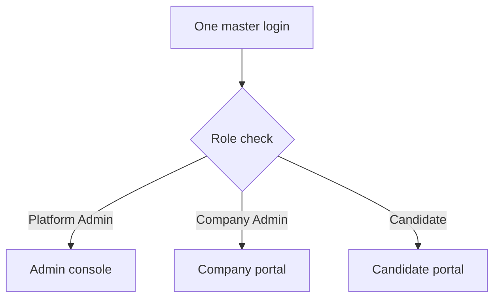

<RoleBadge roles={["sde", "ai", "qa", "mgmt"]} />

### 3.1 Personas

| Persona | Description | Primary goals | How they get access | Created by |
|---|---|---|---|---|
| Prospect / Visitor | Sales lead on the public landing page | Understand the product, book a meeting | Public landing page, cal.com booking | n/a |
| Company Admin | Customer-side owner who configures the org, tasks, rubrics and candidates | Launch assessments, review results, control spend and branding | Email + password, Google SSO or Microsoft SSO | Platform Admin |
| Company Reviewer (Hiring Manager) | Customer-side user who reviews submissions and scores (Phase 2 sub-role) | Review evidence, add scores and notes | Same login as Company Admin, role-restricted | Company Admin |
| Candidate | Person being assessed | Connect to workspace, do the task, submit, optionally see results | Emailed link then forced password reset; or same master login (RBAC routes to candidate portal) | Company Admin (single or bulk upload) |
| Platform Admin (HelloSmart) | Internal super admin / operations | Provision orgs, manage pricing, templates, agents, workspaces and payments | Master login with MFA | Seeded / other Platform Admin |
| Internal Sales / Support (Phase 2) | Restricted internal roles | Track deals, send quotes, support customers | Master login, role-restricted | Platform Admin |
| Reviewer Agents (system actor) | Independent AI agents that monitor and review the work | Produce rubric scores with cited evidence | System-run, no login | Platform Admin (library) / Company (rubric config) |

### 3.2 One login, three portals

All roles use the same master login. After sign-in the system routes each person to the right portal based on their role (role-based access control, or RBAC). A candidate can never reach company or admin routes.

### 3.3 Signing in

| Method | Who | Notes |
|---|---|---|
| Email and password | Company users, candidates, platform admins | Passwords are hashed, forgot-password uses an expiring link, repeated failures are throttled. |
| Google SSO | Company users | Matched to an account that already exists. |
| Microsoft SSO | Company users | Matched to an account that already exists. |
| Emailed link | Candidates | Opens a set-password page. A password reset is forced on first login. The link is single-use and expires. |
| Multi-factor authentication | Platform admins | Mandatory. |

Single sign-on never creates a new company. Companies are created by HelloSmart.

### 3.4 What each role can do

**Company Admin** (the first release has this one company role)

- Manage the organization name, logo and branding, and see the "Powered by hellosmart.ai" mark.
- Add AI provider keys and set caps.
- Browse and preview the company's private templates, then create assessments from them.
- Configure workspace mode, AI on/off, timing, environment variables and the rubric.
- Add, edit, delete and bulk-upload candidates, and resend invitations.
- Publish assessments and assign candidates.
- Watch submissions, progress and active workspaces, and destroy a workspace at any time.
- Review, score, add notes, finalize and later edit results, and release results to candidates.
- See analytics per assessment and across the organization.
- See quotes and invoices, and pay inside the app.

**Company Reviewer** (Phase 2): reviews submissions and adds scores and notes, without access to settings, keys or billing.

**Candidate**

- Sign in by link or the master login.
- See assigned workspaces and their status.
- Read the brief, accept consent, connect, work, resume if disconnected, and submit.
- See results only if the company chooses to release them.

**Platform Admin** (HelloSmart)

- Create every type of account and every organization.
- Set trials and entitlements, and maintain pricing plans and add-ons.
- Build, clone and assign private templates.
- Manage the reviewer-agent library and watch agent health.
- Oversee and destroy workspaces across all companies.
- Configure own-domain routing and white label for paying customers.
- Issue quotes, payment links and payment codes, and track deals.
- View platform-wide analytics, the audit log and data-retention settings.

---