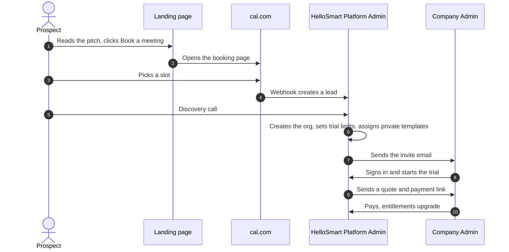
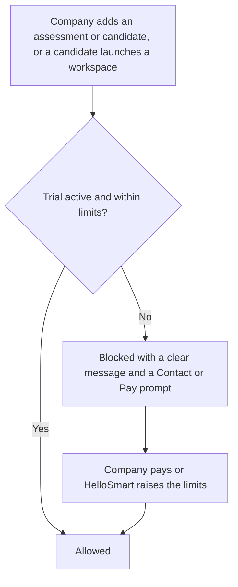

<RoleBadge roles={["sde", "ai", "qa", "mgmt"]} />

HelloSmart is sold **behind the curtain**: a prospect lands on the website, books a meeting, and HelloSmart provisions the product directly on the standard HelloSmart route.

### 4.1 Stages

| Stage | What happens |
|---|---|
| Landing page | States the category, vision and how it works. The one call to action is "Book a meeting". |
| Booking | An embedded cal.com page. Source and campaign details are captured, and a webhook creates a lead in the admin console. |
| Discovery call | HelloSmart learns the target roles, the tasks needed, the AI policy, the add-ons wanted (own routing, white label, custom templates) and sets trial limits. |
| Provisioning | A Platform Admin creates the organization on the standard route in minutes, with no separate infrastructure. |
| Private templates | Templates are built or cloned for this company only, tested, and assigned. |
| Invitation | The first Company Admin receives an invite email. |
| Quote and payment | HelloSmart sends a quote. The company pays by emailed link or inside the app. |
| Upgrade | On payment, entitlements upgrade and purchased add-ons unlock. |

### 4.2 Deal stages (tracked in the admin console)

`Lead` > `Meeting booked` > `Meeting held` > `Quoted` > `Paid` > `Provisioned`

### 4.3 The trial

Each new company gets a trial of **X templates, for Y candidates, for Z days**, all set by the Platform Admin. Suggested defaults are 3 templates, 10 candidates and 14 days. A banner always shows usage, for example "2 of 3 templates, 4 of 10 candidates, 9 days left".

At the cap or at expiry, new assessments, new candidates and new workspace launches are blocked with a clear message and a "Contact us / Pay" prompt. Running sessions finish, and existing data stays readable.

**How the candidate cap is counted.** A candidate counts **once**, at their first workspace launch, because that is when real compute cost starts. Invitations that have not yet launched are limited separately, at 2 times the cap (adjustable by the Platform Admin).

---