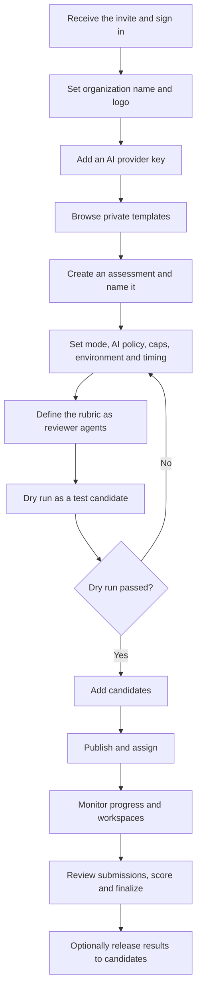
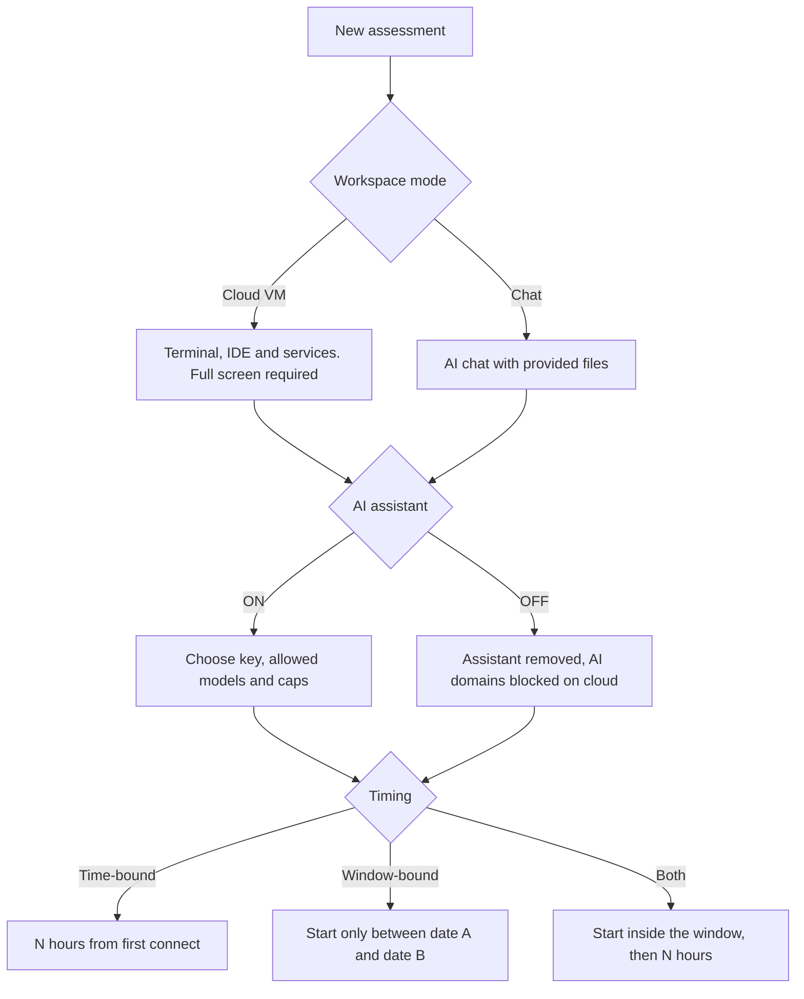
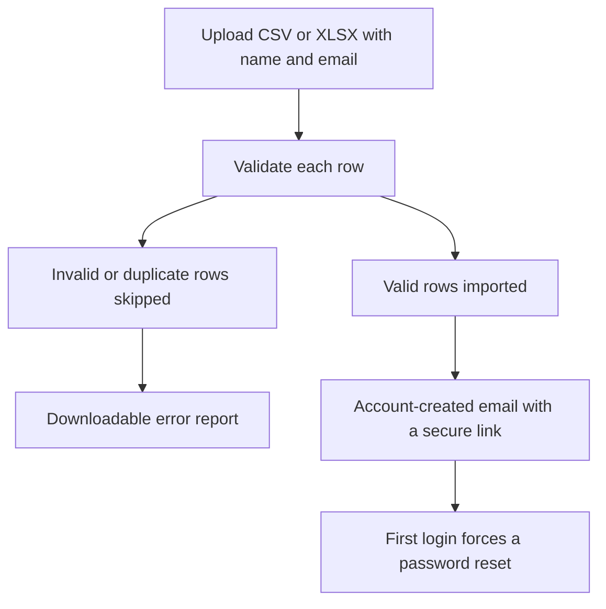

<RoleBadge roles={["sde", "ai", "qa", "mgmt"]} />

From first login to a hiring decision.

### 5.1 The company portal

The portal is organized around the work:

| Section | Purpose |
|---|---|
| Home | Quick actions, setup checklist and the trial banner. |
| Tasks | Browse templates and create and configure assessments. |
| Candidates | Create, view, edit, delete and bulk-upload candidates. |
| Submissions | See every submission and its progress and results. |
| Workspaces | See active workspaces and destroy them. |
| Analytics | Per-assessment and organization-wide analytics. |
| Branding, Organization, Settings | Logo, organization name, AI providers, notifications, billing and data retention. |

### 5.2 Step 1: Sign in and set up the organization

The company signs in with email and password, or Google or Microsoft SSO. The company then sets its organization name, which appears on the candidate portal, emails and reports, and uploads a logo. By default a small **"Powered by hellosmart.ai"** mark appears in a corner of the candidate portal and reports. Removing or replacing it requires the paid white-label add-on.

### 5.3 Step 2: Add AI provider keys

In Settings the company adds API keys for providers such as Anthropic and OpenAI, so its assessments can give candidates an AI assistant.

- Keys are stored encrypted and shown masked (last four characters only).
- Companies can test a connection, rotate a key, delete a key, and choose a default key.
- Keys are never shown to candidates and never placed in a workspace.
- In the first release, companies bring their own key, including during the trial. HelloSmart can also manually allocate a capped platform key to an organization as a quoted add-on, so that Chat workspaces work. Self-serve managed credits arrive in Phase 2.

### 5.4 Step 3: Choose a template and create an assessment

The company opens **Tasks**, browses its private templates, and previews one. A preview shows the scenario, deliverables, tech-stack tags, workspace mode, estimated duration, default AI policy and default reviewer agents.

Creating an assessment means naming it and optionally editing the candidate-facing brief and deliverables within the fields the template allows. The assessment pins the current template version.

### 5.5 Step 4: Configure the assessment

| Setting | Options |
|---|---|
| Workspace mode | Cloud VM or Chat in the first release. Local and Browser appear as locked "coming soon" options until Phase 2. |
| AI assistant | On or Off. |
| Key and models | Which provider key, and which models are allowed. |
| Caps | Per candidate and per assessment, in tokens or currency, plus a rate limit. At the cap the candidate is warned, then blocked. |
| Environment variables and secrets | Slots declared by the template, filled by the company. Encrypted, masked and injected only into the session. |
| Timing | Time-bound, window-bound or both, with timezone. |
| Pause timer on disconnect | Off by default (see chapter 10). |
| Results release | Off by default. |

### 5.6 Step 5: Define the rubric

Each rubric item is a reviewer agent with:

| Field | Meaning |
|---|---|
| Name and goal | What the dimension measures. |
| Signals watched | What the agent reads (AI conversation, prompts, corrections, terminal history, files). |
| Mode | Post-session review (default). Live monitoring that observes and flags without interrupting the candidate is Phase 2. |
| Scale | A scoring scale with written descriptions for each level. |
| Evidence | Every score must cite specific moments or artifacts. |
| Weight | Weights across all items total 100%. |
| Red flags | Behaviors to highlight, such as copying AI output without checking it. |

Companies start from the template's default rubric or from the agent library, and can accept, edit, add or remove items.

### 5.7 Step 6: Dry run

Before publishing, the company runs the assessment as a test candidate in a real workspace. Publishing is blocked until a dry run has passed, so broken tasks never reach candidates.

### 5.8 Step 7: Add candidates

Candidates can be added one at a time or in bulk, and companies can view, search, filter, edit and delete them.

- A template file is available to download, and a row limit applies (for example 500).
- Name and email are required, and email must be unique within the company.
- Changing an email is free until the candidate activates their account; afterwards it is re-verified.
- Deleting a candidate is a soft delete with confirmation. Active workspaces are destroyed, and data is handled under the retention policy.
- The invite can be resent at any time.

### 5.9 Step 8: Publish and assign

Publishing moves an assessment from Draft to Published. The company selects candidates (multi-select or by filter), and the system creates assignments, sends assignment emails and respects the trial caps. Assessments can later be closed to stop new starts, and archived to hide them.

### 5.10 Step 9: Monitor

- **Submissions:** a table per assessment with the candidate, status, time used, last activity and score.
- **Progress:** time remaining and last activity for each candidate.
- **Workspaces:** every active workspace with candidate, mode, status, started time and time left. A company can **destroy** a workspace at any time: the state is saved first, the candidate is notified, and the action is logged.
- **Extensions:** a company can grant extra time or window, or revoke access. Both are logged and shown to the candidate.

### 5.11 Step 10: Review and decide

The submission detail page shows the deliverables, an activity timeline, the AI conversation transcript, the final snapshot and each reviewer agent's report with cited evidence. The reviewer can then:

- Enter a score for each rubric dimension and an overall score, accepting or overriding agent scores.
- Add notes at the dimension level and overall.
- Finalize the result.
- Edit it later. Every edit creates a new version and keeps the previous scores and the original agent scores.
- Release results to the candidate (off by default).

### 5.12 Analytics

Per assessment: invited, started, completed and expired counts, completion rate and drop-off, average time, score distribution, per-rubric averages, AI usage and cost, and agent agreement. Across the organization: roll-ups with a date filter and usage against plan limits.

---