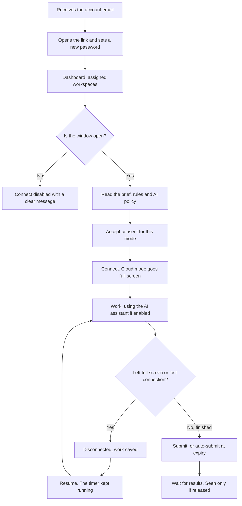
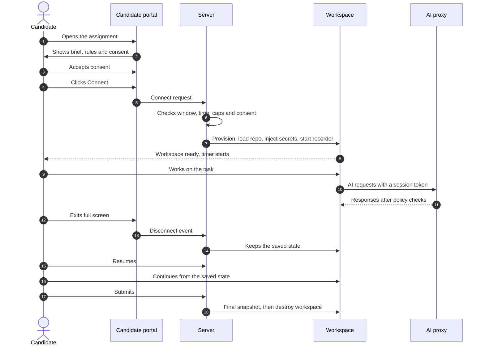

<RoleBadge roles={["sde", "ai", "qa", "mgmt"]} />

### 6.1 Getting access

The candidate receives an email with a secure link, sets a new password (the first login forces a reset), and signs in. Candidates can also use the master login, which routes them to the candidate portal.

### 6.2 The dashboard

Each assigned task shows the company, mode, time rules and a status:

| Status | Meaning |
|---|---|
| Invited | Account created, not yet signed in. |
| Window not open | The start window has not begun. |
| Ready | Can start now. |
| Not connected | Workspace is provisioned, candidate has not connected. |
| Connected | Workspace is live. |
| In progress | Timer is running. |
| Disconnected (resumable) | Left full screen or lost connection; work is saved. |
| Submitted | Finished and waiting for review. |
| Expired | The window or time ran out before the candidate started. |

### 6.3 Before connecting

The candidate sees the brief, deliverables, duration or window, the AI policy (on or off, caps) and exactly what is recorded. They must accept a **consent** screen specific to the workspace mode. Connect stays disabled until they do.

| Mode | What consent covers |
|---|---|
| Cloud | Activity, AI transcript and screen recording as configured. |
| Chat | AI chat transcript. |
| Local (Phase 2) | Installing the agent, and capture of terminal, files and git history. |
| Browser (Phase 2) | Page and action logging. |

The consent screen also tells the candidate that the timer keeps running if they disconnect. The system stores which consent text was shown, when it was accepted and from which IP address.

### 6.4 The session

### 6.5 Full screen in Cloud mode

On connect the workspace asks for full screen and is active only while the candidate stays in it. If they exit, the workspace **disconnects**, an overlay invites them to resume, and the event is logged for the reviewers. Browsers cannot truly prevent a person from leaving full screen, so the system detects it and reacts. The event is treated as evidence for a human, never as an automatic failure.

### 6.6 Nothing is lost

Files, terminal history, editor state, the chat transcript and drafts are saved continuously (target: no more than 30 seconds of loss). On resume, everything is restored. A candidate can reconnect until the timer or the window ends, and every disconnect and resume is logged.

### 6.7 Timer and warnings

A countdown is always visible, with warnings at set thresholds (for example 15 and 5 minutes). The server, not the browser, decides access and expiry.

### 6.8 Submitting

The candidate confirms, a final snapshot is saved, and the session closes. They cannot re-enter unless the company reopens it. If time runs out, the current state is auto-submitted.

### 6.9 Results

Candidates see results only if the company released them. When released, they see overall and per-dimension scores and any notes the company chose to share.

### 6.10 Support and fairness

- If a workspace fails to start, the candidate gets a support route and extra time automatically.
- Candidates can request accommodations such as extra time (Phase 2), and the company can grant it.
- The interface targets WCAG 2.2 AA accessibility.
- Candidates can request to see, correct or delete their data (Phase 2).

---