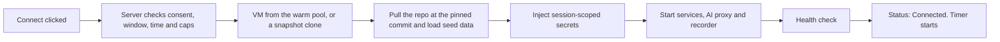
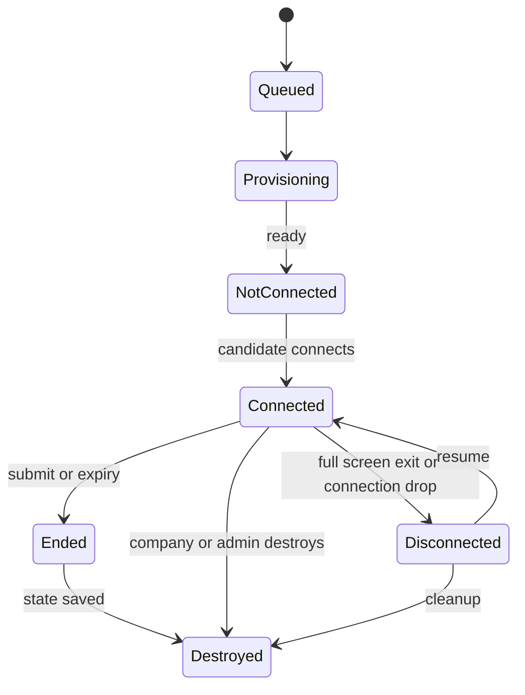

<RoleBadge roles={["sde", "ai", "qa", "mgmt"]} />

A **workspace** is the controlled place where a candidate does the task.

### 7.1 Workspace modes

| Mode | For | What the candidate gets | Release |
|---|---|---|---|
| **Cloud VM** | Engineering, data, DevOps | Terminal, IDE and services, preloaded with the task. | First release |
| **Chat** | Writers, analysts, support, operations and other non-technical roles | An AI chat plus the documents and files to work from. | First release |
| **Local** | Roles needing native tools or the candidate's own setup | A one-line command or small desktop agent that pulls the task environment (for example a dev container); status becomes "Connected (Local)" when it checks in; AI calls still go through the proxy. | Phase 2 |
| **Browser** | Sales development, research, marketing operations | A sandboxed remote browser with mock tools, watched by a monitor agent. | Phase 2 |

### 7.2 Why both Cloud and Local exist

| | Cloud VM | Local |
|---|---|---|
| Consistency | Identical setup for everyone, so scores are comparable | Varies by machine |
| Verification | Strong: the whole environment is controlled and captured | Weaker: only what the recorder and proxy capture |
| Secrets | Keys and data never leave HelloSmart infrastructure | Task code and data sit on the candidate's machine |
| Setup | One click | Install steps, "works on my machine" |
| Candidate comfort | Unfamiliar editor, possible latency | Their own tools and shortcuts |
| Cost | Real compute cost per session | Almost none |
| Special needs | Hard to support heavy or licensed desktop tools | Handles native and licensed tools |
| AI-off enforcement | Enforceable | Not fully enforceable |

Cloud is the default because assessment is meaningful only when the environment is fair, controlled and observable. Local exists because some candidates work best in their own setup and some roles need tools that cannot be hosted. When Local ships, reports will always label the session type so hiring managers know the level of verification.

### 7.3 How a workspace is provisioned

Heavy work happens before the candidate clicks Connect so that launch is fast (target: under 60 seconds for most launches). When a template is published, a prebuilt environment image is created and smoke-tested. When an assessment is published, a dry run proves it works.

At session end the final state is snapshotted, the artifacts and transcript are archived and handed to the reviewer agents, and the workspace is destroyed.

For infrastructure tasks such as Terraform and AWS, candidates do **not** get real cloud access. They work against a mock cloud so a forgotten resource can never become a bill.

### 7.4 What is recorded

Terminal history, file changes, git snapshots, the AI conversation and activity events (connect, disconnect, resume, leaving full screen) are captured, depending on the mode and the consent given. This is the evidence the reviewer agents read.

### 7.5 Workspace lifecycle

Idle, expired and orphaned workspaces are destroyed automatically, and hard spend limits exist per session and per company.

---