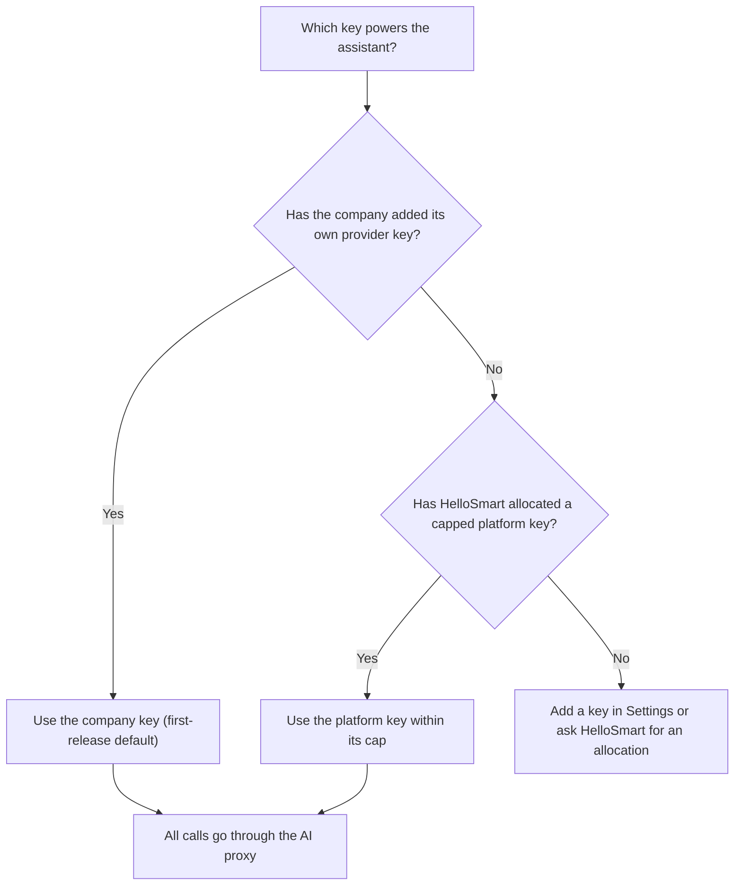
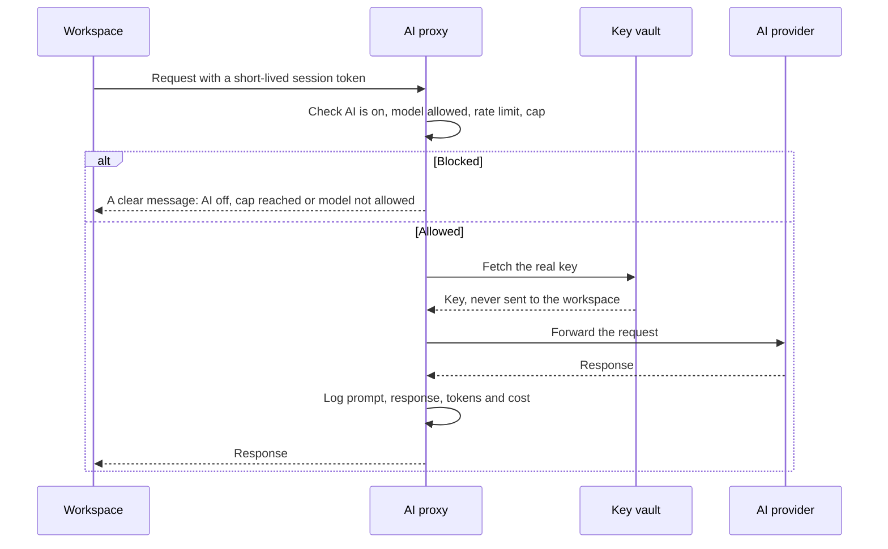

<RoleBadge roles={["sde", "ai", "qa", "mgmt"]} />

HelloSmart lets each company decide **whether** candidates get AI, **which** AI, and **how much**.

### 8.1 Where the settings live

| Level | Setting | Who sets it |
|---|---|---|
| Company Settings | Provider keys, default key | Company Admin |
| Template | Default AI policy and suggested caps | HelloSmart |
| Assessment | AI on/off, key and models, per-candidate and per-assessment caps, rate limit | Company Admin |

The most specific level wins: assessment over template over company defaults.

### 8.2 Which key is used

### 8.3 The AI proxy in action

This one design delivers key security, on/off control, caps and the transcript the reviewer agents need.

### 8.4 Caps

Caps are per candidate and per assessment, in tokens or currency, plus requests per minute. At the cap the candidate is warned first, then blocked, and sees a clear message and their remaining budget. Work can continue without AI.

### 8.5 When AI is off

The assistant is removed from the workspace and outbound access to known AI domains is blocked on Cloud workspaces. (In Local mode, in Phase 2, AI-off cannot be fully enforced because the candidate has their own machine, and reports will say so.)

### 8.6 Cost visibility

Companies see AI usage and cost per assessment and across the organization, by candidate and by model.

---