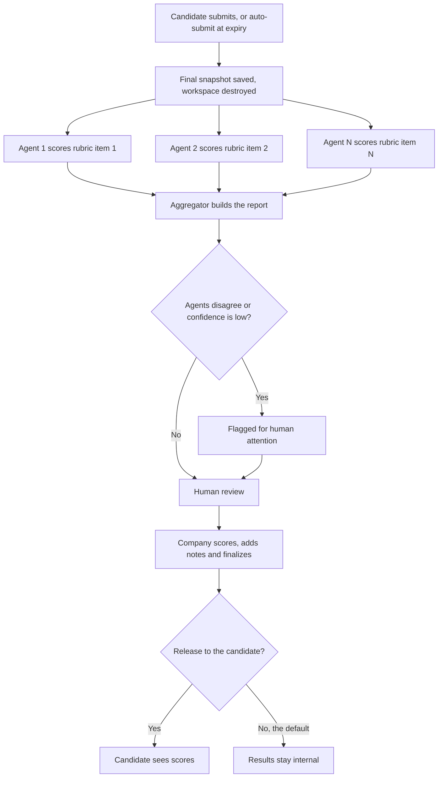
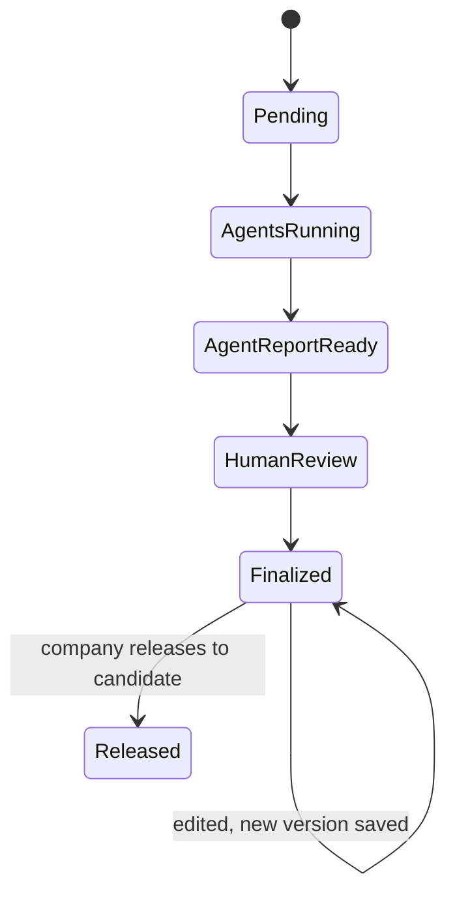

<RoleBadge roles={["sde", "ai", "qa", "mgmt"]} />

### 9.1 How reviews work

### 9.2 Principles

- **Independent.** Each agent scores one rubric item on its own. A separate aggregator builds the report and flags disagreement.
- **Evidence for every score.** An agent must cite specific moments or artifacts.
- **Observe, never interrupt.** Live monitors (Phase 2) flag but do not disturb the candidate.
- **Protected from gaming.** Inputs to the graders are sanitized, suspected prompt-injection attempts are flagged, and affected scores are marked low-confidence for human review.
- **Humans decide.** The company's reviewer can accept or override any score. Overrides keep the original, and edits after finalization create versions.

### 9.3 Review lifecycle

### 9.4 Agent health (Platform Admin)

HelloSmart monitors each agent: success and failure rate, latency, queue depth, cost per review, score consistency and agreement between agents, and drift over time, with alerts on thresholds. If an agent fails, the system retries, then alerts an admin, and the report shows the missing dimension while human review remains possible. An admin can re-run an agent on a submission, and both runs are kept (Phase 2).

---