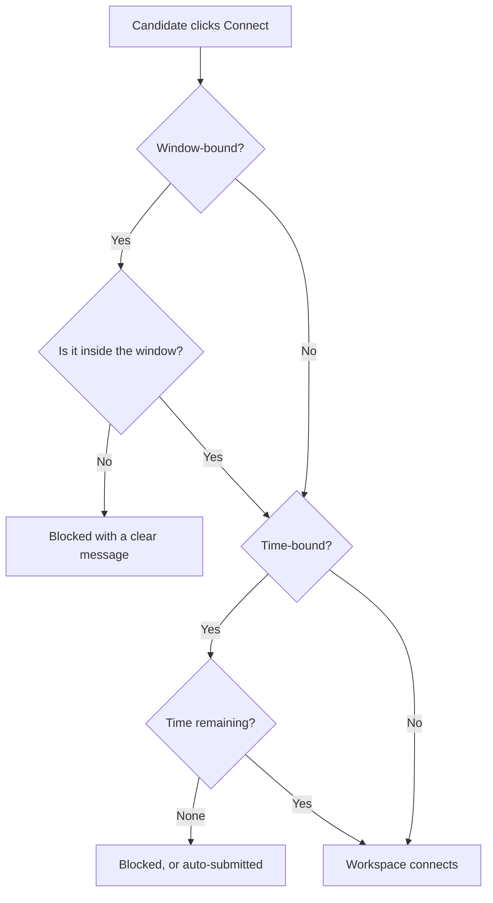

<RoleBadge roles={["sde", "ai", "qa", "mgmt"]} />

### 10.1 The three modes

| Mode | Rule | Example |
|---|---|---|
| Time-bound | N minutes or hours from the candidate's first connect. Countdown is visible; auto-submit at expiry. | "You have 4 hours." |
| Window-bound | The workspace is accessible only between a start and an end date and time, in a stated timezone. | "Open from 1 to 7 November." |
| Combined | Both rules apply and both are enforced by the server. | "Start any time in 7 days, then 4 hours." |

### 10.2 What happens when a candidate clicks Connect

### 10.3 Disconnects and the clock

The timer **keeps running** while a candidate is disconnected. Each assessment has a "Pause timer on disconnect" setting that is **off by default**, and the consent screen warns candidates before they connect. The countdown shown in the browser is for display only; the server enforces access.

### 10.4 Extensions

A company can extend a candidate's time or window, or revoke access. These are logged and shown to the candidate.

---