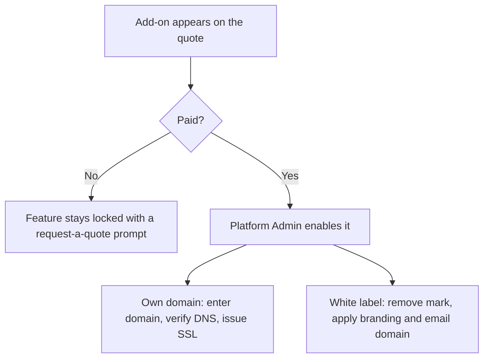

<RoleBadge roles={["sde", "ai", "qa", "mgmt"]} />

### 11.1 What controls what a company can do

The Platform Admin sets, per company, the trial limits (X, Y, Z) and feature switches. Plans have a price, a billing interval, included limits and a feature set. A new plan never silently changes an existing customer's contract.

### 11.2 Add-ons

| Add-on | What it unlocks |
|---|---|
| Own routing / custom domain | Candidate links and emails on the company's own domain, with DNS verification and automatic SSL. |
| White label and branding | Removes the "Powered by hellosmart.ai" mark; custom colors, logo and email sender domain. |
| Custom template build | Templates prepared for one company, quoted per template or role. |
| AI credits | A capped HelloSmart-held AI key allocated to the company. |
| Local mode, Browser workspace, extra reviewer agents, extended data retention | Phase 2 and later options. |

Features remain **locked until paid** (or granted by a Platform Admin).

---