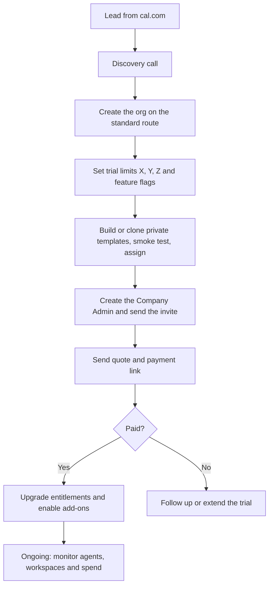

<RoleBadge roles={["sde", "ai", "qa", "mgmt"]} />

HelloSmart's own team runs the platform from an admin console behind the curtain. Admins use the master login with mandatory multi-factor authentication.

### 12.1 What admins manage

| Area | Capabilities |
|---|---|
| Accounts | Create organizations, company admins, candidates and internal staff; suspend or re-enable accounts; a defined permission set per role. |
| Trials and entitlements | Provision X templates, Y candidates, Z days per company; override limits and feature flags; extend a trial or a candidate window. |
| Pricing | Maintain plans and the add-on catalog. |
| Templates | Build and version templates (draft, tested, published); resources such as codebase, seed data, services and environment slots; smoke tests; clone a base template into a company-specific copy; assign privately. |
| Reviewer agents | Maintain the agent library and versions; watch health and performance; protect against grader gaming. |
| Workspaces | See every workspace across all companies with age, usage and cost; force-destroy; clean up orphans and idle sessions. |
| Routing and branding | Configure custom domains and white label for companies that have paid. |
| AI credits | Allocate a capped platform key to a company (first release: manual). |
| Commercial | Track leads and deals, build quotes, send payment links, issue payment codes. |
| Governance | Global audit log, data-retention controls, email templates, platform-wide analytics. |
| Support (Phase 2) | Read-only support view of a company, time-limited, reason required and fully logged. |

---