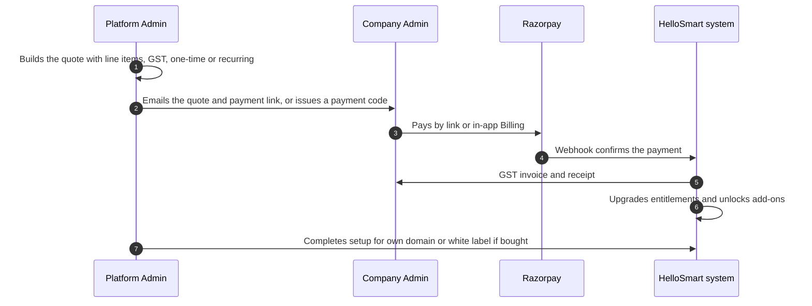
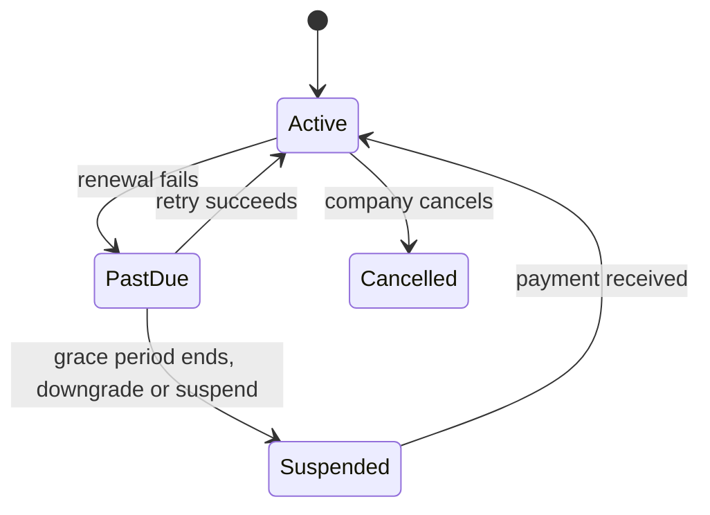

<RoleBadge roles={["sde", "ai", "qa", "mgmt"]} />

Payments are digital end to end. HelloSmart can collect by email or inside the app, once or on a recurring basis, based on what was quoted.

### 13.1 Quotes

A quote has line items (platform plan, candidate pack, custom templates, white label, custom routing, AI credits), discounts, tax (GST), currency and a validity date, and is either one-time or recurring. The company receives it by secure link, and its status moves through Sent, Viewed, Accepted or Expired.

### 13.2 Ways to pay

| Way | How it works |
|---|---|
| Email payment link | The admin emails a link that opens hosted checkout; status updates automatically. |
| In-app payment | The company sees quoted amounts in Billing and pays by card, UPI or netbanking, depending on the gateway. |
| Recurring | Monthly or annual subscriptions with auto-renew, retries on failure, cancellation and plan changes. |
| One-time | Setup fees and custom template builds. |
| Payment code | A code that applies a pre-agreed custom price or discount. It can be single-use or limited-use and can expire. |

The first release uses **Razorpay**, which supports cards, UPI, netbanking and subscriptions. Stripe is added in Phase 2 for international customers. HelloSmart never stores card data.

### 13.3 After payment

Payment success unlocks plan limits and add-ons automatically. The company receives a GST-compliant invoice and a receipt, and can see its history in Billing.

### 13.4 When a renewal fails

---