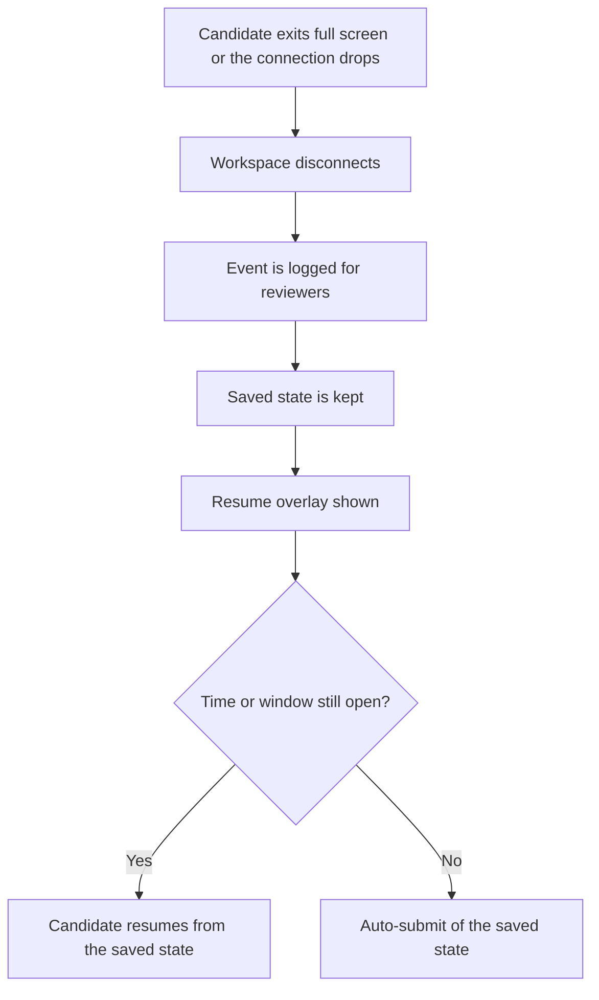
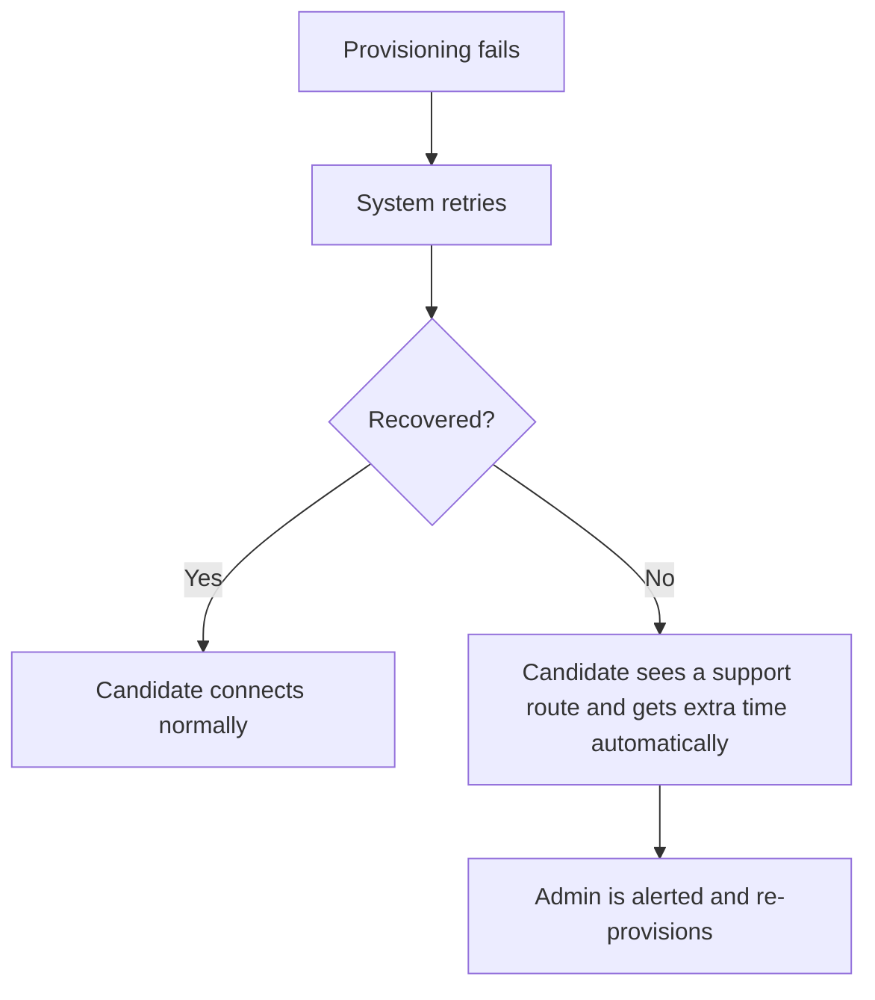
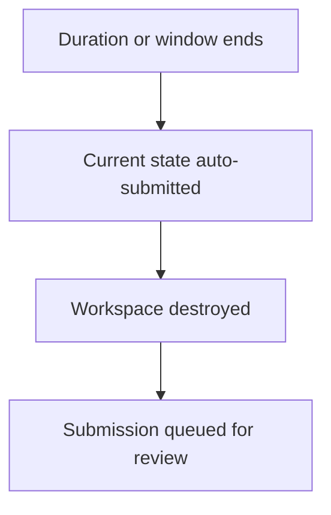
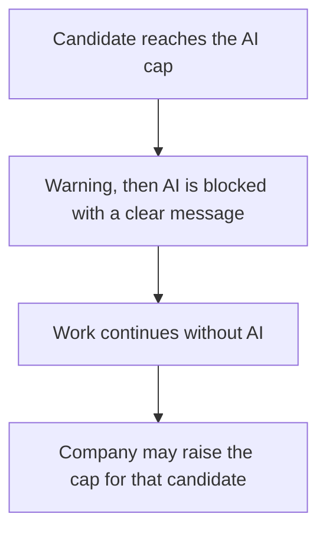

<RoleBadge roles={["sde", "ai", "qa", "mgmt"]} />

The platform is designed for the unhappy paths as much as the happy one.

### 15.1 Left full screen or lost connection

### 15.2 Workspace fails to start

### 15.3 Time runs out

### 15.4 AI cap reached

### 15.5 All exception cases

| ID | Scenario | Trigger | System response | Actor action | Resulting status |
|---|---|---|---|---|---|
| EX-01 | Trial candidate cap reached | Company adds or launches beyond Y candidates (or pending invites exceed 2x). | Blocks the action; keeps existing data readable; shows Contact us / Pay CTA. | Company pays or asks Platform Admin to raise the cap. | Blocked until entitlement changes |
| EX-02 | Trial expired | Z days elapse. | Blocks new assessments, candidates and workspace launches; running sessions finish; data stays readable. | Company pays; Admin can extend trial. | Trial expired |
| EX-03 | AI key invalid, revoked or provider outage | Provider rejects calls during a session. | AI assistant shows a degraded message; session continues; event logged; company and admin notified. | Company rotates the key in Settings. | AI degraded |
| EX-04 | AI cap reached for a candidate | Token or currency cap hit. | Warns first, then blocks AI; candidate sees a clear message; work continues without AI. | Company may raise the cap for that candidate. | AI blocked, session active |
| EX-05 | Full-screen exit (Cloud) | Candidate leaves full screen. | Disconnects workspace, logs the event, shows resume overlay; timer keeps running (default). | Candidate resumes. | Disconnected (resumable) |
| EX-06 | Browser crash or network drop | Connection lost. | State already autosaved; resume restores files, terminal, chat and drafts. | Candidate reconnects before time or window ends. | Disconnected (resumable) |
| EX-07 | Candidate tries to start outside the window | Clicks Connect before start or after end. | Connect disabled; message states the window; enforced server-side. | Candidate waits or asks company for an extension. | Window not open / Expired |
| EX-08 | Time runs out mid-work | Duration or window ends. | Auto-submits the current state, destroys the workspace, queues review. | None. | Submitted (auto) |
| EX-09 | Workspace provisioning fails | VM or services do not start. | Retries; if still failing shows a support route and adds compensating time automatically; alerts Admin. | Candidate contacts support; Admin re-provisions. | Re-provisioned |
| EX-10 | Company destroys an active workspace | Company Admin clicks Destroy. | Snapshots state first, notifies the candidate, logs the action, marks the session. | Company may extend time or reopen. | Workspace destroyed |
| EX-11 | Bulk upload has errors | Invalid emails, duplicates or over the cap. | Valid rows import; invalid rows are skipped and returned in a downloadable error report. | Company fixes and re-uploads. | Partial import |
| EX-12 | Invite link expired or lost | Candidate opens an expired link. | Shows a clear message and a request-new-link action; does not reveal account details. | Company resends the invite. | Invite resent |
| EX-13 | Recurring payment fails | Gateway declines the renewal. | Retries (dunning), emails the company, grace period, then downgrade or suspend. | Company updates payment method in Billing. | Past due / Suspended |
| EX-14 | Paid add-on not purchased | Company tries to use own domain or white label without entitlement. | Feature stays locked with a request-quote prompt. | Company contacts sales; Admin quotes. | Locked |
| EX-15 | Suspected prompt injection or gaming | Submission tries to manipulate the grader. | Inputs sanitized; submission flagged; scores marked low-confidence for human review. | Reviewer decides. | Flagged for review |
| EX-16 | Reviewer agent fails | Agent errors or times out. | Auto-retry, then alert Admin; report shows the missing dimension; human review still possible. | Admin re-runs the agent. | Partial agent report |
| EX-17 | Candidate deletion or erasure request | Company or candidate requests deletion. | Destroys workspaces, deletes personal data and recordings per policy, logs the request. | Company Admin or Platform Admin confirms. | Candidate erased |

---