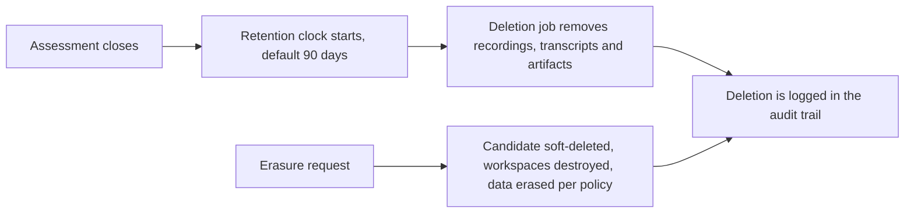

<RoleBadge roles={["sde", "ai", "qa", "mgmt"]} />

### 16.1 Principles

| Principle | What it means in practice |
|---|---|
| **Strict tenant isolation** | Every piece of data belongs to one company. Company A can never read Company B's templates, candidates or submissions. |
| **Secrets stay secret** | Provider keys and environment secrets are encrypted at rest, shown masked and never present in a workspace. |
| **One path for AI** | All candidate AI calls go through the proxy, so they are policy-checked, capped and logged. |
| **Sandboxed workspaces** | Workspaces are isolated, outbound traffic is restricted, and candidates never receive real cloud credentials. |
| **Consent before recording** | Nothing is recorded until the candidate accepts the mode-specific consent. |
| **Human in the loop** | AI scores are evidence for a person, explained by cited evidence, with overrides retained. |
| **Everything is audited** | Configuration changes, key changes, overrides, workspace destroys, result releases and admin actions are logged. |
| **Safe email** | SPF, DKIM and DMARC are configured and bounces are handled. |

### 16.2 Data retention and deletion

The default retention is **90 days** after the assessment closes. It is configurable per company within limits set by HelloSmart. Counsel will confirm the right period for each market.

### 16.3 Regulation

Hiring AI is treated as high-risk. The product is built around human oversight, logging, transparency and explanation by evidence. Relevant frameworks include GDPR, India's DPDP Act, the EU AI Act and New York City's Local Law 144 on bias audits. Legal counsel will confirm the requirements for each market before compliance claims are made. SOC 2 and ISO 27001 readiness and fairness monitoring are planned for Phase 3.

---