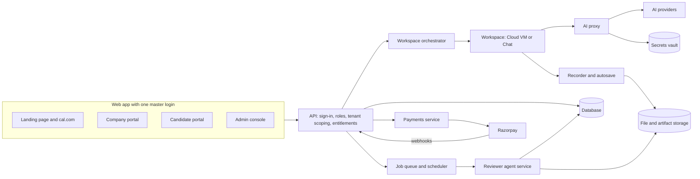

<RoleBadge roles={["sde", "ai", "qa", "mgmt"]} />

This diagram shows the main parts of the platform and how they connect. It describes responsibilities, not specific technology choices, which are not yet fixed.

| Part | Responsibility |
|---|---|
| API | Sign-in, role checks, tenant scoping, entitlement checks, timing enforcement and the audit log. |
| Workspace orchestrator | Starts workspaces from a warm pool or snapshot, loads the task, injects secrets, wires in the recorder and proxy, destroys, and cleans up. |
| Workspace | The Cloud VM or Chat space where the candidate works. It holds only a short-lived token. |
| AI proxy | Checks policy and caps, fetches the real key from the vault, forwards requests, logs conversations. |
| Recorder and autosave | Captures terminal, file diffs, git snapshots, chat and activity events, and persists state continuously. |
| Reviewer agent service | Runs one agent per rubric item, sanitizes input, and produces scored, evidence-cited results. |
| Payments service | Quotes, payment links, checkout, subscriptions, webhooks and invoices. |
| Job queue and scheduler | Auto-submit at expiry, cleanup, retention deletion, reminders, payment retries and agent runs. |
| Secrets vault | Provider keys and environment secrets. |

**Quality targets:** workspace launch in under 60 seconds for most launches, no more than 30 seconds of work lost on a disconnect, 99.5% monthly availability for the portals at launch, and central logging, metrics and alerts.

---