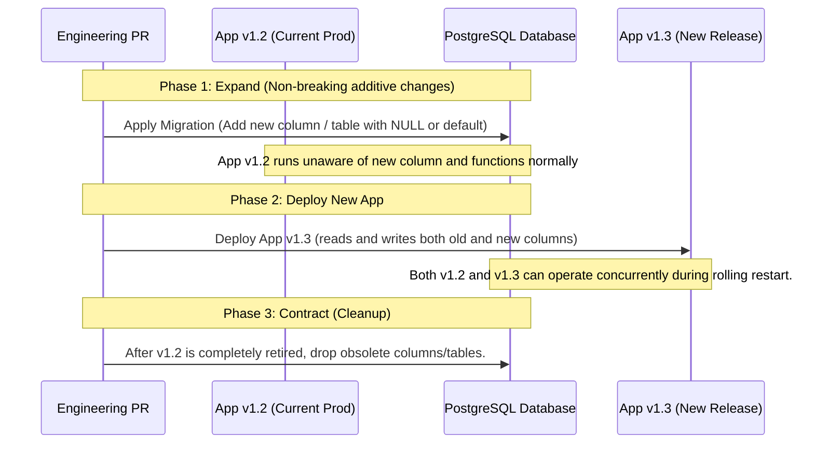

<RoleBadge roles={["sde", "qa", "mgmt"]} />

# Production Release Runbook

This runbook documents the engineering standards and operational execution steps required to deploy HelloSmart to production environments. We follow a **zero-downtime, expand-and-contract migration strategy** with automated canary verification.

---

## 1. Release Philosophy & Cadence

- **Staging Parity**: The staging environment mirrors production architecture (including Sysbox EC2 nodes, PostgreSQL RLS, and AI proxy firewalls).
- **Zero-Downtime Rule**: Deployments must never disrupt active candidate assessment sessions or drop terminal WebSocket connections.
- **Canary Promotion**: Changes are deployed first to our canary fleet (10% traffic), monitored for error spikes for 15 minutes, and then rolled out globally.
- **Rollback Window**: Any release that causes P1/P2 alert triggers is automatically halted and rolled back within 60 seconds.

---

## 2. Zero-Downtime Database Migrations

Because HelloSmart uses PostgreSQL with strict Row-Level Security, all schema changes must follow the **Expand and Contract pattern**:



### Prohibited In-Flight Migration Operations
- Never run `ALTER TABLE ... DROP COLUMN` in the same deployment that stops referencing it.
- Never add a `NOT NULL` constraint without a prior deployment that populates defaults on historical rows.
- Never rename columns directly. Create a new column, dual-write via Drizzle ORM, backfill, and drop the old column in a future sprint.

---

## 3. Deployment Pipeline & Execution Steps

### Pre-Flight Verification
Run these checks locally or via GitHub Actions before tagging a release:

```bash
# 1. Run all test suites
pnpm typecheck
pnpm test
pnpm test:tenancy
pnpm test:e2e

# 2. Check for secret leaks
pnpm secrets:scan

# 3. Verify documentation synchronization
pnpm docs:sync-check
```

### Deployment Commands

```bash
# Step 1: Run pending database migrations
pnpm db:migrate

# Step 2: Build production container images
docker build -t 123456789012.dkr.ecr.us-east-1.amazonaws.com/hellosmart-api:v1.3.0 -f apps/api/Dockerfile .
docker build -t 123456789012.dkr.ecr.us-east-1.amazonaws.com/hellosmart-web:v1.3.0 -f apps/web/Dockerfile .

# Step 3: Trigger rolling deployment on AWS ECS / EKS
aws ecs update-service --cluster hellosmart-prod --service api --force-new-deployment
aws ecs update-service --cluster hellosmart-prod --service web --force-new-deployment
```

---

## 4. Post-Deployment Smoke Verification

Immediately following a deployment, execute the automated synthetic verification suite:

```bash
curl -f -s https://api.hellosmart.ai/health/live | grep '"status":"ok"'
curl -f -s https://api.hellosmart.ai/health/ready | grep '"database":"connected"'
```

### Automated Rollback Trigger Criteria
The deployment pipeline automatically triggers a rollback if:
- HTTP 5xx error rate exceeds 0.5% over a 3-minute rolling window.
- Candidate WebSocket disconnect rate spikes over 2%.
- Any cross-tenant read leak is detected in synthetic test probes.

### Manual Emergency Rollback
```bash
# Revert ECS task definition to previous known healthy revision
aws ecs update-service --cluster hellosmart-prod --service api --task-definition hellosmart-api:PREVIOUS_REVISION
```
