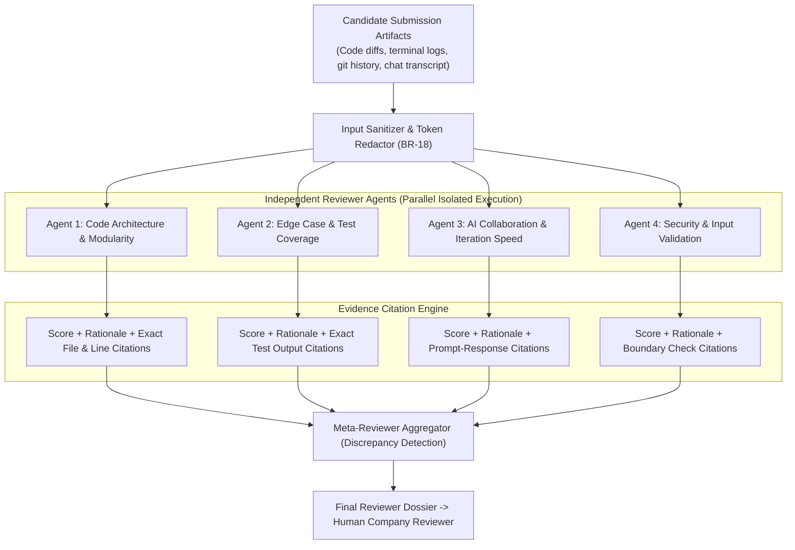
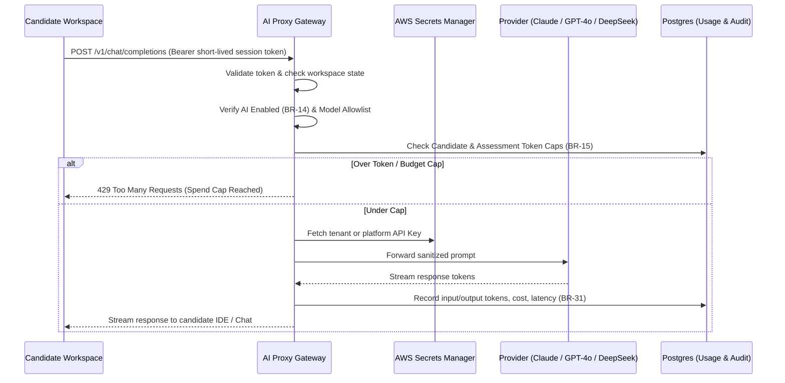

<RoleBadge role="ai" />

Welcome to the HelloSmart AI engineering group. You build the intelligence engine that differentiates HelloSmart: **independent reviewer agents**, the **AI Proxy gateway**, **evidence-cited evaluation pipelines**, and our **tamper-proof scoring aggregator**.

This playbook covers how reviewer agents function, how the AI proxy meters and controls LLM traffic, how to version rubric evaluation prompts, and our benchmark verification harness.

---

## 1. Reviewer Agent Architecture

Traditional AI hiring tools attempt to use a single monolithic LLM prompt to grade candidate performance. That results in hallucinated scores, bias, and lack of accountability.

HelloSmart uses an **independent multi-agent architecture** governed by strict business invariants:



### Reviewer Invariants (BR-18 to BR-20)
1. **Independent Evaluation (BR-18)**: Each rubric item runs as its own separate agent execution. Agents do not share state, memory, or context with other rubric agents to eliminate confirmation bias.
2. **Mandatory Evidence Citations (BR-18)**: Every score emitted by an agent *must* cite concrete evidence: git commit SHA, file path and line numbers, terminal command, or AI chat message ID. Unsubstantiated claims are rejected by the schema validator.
3. **Humans Make the Call (BR-20)**: Agent reviews are evidence dossiers for human hiring managers. The platform **never auto-rejects** candidates based on AI scores.
4. **Discrepancy Flagging**: If the aggregator detects high divergence between agents (e.g. Agent 1 rates candidate 90% for architecture but Agent 4 flags severe vulnerabilities), it flags the submission for immediate human attention.

---

## 2. AI Proxy Pipeline (`services/ai-proxy`)

The candidate workspace never holds OpenAI, Anthropic, or AWS platform keys (BR-13). All workspace LLM interactions route through the **HelloSmart AI Proxy**:



### AI Policy Configuration
Each assessment specifies an `ai_policy`:
```json
{
  "enabled": true,
  "provider_key_id": "pk_7f8a9b0c-1234",
  "allowed_models": ["claude-3-5-sonnet-20241022", "gpt-4o-mini"],
  "cap_per_candidate": { "unit": "usd", "value": 3.50 },
  "cap_per_assessment": { "unit": "usd", "value": 50.00 },
  "rpm": 30,
  "on_cap": "warn_then_block"
}
```

---

## 3. Rubric Item Manifest Structure

Rubric dimensions are defined in version-controlled JSON manifests pinned to template versions (BR-03):

```typescript
interface RubricItemConfig {
  id: string;
  name: string;
  goal: string;
  signals: string[];
  scale: { min: 1; max: 5 };
  level_anchors: Record<'1' | '2' | '3' | '4' | '5', string>;
  weight: number; // Sum across assessment must equal 100
  red_flags: string[];
  model: string;
  temperature: number;
}
```

---

## 4. Evaluation Harness & Regression Testing

To prevent prompt drift and model regression:
- Run the golden dataset evaluation suite:
  ```bash
  pnpm --filter @hs/reviewer test:eval
  ```
- Evaluates agent outputs against 25 calibrated historical candidate runs.
- Asserts that score variance is within +/- 0.35 standard deviations of human consensus scores.
