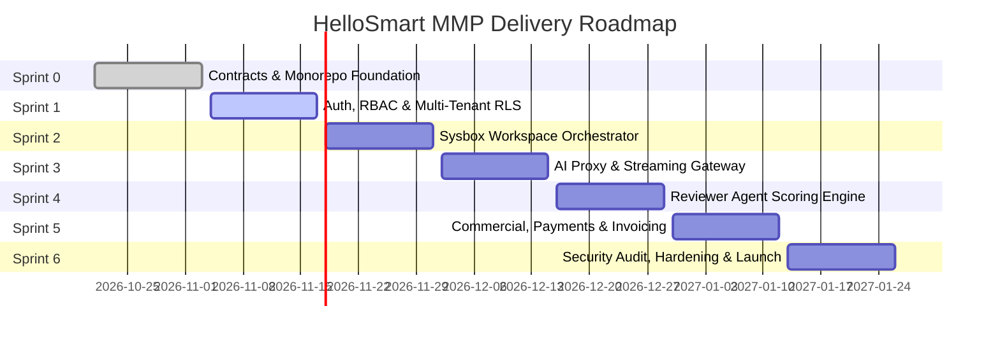

<RoleBadge role="mgmt" />

Welcome to the HelloSmart Managing Team portal. This guide is crafted for Product Managers, Delivery Leads, and Executive Leadership responsible for steering platform strategy, customer provisioning, commercial operations, and cross-functional execution.

---

## 1. Product Vision & Commercial Strategy

**Category**: AI-native work simulation for hiring  
**Tagline**: *"Hire by doing."*

HelloSmart allows hiring companies to evaluate candidates by observing how they solve real-world problems in fully provisioned cloud environments with AI co-pilots, rather than judging them on leetcode puzzles or unverified resumes.

### The Sales-Assisted MMP Loop
1. **Prospect Discovery**: Prospective enterprise clients book an introductory scoping call via our integrated `cal.com` embed.
2. **Quoting & Scoping**: Sales issues a custom quote specifying the assessment plan, candidate cap, duration, and optional add-ons.
3. **Provisioning**: HelloSmart Platform Admins create the customer organization, seed bespoke template blueprints, and assign platform quotas.
4. **Assessment Execution**: Company Admins invite candidates to complete assessments. Candidates write code, debug services, and prompt AI assistants in sandboxed Sysbox containers.
5. **Evidence Dossier**: Independent reviewer agents score submissions with exact citations; company hiring managers make the final hire/no-hire decision.

---

## 2. Commercial Pricing & Add-On Model

| Product Tier / Add-On | Pricing Structure | Description |
|---|---|---|
| **Starter Pilot** | Fixed quote / 30-day window | 1 custom template, up to 15 candidates, standard cloud VM |
| **Growth Plan** | Annual subscription + candidate packs | 5 custom templates, 100 candidates, reviewer agent pipeline |
| **Enterprise Dedicated** | Custom contract | Custom VM sizing, dedicated IP egress, SSO enforcement |
| **Own-Domain Routing** (Add-on) | $250/mo or quoted | Branded login and candidate portal on customer's domain |
| **White-Label Branding** (Add-on) | $500/mo or quoted | Complete removal of "Powered by HelloSmart.ai" watermark |
| **Managed AI Credits** (Add-on) | Cost + 20% margin | Platform-managed OpenAI/Anthropic quota for company workspaces |

---

## 3. Sprint Delivery Roadmap (MMP S0–S6)

---

## 4. Business Rules Compliance (BR-01 to BR-33)

Every feature release must respect our **33 Inviolable Business Rules**:
- **BR-01 (Isolation)**: All queries and storage scoped by `org_id`. Cross-org returns 404.
- **BR-02 (Template Privacy)**: Templates built for a company are strictly private to that company. No public marketplace.
- **BR-04 (No Public Self-Signup)**: Organizations are provisioned exclusively by Platform Admins.
- **BR-06 (Candidate Cap Counting)**: Candidates count against the quota only upon **first workspace launch**.
- **BR-10 (Full-Screen Discipline)**: Cloud sessions require fullscreen; exiting immediately disconnects and shows a resume prompt.
- **BR-13 (Zero Key Leaks)**: Real AI keys and cloud credentials never enter candidate containers.
- **BR-20 (Human in Control)**: AI agents emit evidence dossiers; hiring decisions remain 100% human.
- **BR-31 (Immutable Audit Chain)**: Tamper-evident cryptographic logging for all administrative events.
