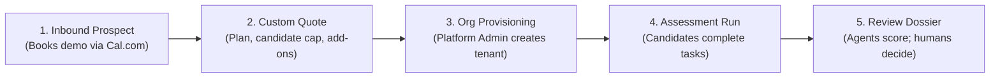
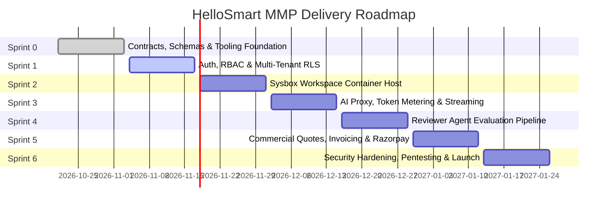
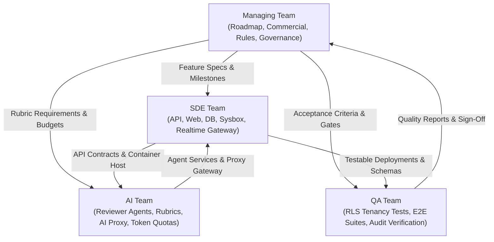

<RoleBadge role="mgmt" />

This playbook is the operational and governance manual for Product Managers, Engineering Leads, Delivery Managers, and Platform Administrators steering HelloSmart.ai.

HelloSmart is an AI-native work simulation platform for technical hiring. We evaluate candidates by having them solve real problems in sandboxed cloud environments alongside AI tools. Independent reviewer agents evaluate their work with exact evidence citations, while human hiring managers make the final decision.

---

## 1. Product Vision and Commercial Model

### Core Thesis
Traditional technical interviews rely on algorithmic puzzles or take-home assignments that candidates solve with unmonitored AI tools. HelloSmart shifts the paradigm to **"Hire by doing"**:
- Candidates work in real Linux VM environments (Sysbox containers) with full terminal and editor access.
- AI co-pilots are integrated directly into the workspace, governed by client-configured policies and token budgets.
- Work is continuously snapshotted (file changes, terminal history, git commits, AI prompts).
- Submissions are evaluated by independent reviewer agents that cite line numbers, terminal runs, and chat messages as evidence.
- Human hiring managers retain 100% authority over final hiring decisions.

### The Sales-Assisted MMP Loop
In the Minimum Marketable Product (MMP), customer acquisition is sales-assisted and "behind the curtain":

1. **Prospect Discovery**: Prospective enterprise clients book an introductory scoping call through our embedded `cal.com` calendar.
2. **Quoting and Scoping**: Sales generates a custom quote specifying the template blueprint, candidate volume, active duration, and paid add-ons.
3. **Tenant Provisioning**: Platform Admins provision the organization, assign private templates, and configure entitlement caps.
4. **Assessment Execution**: Company Admins invite candidates. Candidates launch sandboxed workspaces and complete assignments.
5. **Review and Finalization**: Reviewer agents analyze submissions and produce evidence dossiers. Company reviewers review, override if needed, and finalize hiring outcomes.

---

## 2. Commercial Pricing and Add-On Structure

| Package / Add-On | Structure | Included Capabilities |
|---|---|---|
| **Starter Pilot** | Fixed quote / 30-day window | 1 custom template, up to 15 candidates, standard cloud VM workspaces, basic email support. |
| **Growth Tier** | Annual contract + candidate packs | Up to 5 private templates, 100 candidates included, full multi-agent evaluation pipeline, priority support. |
| **Enterprise Dedicated** | Custom multi-year agreement | Custom VM hardware sizing, dedicated egress IPs, SSO enforcement, bespoke SLA. |
| **Own-Domain Routing** (Add-on) | Fixed monthly or annual add-on | Custom login and portal URL (`assess.customer.com`) with automated TLS certificate management. |
| **White-Label Branding** (Add-on) | Fixed monthly or annual add-on | Complete removal of "Powered by HelloSmart.ai" watermark across candidate emails and workspace UI. |
| **Custom Template Build** (Add-on) | Per-template professional fee | Engineering service where HelloSmart architects design and seed private scenarios for the customer. |
| **Managed AI Credits** (Add-on) | Pass-through cost + 20% margin | Platform-managed OpenAI or Anthropic quotas allocated directly to customer workspaces without customer API keys. |

---

## 3. Sprint Delivery Roadmap (MMP S0 to S6)

### Milestone Acceptance Criteria
- **Sprint 0**: Shared Zod schemas, OpenAPI 3.1 contracts, PostgreSQL migrations with RLS, and docs portal with zero drift.
- **Sprint 1**: Master login flow, role-based redirection, candidate forced password reset, and cross-tenant isolation test suite (`BR-01`).
- **Sprint 2**: Sysbox container manager, warm pool orchestrator, candidate terminal streaming, and RPO &le; 30s snapshot engine.
- **Sprint 3**: AI Proxy gateway, token budgeting, candidate spend caps, model allowlists, and provider key vault integration.
- **Sprint 4**: Independent reviewer agents, prompt sanitization, evidence extraction engine, and meta-reviewer discrepancy scoring.
- **Sprint 5**: Quote builder, Razorpay checkout and recurring billing webhooks, GST invoice generation, and audit logging.
- **Sprint 6**: External security pentest remediation, disaster recovery verification, canary deployment drill, and production go-live.

---

## 4. The 33 Inviolable Business Rules (BR-01 to BR-33)

Every feature, pull request, and operational decision must strictly conform to these invariants. Violations block release approval.

### Tenancy, Access, and Provisioning
- **BR-01 Tenant Isolation**: Every database query, cache key, file path, background job, and audit log must be explicitly scoped by `org_id`. Cross-tenant requests must return HTTP 404, never 403, preventing resource ID existence discovery.
- **BR-02 Template Privacy**: Templates created for an organization are strictly private to that organization. HelloSmart maintains no public catalog or cross-tenant marketplace in MMP.
- **BR-03 Version Pinning**: When an assessment is published, it pins an immutable `TemplateVersion`. Editing the master template blueprint never impacts in-flight or published assessments.
- **BR-04 Organization Creation**: Only Platform Admins can provision organizations and Company Admin accounts. Public self-signup is disabled. SSO matches existing verified emails and never creates new tenants.
- **BR-05 Entitlements**: Template counts, candidate quotas, active duration windows, and feature flags are configured per tenant and validated server-side on every mutation.
- **BR-06 Candidate Quota Counting**: A candidate consumes quota exactly once, upon **first workspace launch** (`counted_against_cap_at`). Pending invitations are capped at 2x the candidate limit.
- **BR-07 Trial Expiration**: When an account reaches its expiration date or candidate cap, new workspace launches and candidate invites are blocked. In-flight active candidate sessions are permitted to finish.
- **BR-24 Candidate Onboarding**: Candidates receive an automated onboarding invitation with a single-use expiring token. First login strictly requires a password reset.
- **BR-25 Route Isolation**: Candidate sessions cannot access company admin or platform admin endpoints. Company admins cannot access platform admin capabilities.

### Timing, Windows, and Candidate Experience
- **BR-08 Server-Side Timing Enforcement**: Assessment timers and availability windows are calculated and enforced exclusively on the backend in UTC. Client countdown timers are cosmetic. Expired sessions are automatically submitted.
- **BR-09 Disconnect Timer Policy**: If a candidate disconnects, the exam countdown timer continues running by default (`pause_timer_on_disconnect = false`). Candidates are informed on the pre-flight screen.
- **BR-10 Fullscreen Requirement**: Cloud VM workspaces require browser fullscreen. Exiting fullscreen disconnects the terminal session, logs a `fullscreen_exit` event, and shows a resume prompt.
- **BR-11 Continuous State Persistence**: Candidate work (terminal input, git commits, uncommitted file diffs, chat history) is continuously persisted with an RPO &le; 30 seconds, enabling seamless resumption.
- **BR-12 Explicit Recording Consent**: Connecting to a workspace is disabled until the candidate explicitly accepts the exam recording consent agreement, recording IP, timestamp, and user agent.
- **BR-22 Workspace Destruction**: Destroying a workspace creates a final snapshot, notifies the candidate, and writes an audit event. Company admins can destroy their own workspaces; platform admins can destroy any.
- **BR-23 Spend and Idle Cost Control**: Inactive, orphaned, or expired containers are reaped automatically. Hard memory and execution caps prevent infrastructure runaway.
- **BR-33 No Real Cloud Credentials**: Candidate workspaces are never injected with production cloud credentials. Infrastructure tasks use LocalStack or isolated container mocks.

### AI Controls, Proxies, and Spending
- **BR-13 AI Proxy is the Only Path**: Candidate workspaces contain only short-lived session tokens. Provider API keys are never placed in candidate containers. All AI requests pass through `services/ai-proxy`.
- **BR-14 AI Disabled Mode**: When an assessment disables AI tools, the assistant panel is hidden and outbound network egress to known AI provider endpoints is blocked at the firewall.
- **BR-15 Spend Caps and Token Quotas**: Assessments enforce per-candidate and per-assessment token and financial spend caps. Exceeding limits triggers a warning followed by hard request rejection.
- **BR-16 Provider Key Protection**: Customer-supplied API keys are encrypted at rest in AWS Secrets Manager. UI displays show only the last 4 characters and provider name.
- **BR-17 Platform Key Allocation**: When customers use platform-provided AI credits, Platform Admins assign a capped allocation pool monitored by automatic alarms.

### Reviewer Agents, Evidence, and Scoring
- **BR-18 Independent Agent Evaluation**: Each rubric dimension is evaluated by a standalone agent execution. Agents share no context with other rubric agents, preventing cross-bias. Submissions are treated as untrusted data.
- **BR-19 Mandatory Evidence Citations**: Every score emitted by a reviewer agent must cite specific evidence: commit SHAs, file paths and line ranges, terminal logs, or chat message IDs.
- **BR-20 Human in the Loop**: AI agent outputs are advisory evidence dossiers for hiring managers. The platform strictly prohibits automated rejection based on AI scores.
- **BR-21 Discrepancy Flagging**: When evaluation agents disagree sharply (for example, high code quality paired with critical security vulnerabilities), the aggregator flags the review for manual escalation.

### Commercial Operations, Payments, and Billing
- **BR-26 Sales-Assisted Quoting**: Platform Admins issue custom digital quotes with expiration dates, payment schedules, and entitlement limits.
- **BR-27 Razorpay Integration**: Invoices and subscriptions are billed through Razorpay. All webhook handlers are strictly idempotent, deduplicating events by gateway transaction ID.
- **BR-28 Custom Payment Codes**: Sales may issue one-time or multi-use discount codes pinned to specific quotes or organizations.
- **BR-29 Feature Flag Gating**: Paid add-ons (own-domain routing, white-label UI, custom templates) are gated by tenant-level feature flags.
- **BR-30 Zero Card Data Storage**: HelloSmart never stores credit card numbers, CVVs, or bank credentials. All payment processing occurs on PCI-DSS certified gateway hosts.

### Audit Trails, Security, and Compliance
- **BR-31 Immutable Audit Log**: High-privilege actions (org provisioning, entitlement modifications, score overrides, key updates, workspace destructions) generate append-only audit rows protected by cryptographic hashing.
- **BR-32 Regulatory Data Retention**: Assessment submissions, recordings, and review dossiers are retained according to the organization's retention policy (default 90 days), after which automated jobs purge artifacts.

---

## 5. Team Governance and Cross-Functional Roles

### Team Responsibilities
- **Managing Team**: Owns product direction, client quotes, commercial contracts, customer provisioning, business rule enforcement, and release go/no-go decisions.
- **SDE Team**: Delivers core API services, web applications, container workspace orchestration, database migrations, and telemetry streaming.
- **AI Team**: Implements independent evaluation agents, prompt pipelines, evidence extraction algorithms, and AI Proxy rate-limiting.
- **QA Team**: Protects multi-tenancy invariants, maintains end-to-end regression suites, audits cryptographic integrity, and certifies production readiness.

---

## 6. Definition of Done for Leadership Sign-Off

Before any milestone is accepted or promoted to production:
1. **Contract and Schema Integrity**: OpenAPI specifications and Drizzle database models match with zero unmapped fields.
2. **Tenancy Verification**: Automated test suites confirm that cross-tenant read attempts return HTTP 404 (`pnpm test:tenancy`).
3. **Evidence Validation**: All reviewer agent scoring runs produce verified line and file citations.
4. **Documentation Compliance**: The change passes `pnpm docs:sync-check` with zero documentation drift.
5. **Security Clearance**: No plaintext API keys exist in code, logs, container images, or API responses.
