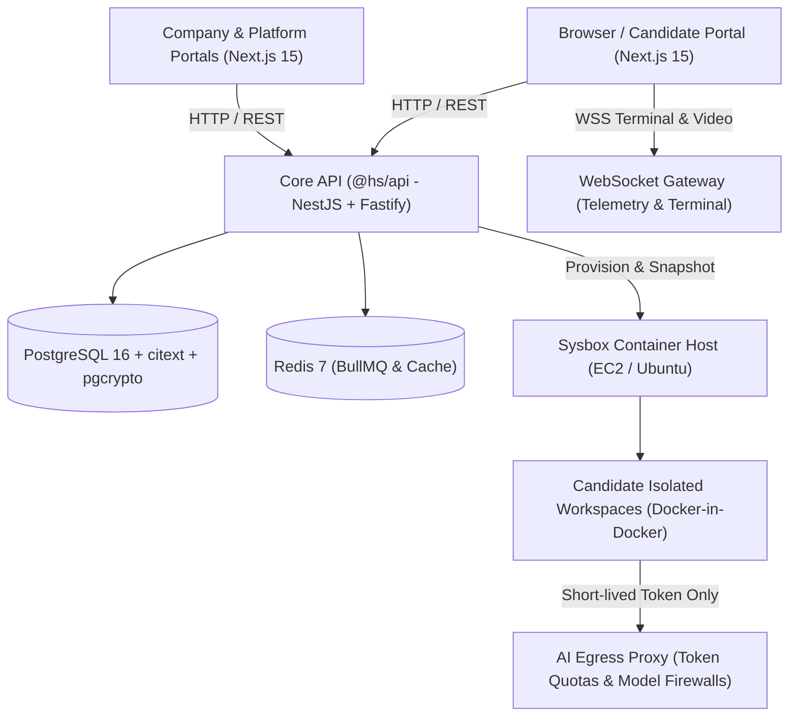

<RoleBadge role="sde" />

Welcome to the HelloSmart engineering core. As a Software Development Engineer on HelloSmart, you build and maintain the high-scale foundation of the platform: the **modular monolith API**, the **candidate cloud VM orchestrator**, the **real-time streaming gateway**, and our **Next.js web portal**.

This guide lays out everything you need to know: architecture boundaries, how to run locally, container runtime gotchas, database migrations, and our mandatory documentation definition of done.

---

## 1. Architecture at a Glance

HelloSmart is structured as a **modular monolith** with event-driven background workers and sandboxed runtime agents:



### Core Monorepo Packages

| Path | Name | Responsibility | Tech Stack |
|---|---|---|---|
| `apps/api` | `@hs/api` | Tenancy, RBAC, assessments, timing engine, commercial | NestJS 10, Fastify, Drizzle ORM |
| `apps/web` | `@hs/web` | Master login, Company portal, Candidate portal, Admin console | Next.js 15, React 19, Tailwind CSS |
| `apps/docs` | `@hs/docs` | Role-protected engineering & product documentation | Next.js 16, Fumadocs, Mermaid |
| `apps/worker` | `@hs/worker` | Auto-submit scheduler, snapshot persistence, cleanup | BullMQ, Node.js 24 |
| `services/ws-gateway` | `@hs/ws-gateway` | Candidate terminal PTY streaming and full-screen telemetry | Fastify WebSocket, node-pty |
| `services/ai-proxy` | `@hs/ai-proxy` | Egress control, token metering, spend enforcement | Fastify, undici, Vault KMS |
| `packages/contracts` | `@hs/contracts` | OpenAPI 3.1 schemas, database migrations, event schemas | Zod, TypeScript, SQL |

---

## 2. Daily Development Workflow

### Starting the Local Environment

Ensure Docker Desktop or a local Docker daemon is running:

```bash
# 1. Bring up PostgreSQL 16 and Redis 7
pnpm infra:up

# 2. Run database migrations and test fixtures seed
pnpm db:migrate
pnpm db:seed

# 3. Start development servers across the monorepo in parallel
pnpm dev
```

### Core Verification Commands

Before creating a branch or opening a pull request, run:

```bash
# Type checking across all workspace packages
pnpm typecheck

# Unit and integration test suite
pnpm test

# Automated cross-tenant isolation tests (BR-01 verification)
pnpm test:tenancy

# AIDLC Documentation drift check
pnpm docs:sync-check
```

---

## 3. Critical Invariants Every SDE Must Uphold

Every pull request must strictly enforce the HelloSmart Business Rules (defined in [AGENTS.md](/docs/knowledge-base/00-start-here)):

### BR-01: Multi-Tenancy & Row-Level Security
- Every database query must be scoped by `org_id`.
- Tenant context is set per transaction:
  ```sql
  SELECT set_config('app.org_id', $1, true);
  ```
- **Cross-tenant reads must return HTTP 404, never 403**, preventing existence leakage.
- Every new API endpoint must include a dedicated cross-tenant isolation test in `tests/tenancy/`.

### BR-13: Workspace Token Security
- **Never inject real LLM provider API keys or cloud credentials into candidate containers.**
- Workspaces receive only a short-lived, cryptographically signed session token scoped strictly to that candidate's assignment.
- All AI API calls must be directed to `services/ai-proxy`, which fetches real credentials from AWS Secrets Manager, validates token limits, and logs prompts.

### BR-10 & BR-11: Full Screen & Zero Work Loss
- Candidate workspaces must continuously snapshot work (terminal history, git commits, uncommitted file diffs, chat transcripts) with an **RPO &le; 30 seconds**.
- If a candidate exits full screen, the session is immediately **disconnected (not destroyed)**, logs a `fullscreen_exit` activity event, and displays a resume overlay.

---

## 4. Sysbox Container Workspaces

Candidate workspaces use **Sysbox** (`sysbox-runc`), an open-source container runtime that enables unprivileged containers to act like traditional virtual machines:

1. **Why not privileged Docker?** Privileged Docker (`--privileged`) exposes the host kernel and `/dev` devices, allowing trivial container breakouts. Sysbox provides isolated user namespaces and separate Docker daemons (`Docker-in-Docker`) with complete host isolation.
2. **Warm Pool Orchestration**: To ensure candidate connect times stay under 15 seconds, the workspace orchestrator maintains a pre-warmed pool of generic Ubuntu images with standard toolchains (Node, Python, Go, Rust, Git).
3. **Egress Firewall**: Outbound internet traffic from candidate containers is routed through an egress proxy with strict domain whitelisting. Access to unauthorized AI domains or credential metadata endpoints is blocked at the network level.

---

## 5. AIDLC Documentation Sync Rule

> [!IMPORTANT]
> Whenever you modify a database migration (`packages/contracts/db/`), update an API schema (`packages/contracts/openapi/`), or alter a service architecture, you **must update the documentation in `apps/docs/content/docs/` in the same pull request**.
>
> Run `pnpm docs:sync-check` to verify your changes before submitting.
