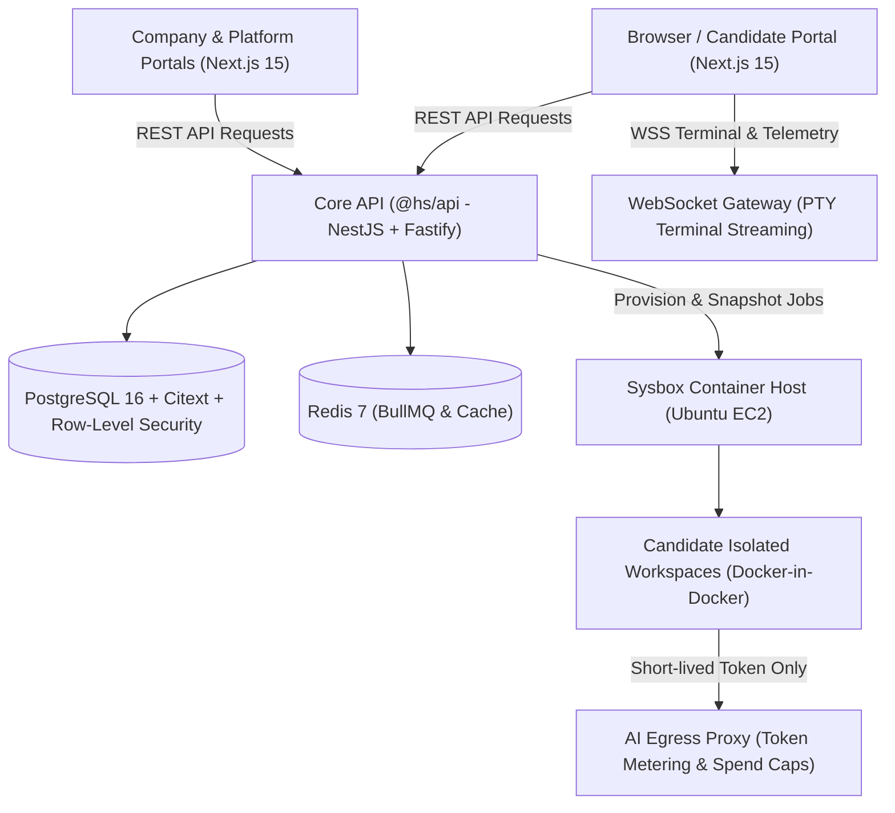

<RoleBadge role="sde" />

This playbook is the hands-on engineering manual for Software Development Engineers (SDEs) on HelloSmart.

As an SDE, you build and maintain the core platform foundation: the **modular monolith backend API**, the **Sysbox container workspace orchestrator**, the **real-time terminal streaming gateway**, and the **Next.js web portals**.

---

## 1. System Architecture and Component Boundaries

HelloSmart is designed as a **modular monolith** backed by PostgreSQL 16, Redis 7 (BullMQ), and isolated Linux worker nodes. This architecture delivers low operational complexity during MMP while maintaining strict domain separation:



### Monorepo Directory Map

| Path | Package Name | Responsibility | Tech Stack |
|---|---|---|---|
| `apps/api` | `@hs/api` | Tenancy, authentication, assessment orchestration, timing engine, and billing | NestJS 10, Fastify, Drizzle ORM |
| `apps/web` | `@hs/web` | Master login, Company portal, Candidate portal, and Platform Admin console | Next.js 15 (App Router), React 19, Tailwind CSS |
| `apps/docs` | `@hs/docs` | Internal developer documentation, architecture specs, and BRD index | Next.js 16, Fumadocs, Mermaid |
| `apps/worker` | `@hs/worker` | Auto-submit scheduler, snapshot persistence, and container cleanup jobs | BullMQ, Node.js 24 |
| `services/ws-gateway` | `@hs/ws-gateway` | Candidate terminal PTY streaming and full-screen telemetry events | Fastify WebSocket, node-pty |
| `services/ai-proxy` | `@hs/ai-proxy` | Egress control, model allowlists, and per-candidate token metering | Fastify, undici, AWS Secrets Manager |
| `packages/contracts` | `@hs/contracts` | Shared OpenAPI 3.1 contracts, Zod validation schemas, and database migrations | Zod, TypeScript, Drizzle migrations |

---

## 2. Daily Development Workflow

### Prerequisites
- Node.js 24 LTS
- pnpm 9.x (`corepack enable pnpm`)
- Docker Desktop or a local Linux Docker daemon

### Step-by-Step Local Setup

```bash
# 1. Clone the repository and install workspace dependencies
pnpm install

# 2. Start local infrastructure dependencies (PostgreSQL 16, Redis 7, LocalStack)
pnpm infra:up

# 3. Apply database migrations and seed sample tenants and fixtures
pnpm db:migrate
pnpm db:seed

# 4. Start all applications in parallel development mode
pnpm dev
```

The services run on the following default local ports:
- **Web Portal**: `http://localhost:3000` (Company, Candidate, and Admin portals)
- **API Server**: `http://localhost:4000` (Swagger docs at `/docs`)
- **Docs Portal**: `http://localhost:3001` (Internal engineering documentation)
- **Prism Mock Server**: `http://localhost:4010` (Contract-driven mock API)

### Essential Pre-Commit Verification Commands

Before pushing any code or opening a pull request, run these validation suites:

```bash
# Type check all monorepo packages
pnpm typecheck

# Run unit and integration test suites
pnpm test

# Run multi-tenant Row-Level Security verification (BR-01)
pnpm test:tenancy

# Verify zero documentation drift (AIDLC rule)
pnpm docs:sync-check
```

---

## 3. Core Architectural Patterns and Rules

### BR-01: Multi-Tenancy and Row-Level Security (RLS)
HelloSmart enforces strict tenant isolation at the database layer using PostgreSQL Row-Level Security:
- Every tenant-owned table includes an `org_id` column.
- Database connections run inside transactions where tenant context is set before queries execute:
  ```sql
  SELECT set_config('app.org_id', $1, true);
  ```
- **Cross-tenant requests must return HTTP 404 Not Found, never HTTP 403 Forbidden**. Returning a 403 leaks whether an ID exists in another tenant's account.
- Every new API endpoint must have a corresponding test in `tests/tenancy/` asserting that querying another organization's ID returns 404.

### BR-13: Short-Lived Workspace Tokens
- **Never inject production cloud credentials or LLM provider API keys into candidate containers.**
- When a candidate launches a workspace, the orchestrator generates a short-lived, cryptographically signed session token scoped to that specific workspace.
- The candidate container directs all AI requests to `services/ai-proxy`, which verifies the session token, validates spend caps, fetches the real API key from AWS Secrets Manager, and streams the response back.

### BR-10 and BR-11: Fullscreen Discipline and Zero Work Loss
- The Candidate Cloud VM workspace operates in browser fullscreen.
- Exiting fullscreen disconnects the WebSocket stream, logs a `fullscreen_exit` telemetry event, and presents a resume dialog. It does **not** destroy the container.
- Candidate files, terminal buffers, and git state are saved continuously with an **RPO &le; 30 seconds**. When the candidate resumes, their workspace is restored without loss.

### Database Migrations (Expand-and-Contract)
Because HelloSmart targets zero-downtime releases:
1. **Never rename or drop a column in a single migration.**
2. Follow the expand-and-contract pattern:
   - **Phase 1 (Expand)**: Add the new column as nullable. Deploy API code that writes to both columns and reads from the old column.
   - **Phase 2 (Migrate)**: Run a backfill script to populate historical rows.
   - **Phase 3 (Contract)**: Deploy code reading from the new column. In the following release, drop the old column.

---

## 4. Sysbox Container Workspace Runtime

HelloSmart uses **Sysbox** (`sysbox-runc`) on unprivileged Ubuntu worker instances to power candidate cloud VMs:

1. **Why Sysbox instead of privileged Docker?** Running Docker inside unprivileged containers normally requires `--privileged`, which exposes host devices and kernel capabilities. Sysbox virtualizes system resources (procfs, sysfs) inside isolated user namespaces, providing true virtualization security without VM overhead.
2. **Warm Container Pool**: Cold starting a container workspace with full toolchains can take 40+ seconds. The orchestrator maintains a pool of pre-warmed, generic Ubuntu containers with Node, Python, Go, and Git pre-installed, reducing candidate launch times to under 15 seconds.
3. **Egress Firewalling**: Containers are connected to a software bridge with an egress proxy that whitelists required package registries (npm, PyPI) while blocking AWS metadata endpoints (`169.254.169.254`) and unauthorized AI APIs.

---

## 5. Software Engineer Definition of Done (DoD)

A pull request is ready for review and merge only when:
1. All TypeScript compiler checks pass across all workspace packages (`pnpm typecheck`).
2. Unit and integration tests pass with 100% success rate (`pnpm test`).
3. Multi-tenant isolation is verified with a dedicated cross-tenant test (`pnpm test:tenancy`).
4. Any schema, API, or architecture changes are documented in `apps/docs/content/docs/`.
5. `pnpm docs:sync-check` passes with zero documentation drift.
