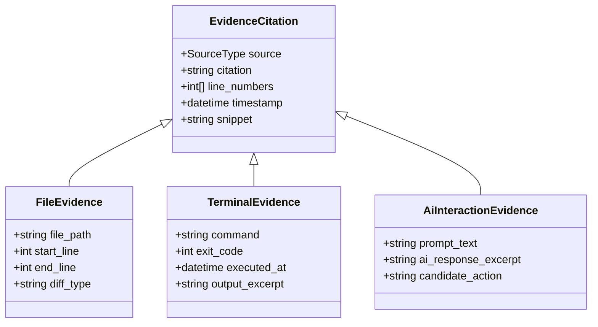

# Evidence Extraction Protocol: Mandatory Code Line-Number & Terminal Run Citations

**Target Invariant:** BR-18 (Every score must cite verifiable evidence)  
**Author:** Tino Britty J (System Architect & Team Lead)  
**Status:** Approved Architectural Protocol  
**Consumer:** `services/reviewer` & `apps/web/src/components/reviewer/`  

---

## 1. The Evidence Invariant
In HelloSmart, an AI reviewer agent may **never** emit an arbitrary or ungrounded score. Every rubric dimension score (1 to 5) must be substantiated by an array of verifiable `evidence` objects pointing directly into the candidate's workspace artifacts.

Any score lacking concrete evidence citations is rejected by the schema validator.

---

## 2. Evidence Citation Taxonomy



### 1. File Source Citations
- **Syntax**: `relative/path/to/file.ext#L<start>-L<end>`
- **Example**: `src/checkout/coupon.service.ts#L42-L49`
- **Payload Schema**:
  ```json
  {
    "source": "file",
    "citation": "src/checkout/coupon.service.ts#L42-L49",
    "line_numbers": [42, 43, 44, 45, 46, 47, 48, 49],
    "snippet": "const normalizedCode = inputCode.trim().toUpperCase();"
  }
  ```

### 2. Terminal Execution Citations
- **Syntax**: `terminal:cmd#<timestamp_or_step>`
- **Example**: `terminal:pnpm_test#2026-11-06T14:22:10Z`
- **Payload Schema**:
  ```json
  {
    "source": "terminal",
    "citation": "terminal:pnpm_test#2026-11-06T14:22:10Z",
    "timestamp": "2026-11-06T14:22:10Z",
    "snippet": "FAIL test/coupon.spec.ts (4 passed, 1 failed, expected 200 got 400)"
  }
  ```

### 3. AI Copilot Interaction Citations
- **Syntax**: `ai_chat:msg#<message_uuid>`
- **Example**: `ai_chat:msg#9f81a7b2-3c1d-4e5f-b6a7-890123456789`
- **Payload Schema**:
  ```json
  {
    "source": "ai_chat",
    "citation": "ai_chat:msg#9f81a7b2-3c1d-4e5f-b6a7-890123456789",
    "timestamp": "2026-11-06T14:15:32Z",
    "snippet": "Candidate Prompt: 'Why is regex /^[A-Z0-9]+$/ rejecting lowercase promo codes?'"
  }
  ```

---

## 3. UI Deep-Linking Integration
The company reviewer interface (`apps/web`) renders citation badges as interactive hyperlinks:
- Clicking a `file` citation opens the read-only Monaco Diff Viewer scrolled and highlighted directly to lines `42–49`.
- Clicking a `terminal` citation opens the terminal replay log to the exact command execution offset.
- Clicking an `ai_chat` citation expands the Copilot drawer to the corresponding prompt turn.
