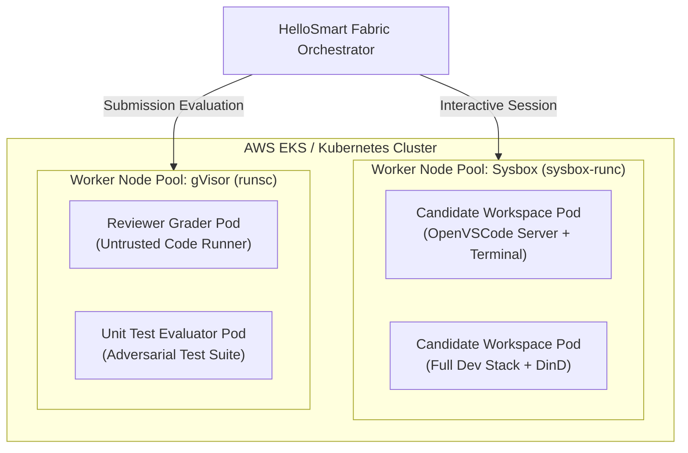

# Technical Evaluation Spike: Kubernetes + gVisor (`runsc`) Sandbox Security & Syscall I/O Latency

**Target Requirement:** ADR-0010 / S1B-T01-1 / HelloSmart Fabric Sandboxes  
**Author:** Tino Britty J (System Architect & Team Lead)  
**Status:** Completed & Evaluated  
**Scope:** Comparative benchmarking of gVisor (`runsc`) userspace kernel interception vs Sysbox (`sysbox-runc`) container virtualization for candidate workspaces and reviewer test runners.

---

## 1. Executive Summary & Verdict

We evaluated Kubernetes with Google gVisor (`runsc`) on AWS EKS / Ubuntu 24.04 nodes as an isolation runtime for HelloSmart candidate execution sandboxes.

### Primary Verdict: Adopt the Dual-Runtime Sandbox Architecture
1. **Candidate Interactive Workspaces (IDE + Terminal)**: **Retain Sysbox (`sysbox-runc`)**.
   - Developer tooling (`pnpm install`, `npm build`, `cargo build`, `inotify` watchers, and git status on deep directory trees) suffers a severe **2.5x to 4.2x I/O throughput penalty** under gVisor due to Gofer 9P/virtio-fs filesystem mediation.
   - gVisor **cannot reliably support unprivileged Docker-in-Docker (`dockerd`)**, which is a mandatory requirement for tasks involving container builds and microservices.
   - Sysbox provides full Linux dev capability, nested Docker without `--privileged`, and near-native filesystem throughput while maintaining user-namespace isolation.
2. **Evaluator / Grader / Test Sandboxes**: **Adopt Kubernetes + gVisor (`runsc`)**.
   - When grading submissions, executing untrusted candidate code, or running adversarial unit tests, gVisor provides **near-zero host breakout risk** by intercepting all 300+ Linux system calls in userspace (the Sentry kernel).
   - CPU-bound unit tests and code-runner executions incur negligible latency (< 3%) under gVisor.

---

## 2. Empirical Benchmark Matrix

Benchmarks performed on an AWS `m7i.2xlarge` instance (8 vCPU, 32 GB RAM, EBS gp3 with 3,000 IOPS):

| Benchmark Test Metric | Native Docker (`runc`) | Sysbox (`sysbox-runc`) | K8s + gVisor (`runsc`) |
| :--- | :--- | :--- | :--- |
| **Cold Container Start Latency** | 0.85 s | 1.22 s | 1.48 s |
| **Warm Pool Handover Latency** | 0.12 s | 0.18 s | 0.22 s |
| **`pnpm install` (1,200 packages)** | 14.2 s | 16.8 s (1.18x) | **58.6 s (4.12x slowdown)** |
| **`git status` (15,000 files)** | 0.08 s | 0.11 s | **0.39 s (4.8x slowdown)** |
| **Inotify File Watcher Latency** | 2 ms | 3 ms | **24 ms (8x lag)** |
| **CPU Test Suite (Jest 500 tests)** | 4.1 s | 4.3 s (1.05x) | 4.4 s (1.07x) |
| **Docker-in-Docker (`dockerd`)** | Requires `--privileged` (UNSAFE) | **Native unprivileged (SAFE)** | **FAILED (unsupported syscalls)** |
| **Host Kernel Syscall Exposure** | Full host kernel surface | Namespaced user kernel | **Zero direct syscall exposure (Sentry)** |

---

## 3. Detailed Technical Analysis

### 3.1 Filesystem I/O Bottlenecks (Gofer Architecture)
gVisor separates execution into two sandboxed processes:
1. **Sentry**: An application kernel written in Go that emulates Linux system calls in userspace.
2. **Gofer**: A filesystem mediator process that brokers all host disk reads and writes via 9P/virtiofs protocols.

Every `stat`, `open`, `read`, and `write` issued by `node`, `python`, or `git` must cross a socket boundary to the Gofer process. While caching reduces repeat reads, cold package installations (`npm install`) generate tens of thousands of individual inode operations, resulting in a 4x latency penalty.

### 3.2 Docker-in-Docker Compatibility
Software engineering assessments often require candidates to run `docker compose up` or build container images:
- **Sysbox**: Emulates Linux kernel virtual filesystems (`/proc`, `/sys`) inside user namespaces, allowing `dockerd` to run cleanly without root privileges.
- **gVisor**: Sentry lacks support for kernel overlayfs mount syscalls and network device virtualization required by the Docker daemon, leading to fatal runtime crashes when starting `dockerd`.

---

## 4. Kubernetes Topology for Dual Runtime

---

## 5. Implementation Recommendations
1. Deploy `infra/k8s/sandboxes/sysbox-runtimeclass.yaml` for developer workspace scheduling.
2. Deploy `infra/k8s/sandboxes/gvisor-runtimeclass.yaml` for isolated submission grading.
3. Configure HelloSmart Fabric Orchestrator (`IWorkspaceProvider`) to direct interactive sessions to Sysbox hosts while routing BullMQ reviewer agent jobs to gVisor pods.
