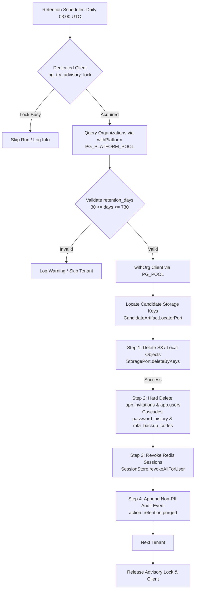

# Data Retention & Soft-Delete Purge Worker Specification

> **Requirement Traceability:** `[4.4]` Data Retention & Soft-Delete Purge Worker  
> **Relevant Business Rules:** `BR-27` (Data Retention: 90 days after assessment closes), `BR-26` (Candidate Deletion: company soft-deletes, automated purge hard-deletes), `BR-31` (Append-Only Audit Logging)  
> **System Architecture & Tenancy:** `BR-01` (Tenant Isolation via `withOrg` and RLS), `BR-05` (Entitlements & Retention Configuration)  
> **Related BRD Requirements:** `CO-016` (Configurable Retention Period), `AD-028` (Data Retention Settings), `NF-007` (Compliance & GDPR Data Deletion), `Decision D9` (Retention Boundaries 30–730 Days)

---

## 1. Overview & Architectural Boundaries

HelloSmart enforces strict data minimization, compliance (GDPR/SOC2), and tenancy hygiene through an automated retention worker (`apps/api/src/modules/jobs/retention-purge.worker.ts`).

The system uses a two-tier deletion lifecycle:

1. **Soft Deletion (`BR-26`)**: When a company administrator deletes a candidate in the company portal, the user's status is set to `'deleted'` and `deleted_at` is stamped with the current timestamp. The record remains queryable by authorized administrators for compliance and audit review.
2. **Hard Purge (`BR-27`)**: A scheduled, distributed background worker runs daily during off-peak hours. It evaluates each organization's configured `retention_days` and permanently deletes candidate records and their associated storage artifacts whose `deleted_at` exceeds the retention cutoff (`deleted_at < NOW() - retention_days`).



---

## 2. Retention Boundaries & Validation (`CO-016`, `AD-028`, `Decision D9`)

Each organization configures its own data retention window. In PostgreSQL schema (`app.organizations`), this is constrained by check constraint `organizations_retention_days_check`:

```sql
retention_days integer NOT NULL DEFAULT 90 CHECK (retention_days >= 30 AND retention_days <= 730)
```

- **Default Window:** 90 days (`BR-27`).
- **Minimum Window:** 30 days.
- **Maximum Window:** 730 days (2 years).

### Worker Defensive Bounds Check

Even though the database enforces this constraint at write time, the worker performs defensive application-level validation:

```typescript
if (retentionDays < 30 || retentionDays > 730) {
  this.logger.warn(
    `Skipping org ${orgId}: configured retention_days (${retentionDays}) outside allowed bounds [30, 730].`,
  );
  continue;
}
```

If an organization row contains invalid or corrupt retention data, it is skipped without interrupting other tenant purges.

---

## 3. Distributed Concurrency & Advisory Locking

To prevent race conditions, duplicate deletions, or redundant storage API calls when running multiple API replicas in production, the purge worker utilizes PostgreSQL application-level advisory locking:

- **Advisory Lock ID:** `8472938174` (64-bit BigInt signed integer derived from `crc32("hellosmart.retention_purge_worker")`).
- **Dedicated Client Pattern:** Session-level locks on pooled connections risk lock leakage or connection stall. The worker checks out a **dedicated single client** from `PG_PLATFORM_POOL`, queries `SELECT pg_try_advisory_lock(8472938174) AS acquired`, and releases both the lock and client inside a strict `try ... finally` block:
  ```typescript
  try {
    const lockRes = await lockClient.query<{ acquired: boolean }>(
      `SELECT pg_try_advisory_lock($1) AS acquired`,
      [RETENTION_PURGE_ADVISORY_LOCK_ID],
    );
    if (!lockRes.rows[0]?.acquired) {
      this.logger.log('Retention purge advisory lock is held by another instance; skipping run.');
      return { skippedDueToLock: true, ... };
    }
    // Perform purge...
  } finally {
    try {
      await lockClient.query(`SELECT pg_advisory_unlock($1)`, [RETENTION_PURGE_ADVISORY_LOCK_ID]);
    } finally {
      lockClient.release();
    }
  }
  ```
- **Non-blocking Behavior:** If replica A is executing the purge, replica B fails to acquire the lock immediately and exits cleanly without error or queuing.

---

## 4. Execution Order & Deletion Sequence

To ensure data integrity, zero orphaned artifacts, and clean foreign key cascade, the worker executes a strictly ordered 4-step sequence per candidate:

### Step 1: Storage Artifacts Deletion First (`StoragePort.deleteByKeys`)

Artifacts must be permanently removed from object storage **before** deleting metadata or user identifiers from the database. If storage deletion fails (e.g., S3 500 error or network partition):

- The database deletion is **aborted** for that candidate.
- A failure is counted in the tenant report.
- The candidate remains in the database with status `'deleted'`, allowing the subsequent day's purge job to retry artifact deletion.

### Step 2: Database Rows Deletion in Dependency Order

Within a tenant-scoped transaction (`withOrg`):

1. **`app.invitations`**: Deleted first because its foreign key (`user_id REFERENCES app.users(id)`) has `NO ACTION`.
   ```sql
   DELETE FROM app.invitations WHERE user_id = $1 AND org_id = $2;
   ```
2. **`app.users`**: Hard-deleted.
   ```sql
   DELETE FROM app.users WHERE id = $1 AND org_id = $2;
   ```
3. **Engine-Level Cascades**:
   - `app.password_history`: Foreign key `user_id REFERENCES app.users(id) ON DELETE CASCADE`.
   - `app.mfa_backup_codes`: Foreign key `user_id REFERENCES app.users(id) ON DELETE CASCADE`.

### Step 3: Session Revocation (`SessionStore.revokeAllForUser`)

Active sessions associated with the purged user are evicted from Redis to guarantee immediate termination across any active browsers or API tokens.

### Step 4: Non-PII Aggregate Audit Logging (`audit.events`)

One append-only audit event is written per organization per run with action `retention.purged`.

---

## 5. Tenancy & Least-Privilege Role Separation (`0005_platform_role.sql`)

Following migration `0005_platform_role.sql`, `app.is_platform()` evaluates:

```sql
SESSION_USER IN ('hs_platform', 'hs_migrator') AND current_setting('app.is_platform', true) = 'true'
```

The application maintains two distinct connection pools:

1. **`PG_PLATFORM_POOL` (`hs_platform`)**: Used exclusively to acquire the cross-instance advisory lock and discover active organizations.
2. **`PG_POOL` (`hs_app`)**: Used for all candidate deletion operations. All queries run inside `withOrg(appClient, orgId, async (tx) => { ... })`, which executes:
   ```sql
   SELECT set_config('app.org_id', $1, true);
   ```
   This guarantees that PostgreSQL Row-Level Security (`RLS`) actively isolates every `DELETE` and `SELECT` statement. Even if application code were compromised, tenant A's worker cannot read or delete tenant B's records.

---

## 6. Audit Trail & PII Sanitization (`BR-31`)

Per `BR-31`, audit events are immutable, append-only, and cryptographically verified via SHA-256 hash chaining.

To prevent PII recreation during compliance purges, the `retention.purged` audit event contains **strictly aggregate, non-PII metrics**:

| Field               | Type      | Description                                             |
| ------------------- | --------- | ------------------------------------------------------- |
| `candidates_purged` | `number`  | Count of candidate records permanently removed          |
| `objects_deleted`   | `number`  | Count of storage artifacts deleted from S3 / LocalFs    |
| `failures`          | `number`  | Count of candidates skipped due to storage or DB errors |
| `retention_days`    | `number`  | The tenant's configured retention window applied        |
| `dry_run`           | `boolean` | Flag indicating whether this was an operational dry-run |

### Example Audit Event

```json
{
  "org_id": "7beb8d79-ccde-5d73-922c-894648d63e54",
  "actor_id": "00000000-0000-4000-8000-000000000000",
  "actor_role": "system",
  "action": "retention.purged",
  "entity": "retention_worker",
  "before": null,
  "after": {
    "candidates_purged": 14,
    "objects_deleted": 28,
    "failures": 0,
    "retention_days": 90,
    "dry_run": false
  }
}
```

No candidate names, emails, user IDs, or filenames are written to the audit log.

---

## 7. Artifact Locator & Sprint 4 Roadmap

The candidate artifact locator is abstracted through `CandidateArtifactLocatorPort`:

- **Current MMP Implementation (`EmptyCandidateArtifactLocator`)**: Because `app.submissions` and `app.assignments` tables are scheduled for schema migration in Sprint 4 (Tickets 4.5+), candidate artifacts are not yet linked to candidate records in the relational schema.
- **Sprint 4 Target (`SubmissionArtifactLocator`)**: When `app.submissions` and `app.assignments` tables are migrated, `SubmissionArtifactLocator` will query candidate assignment submission keys (`storage/{org_id}/submissions/{assignment_id}/...`) and pass them to `StoragePort.deleteByKeys`.

---

## 8. Residual Risks & Product Questions for Vishal V

1. **Historical PII in Pre-Existing Audit Logs**:
   - _Finding:_ Historical audit actions such as `candidate.created`, `candidate.updated`, and `candidate.deleted` logged the candidate's `name` and `email` inside the JSON `before` / `after` payloads.
   - _Constraint:_ `audit.events` is protected by the `audit_no_update` trigger and append-only hash chain. It is mathematically and architecturally impossible to redact historical audit rows without invalidating the cryptographic hash chain.
   - _Recommendation:_ Retain historical audit logs per standard regulatory compliance (SOC2/ISO27001), while ensuring the new purge action `retention.purged` writes zero PII.
2. **BR-27 "Log Every Deletion" vs. Aggregate Audit Event**:
   - _Discrepancy:_ `BR-27` states that deletion jobs "log every deletion", whereas privacy best practices mandate that deletion jobs should not log candidate names or emails.
   - _Decision:_ Implemented one aggregate audit event per tenant per run (`retention.purged`).
   - _Option for Vishal V:_ If individual audit logs are required, emit one event per candidate containing an opaque UUID / hash with zero PII.
3. **Assessment Completion vs. Candidate Soft-Delete Date**:
   - _Discrepancy:_ `BR-27` defines retention as "90 days after assessment closes", while Ticket 4.4 specifies purging soft-deleted candidates based on `deleted_at < NOW() - retention_days`.
   - _Resolution:_ Purge worker currently handles candidate soft-delete retention. A future worker extension in Sprint 4 will handle closed assessment artifact archival.
4. **S3 Object Versioning & WAL Backups**:
   - _Note:_ Hard-deleting objects via S3 `DeleteObjects` places a delete marker if S3 Object Versioning is enabled. Storage bucket lifecycle policies must be configured with `NoncurrentVersionExpiration` matching tenant retention windows.

---

## 9. Operations Runbook

### Environment Variables

| Variable                     | Default | Purpose                                                                                                       |
| ---------------------------- | ------- | ------------------------------------------------------------------------------------------------------------- |
| `RETENTION_PURGE_ENABLED`    | `false` | Master toggle. Must be set to `true` to enable automated daily purging.                                       |
| `RETENTION_PURGE_HOUR_UTC`   | `3`     | Hour of the day (0–23 UTC) when the daily purge executes (03:00 UTC).                                         |
| `RETENTION_PURGE_BATCH_SIZE` | `100`   | Maximum candidates fetched per tenant per run to bound memory and transaction duration.                       |
| `RETENTION_PURGE_DRY_RUN`    | `false` | When `true`, runs queries and counts purge targets without deleting files, DB rows, or emitting audit events. |

### Caution: Seed Data Retention Notice

In development and staging environments, `Brindle & Co` (`retention_days = 30`) contains seeded candidates soft-deleted on `2026-10-19`. These candidates cross their 30-day retention threshold on **2026-11-18**.
To prevent unintended data loss in dev/staging environments, `RETENTION_PURGE_ENABLED` must remain `false` by default.

### Dry-Run Verification

To simulate a retention purge without deleting data:

1. Set `RETENTION_PURGE_DRY_RUN=true`.
2. Invoke `worker.run({ dryRun: true })` or trigger the scheduler.
3. Review worker logs:
   ```text
   [RetentionPurgeWorker] Starting retention purge run (dryRun: true, batchSize: 100)...
   [RetentionPurgeWorker] Retention purge run finished. Processed 3 orgs: 2 candidates purged, 0 objects deleted, 0 failures. (dryRun: true)
   ```
