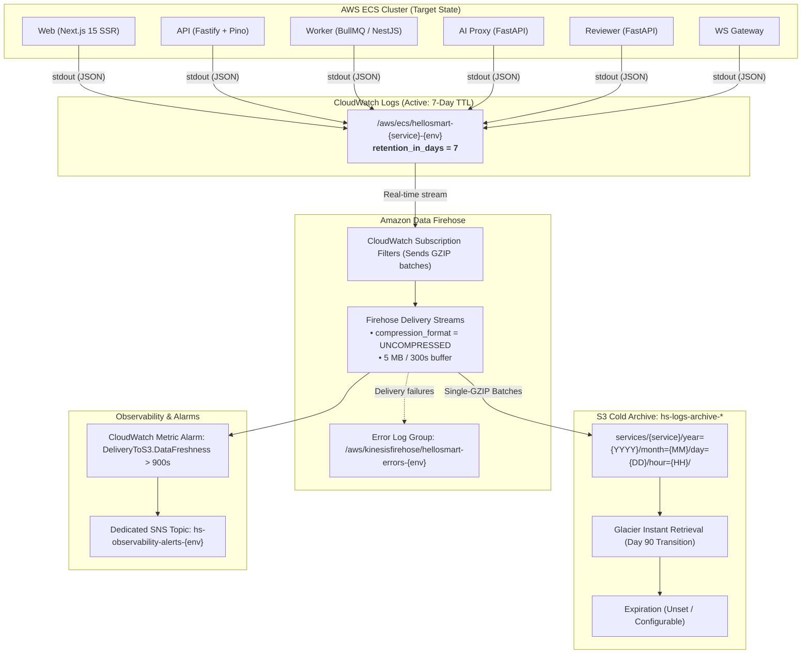

# Central Log Retention and Archival Policy — HelloSmart.ai

> [!IMPORTANT]
> **Runtime Environment & Deployment Status:**
> The existing QA deployment currently runs on a single KVM VPS via Docker Compose (`infra/qa-vps/docker-compose.qa.yml`), where logs are managed locally on host disk by the Docker daemon's `json-file` log driver (50 MB cap, 5 rotated files).
> 
> The Terraform module under [`infra/terraform/modules/observability/`](../infra/terraform/modules/observability/) provisions the **target AWS cloud observability architecture** (CloudWatch Log Groups, Subscription Filters, Amazon Data Firehose streams, and the S3 cold archive).
> 
> Containers will begin streaming into this pipeline once the AWS ECS compute module (`infra/terraform/modules/compute/`) and ECS task definitions (`awslogs` log driver) are deployed. **Live cloud logging and S3 archival are not currently active in the QA VPS environment.**

---

## 1. Executive Summary & Policy Objectives

HelloSmart.ai operates high-stakes hiring simulations where technical diagnostic data must be preserved securely, efficiently, and compliantly. This document defines the infrastructure architecture and operational policy for storing, retaining, and archiving backend application and container logs.

### Policy Invariants

| Dimension | Policy Specification | Architectural Implementation |
|---|---|---|
| **Active Retention** | Exactly 7 days (168 hours) | AWS CloudWatch Log Groups with `retention_in_days = 7` |
| **Cold Archival** | High-durability S3 storage | Amazon Data Firehose streaming to dedicated encrypted S3 bucket |
| **Compression & Format** | Single-GZIP compressed JSON | CloudWatch subscription filter native GZIP payload passed uncompressed by Firehose |
| **Partitioning Layout** | Hive-compliant date partitioning | `services/<service>/year=YYYY/month=MM/day=DD/hour=HH/` |
| **Data Separation** | Dedicated archive bucket | Strictly isolated from candidate work (`hs-candidate-*`) and business audit events (`app.audit_log`) |
| **Archive Expiration** | Unset (Indefinite pending legal approval) | Configurable Terraform parameter `archive_retention_days = null` |
| **Cold Storage Class** | Glacier Instant Retrieval (`GLACIER_IR`) | S3 Lifecycle transition at 90 days; sub-second query latency in Athena without restore jobs |
| **Monitoring & Alarms** | Real-time delivery health checks | CloudWatch Metric Alarms on Firehose delivery freshness routed to dedicated SNS alert topic |

---

## 2. Architecture & Data Flow



---

## 3. Scope of In-Scope Container Services

The retention and archival pipeline captures all six container services defined across HelloSmart's architecture and deployment workflows:

1. **`web` (`apps/web`):** Next.js 15 server-side rendering (SSR), authentication callbacks, client error reporting, and front-door HTTP routing.
2. **`api` (`apps/api`):** HTTP request completions, session evaluations, assessment workflows, lifecycle operations, and caught exceptions.
3. **`worker` (`apps/worker`):** Background jobs, email delivery tasks, session timeouts, and scheduled maintenance.
4. **`ai-proxy` (`services/ai-proxy`):** Token quotas, model routing, upstream LLM latency, and rate-limiting enforcement.
5. **`reviewer` (`services/reviewer`):** Rubric evaluation jobs, grading agent invocations, and evidence synthesis.
6. **`ws-gateway` (`services/ws-gateway`):** Candidate terminal/IDE WebSocket connections, heartbeats, and session disconnections.

Each service is provisioned with an isolated CloudWatch Log Group and a dedicated Firehose delivery stream to prevent cross-service head-of-line blocking or resource starvation.

---

## 4. S3 Archive Partition Structure & Compression Mechanism

Archived logs are delivered to a dedicated S3 bucket:
`s3://hs-logs-archive-<account_id>-<env>/`

### Object Key Structure

```
services/<service>/year=!{timestamp:yyyy}/month=!{timestamp:MM}/day=!{timestamp:dd}/hour=!{timestamp:HH}/hs-logs-<service>-<env>-<stream_id>-<timestamp>
```

For failed delivery records:
```
errors/services/<service>/!{firehose:error-output-type}/year=!{timestamp:yyyy}/month=!{timestamp:MM}/day=!{timestamp:dd}/hour=!{timestamp:HH}/
```

### Compression Architecture (Preventing Double-Compression)

> [!NOTE]
> **Why `compression_format = "UNCOMPRESSED"` in Firehose:**
> When CloudWatch Logs forwards records to Firehose via a Subscription Filter, CloudWatch **already compresses the batch payload using gzip**.
> 
> If Firehose were configured with `compression_format = "GZIP"`, Firehose would compress the gzipped byte stream a second time, creating a double-compressed binary file. Downstream tools like Amazon Athena decompress gzip only once and fail with `MalformedJsonException` when encountering binary gzip headers.
> 
> By setting `compression_format = "UNCOMPRESSED"`, Firehose writes the native single-GZIP stream directly to S3. Standard utilities (`gzip -dc`) and Athena's `JsonSerDe` decompress the file once into valid JSON records.

---

## 5. Security & Access Controls

The storage architecture enforces defense-in-depth across storage, delivery, and identity layers:

1. **S3 Block Public Access:** All four public access block settings (`block_public_acls`, `block_public_policy`, `ignore_public_acls`, `restrict_public_buckets`) are set to `true`.
2. **In-Transit Encryption:** S3 Bucket Policy explicitly denies any request where `aws:SecureTransport` is `false`, enforcing TLS 1.2+.
3. **At-Rest Encryption:** 
   - CloudWatch Log Groups are encrypted using AWS-managed KMS or a customer-managed key (`kms_key_arn`).
   - S3 Log Archive bucket uses SSE-KMS (`s3_kms_key_arn`) or SSE-S3 AES-256 with S3 Bucket Keys enabled to optimize KMS request costs.
   - Firehose delivery streams enforce server-side encryption.
4. **Versioning:** S3 object versioning is enabled (`status = "Enabled"`) to protect against accidental overwrites or malicious deletion.
5. **Least-Privilege IAM:**
   - **CloudWatch to Firehose Role:** Can only assume `logs.amazonaws.com` and invoke `firehose:PutRecord`/`firehose:PutRecordBatch` on the specific delivery streams in the module. If a customer-managed KMS key is used, it also receives scoped `kms:GenerateDataKey*` and `kms:Decrypt` permissions.
   - **Firehose to S3 Role:** Can only assume `firehose.amazonaws.com` and perform scoped S3 object operations (`s3:PutObject`, `s3:AbortMultipartUpload`) on the archive bucket ARN prefix.
6. **Separation from Candidate & Audit Data:**
   - Candidate work artifacts are stored in `hs-candidate-<env>` with 90-day assessment-bound retention (BR-27).
   - Business audit events are stored immutably in PostgreSQL (`app.audit_log`).
   - The log archive bucket stores strictly operational and diagnostic container logs (Internal classification).

---

## 6. Lifecycle Management & Retrieval Trade-Offs

### Active Tier (CloudWatch)
- **Retention:** Explicitly set to 7 days (`retention_in_days = 7`).
- **Enforcement:** Automated CloudWatch TTL expiration permanently purges log streams older than 7 days from active search.

### Cold Tier (S3 Archive)
- **Incomplete Multipart Uploads:** Automatically aborted after 7 days to eliminate orphaned upload charges.
- **Storage Class Choice — `GLACIER_IR` vs `GLACIER`:**
  - By default, objects transition to `GLACIER_IR` (Glacier Instant Retrieval) after 90 days (`archive_storage_class = "GLACIER_IR"`).
  - **Rationale:** Unlike standard `GLACIER` (which requires asynchronous restore jobs taking 3–5 hours before data can be read), `GLACIER_IR` provides **sub-second query access** in Amazon Athena while still reducing storage costs by over 78% compared to S3 Standard ($0.005 vs $0.023/GB-month). This ensures compliance officers and security engineers can query historical logs immediately during audit or incident investigations.
- **Cold Expiration Policy:**
  - `archive_retention_days` is parameterized in Terraform with default value `null`.
  - The Terraform module utilizes a dynamic `expiration` block that remains omitted while the parameter is `null`.
  - **No cold logs will be automatically deleted** until the compliance and legal teams approve a specific retention duration.

---

## 7. Querying and Verifying Archived Logs

### Amazon Athena (High-Throughput Analytics)

Archived logs can be queried directly in Amazon Athena using partition projection.

```sql
CREATE EXTERNAL TABLE IF NOT EXISTS hellosmart_observability.service_logs (
  messageType STRING,
  owner STRING,
  logGroup STRING,
  logStream STRING,
  subscriptionFilters ARRAY<STRING>,
  logEvents ARRAY<STRUCT<
    id: STRING,
    timestamp: BIGINT,
    message: STRING
  >>
)
PARTITIONED BY (
  service STRING,
  year STRING,
  month STRING,
  day STRING,
  hour STRING
)
ROW FORMAT SERDE 'org.openx.data.jsonserde.JsonSerDe'
LOCATION 's3://hs-logs-archive-<account_id>-prod/services/'
TBLPROPERTIES (
  'projection.enabled' = 'true',
  'projection.service.type' = 'enum',
  'projection.service.values' = 'web,api,worker,ai-proxy,reviewer,ws-gateway',
  'projection.year.type' = 'date',
  'projection.year.format' = 'yyyy',
  'projection.year.range' = '2026,2030',
  'projection.month.type' = 'integer',
  'projection.month.range' = '1,12',
  'projection.month.digits' = '2',
  'projection.day.type' = 'integer',
  'projection.day.range' = '1,31',
  'projection.day.digits' = '2',
  'projection.hour.type' = 'integer',
  'projection.hour.range' = '0,23',
  'projection.hour.digits' = '2',
  'storage.location.template' = 's3://hs-logs-archive-<account_id>-prod/services/${service}/year=${year}/month=${month}/day=${day}/hour=${hour}'
);
```

#### Querying by Correlated Request ID
```sql
SELECT 
  event.timestamp,
  json_extract_scalar(event.message, '$.level') AS level,
  json_extract_scalar(event.message, '$.reqId') AS reqId,
  json_extract_scalar(event.message, '$.method') AS method,
  json_extract_scalar(event.message, '$.url') AS url,
  json_extract_scalar(event.message, '$.statusCode') AS statusCode,
  json_extract_scalar(event.message, '$.responseTime') AS responseTime,
  json_extract_scalar(event.message, '$.msg') AS msg
FROM hellosmart_observability.service_logs
CROSS JOIN UNNEST(logEvents) AS t(event)
WHERE service = 'api'
  AND year = '2026'
  AND month = '10'
  AND day = '26'
  AND json_extract_scalar(event.message, '$.reqId') = '9b1deb4d-3b7d-4bad-9bdd-2b0d7b3dcb6d';
```

### AWS CLI & Local Decompression

To retrieve and inspect logs from a specific hour:

```bash
# 1. Download logs for a given service and hour
aws s3 sync s3://hs-logs-archive-123456789012-prod/services/api/year=2026/month=10/day=26/hour=13/ ./tmp-logs/

# 2. Decompress single-GZIP payload and extract JSON messages
gzip -dc ./tmp-logs/* | jq '.logEvents[].message | fromjson'
```

---

## 8. Monitoring & Delivery Alarms

Each service's delivery stream is monitored by a dedicated CloudWatch Metric Alarm:

- **Alarm Name:** `hs-firehose-delivery-errors-<service>-<env>`
- **Metric:** `DeliveryToS3.DataFreshness` (Namespace: `AWS/Firehose`)
- **Evaluation:** Triggers if data freshness age exceeds 900 seconds (15 minutes).
- **Missing Data Handling:** `treat_missing_data = "notBreaching"` prevents false alarm triggers during low-traffic periods.
- **Notification Destination:** Dispatches alerts to `local.alerts_topic_arn`, which automatically provisions a dedicated SNS topic `hs-observability-alerts-<env>` when no external topic is supplied.
- **Error Logs:** Delivery errors (such as IAM permission issues or S3 bucket policy rejections) are logged directly to:
  `/aws/kinesisfirehose/hellosmart-errors-<env>` with separate streams for each service.

---

## 9. Environment Runtime Strategy & Current Status

| Environment | Current Runtime | Archival Status & Mechanism |
|---|---|---|
| **Local Development** | Docker Compose (`docker-compose.yml`) | Ephemeral; destroyed on `docker compose down`. LocalStack emulates S3/SQS/KMS; Firehose is not emulated locally to preserve developer system resources. |
| **QA VPS** | Docker Compose on AWS EC2 (`infra/qa-vps`) | **Operational 7-day retention & verified local archival.** Bounded Docker logs (`json-file`, 50 MB, 5 files). Scheduled extraction keeps 7 days in active storage and archives older logs to persistent date-partitioned storage (`logs/archive/YYYY/MM/<date>.log.gz`) with cryptographic integrity verification before source deletion. CloudWatch/Firehose not active on QA host. |
| **Staging** (Target) | AWS ECS (`awslogs` driver) | Prospective IaC provisioned. Will stream container logs to CloudWatch (7d) → Firehose → S3 archive once the `compute/` ECS module is deployed. |
| **Production** (Target) | AWS ECS (`awslogs` driver) | Prospective IaC provisioned. Will stream container logs to CloudWatch (7d) → Firehose → S3 archive once the `compute/` ECS module is deployed. |

---

## 10. Operational QA Log Storage, Retention, and Archival Engine

While AWS ECS utilizes CloudWatch Log Groups with automated TTL expiration, the QA environment runs on an AWS EC2 instance running Docker Compose (`infra/qa-vps/docker-compose.qa.yml`). To ensure strict adherence to the 7-day retention and cold archival policy without relying on unmerged cloud compute modules, HelloSmart provides an operational QA log engine: [`scripts/qa-log-archive.mjs`](../../scripts/qa-log-archive.mjs).

### Architectural Invariants in QA
1. **Application Emits Exclusively to stdout:** No application files are written to disk. The Twelve-Factor App principle is preserved.
2. **Bounded Docker Log Storage:** Each container service (`web`, `api`, `worker`, `ai-proxy`, `reviewer`, `ws-gateway`) is bounded to 50 MB with 5 rotating files (`max-size: 50m`, `max-file: 5`), capping Docker internal storage at 250 MB per container.
3. **Non-Privileged Ingestion:** Uses standard `docker compose logs --timestamps --since <cursor> <service>` run as the unprivileged `deploy` user. No dangerous privileged container access to `/var/lib/docker` is permitted.
4. **Active 7-Day Storage (UTC Calendar Definition):** Extracted logs are written to `/srv/hellosmart/logs/active/<service>/YYYY-MM-DD.log`. "Seven days" is defined as seven full preceding UTC calendar dates plus the current date in progress (e.g. at 00:05 UTC on October 28, logs from October 21–28 remain active, while October 20 and older are archived).
5. **Deduplication & Restart Resilience:** Log ingestion inspects the tail of existing active files and deduplicates lines matching cursor timestamps, preventing duplicate records when replaying overlapping boundaries or resuming after process interruption.
6. **Cold Local Archival:** Daily log files strictly older than the 7-day cutoff are compressed (`GZIP`, level 9) into date-partitioned storage:
   `/srv/hellosmart/logs/archive/<service>/YYYY/MM/YYYY-MM-DD.log.gz`
7. **Cryptographic Integrity Verification & Safe Deletion Safeguard:**
   - Source log file SHA256 checksum and exact byte size are computed using a memory-bounded streaming reader.
   - The archive is written to a temporary atomic file (`.tmp.gz`).
   - The temporary archive is fully decompressed in-stream to verify GZIP framing, byte length equality, and SHA256 parity against the source.
   - Upon verification, the atomic rename occurs (`.tmp.gz` → `.gz`).
   - **Source unlinking occurs ONLY after successful archive verification.** If verification fails, the source file is never deleted, ensuring zero log loss.
8. **Idempotency & Concurrency:**
   - Overlapping runs are guarded by an atomic PID lockfile (`.qa-archive.lock`) using `O_CREAT | O_EXCL`.
   - Stale lock detection checks `process.kill(pid, 0)`: a lock is recycled only if the owning process has actually terminated (`ESRCH`). Active processes are never overridden.
   - If an archive already exists and is verified valid, the engine avoids duplicate compression and cleans up redundant active source files safely.
9. **Deployment Integration:**
   - `qa.sh deploy <sha>` automatically executes `./qa-archive.sh` prior to container recreation, ensuring in-flight logs are flushed to persistent active storage.

### Completeness Guarantees & Operational Limitations
- **What is verified & guaranteed:**
  - Archival is strictly crash-safe and lossless from the moment logs are written to active storage (`/srv/hellosmart/logs/active/`). Source files are never deleted without cryptographic integrity proof.
  - Ingestion is idempotent: repeated runs or interrupted collections do not duplicate records or corrupt active files.
  - Concurrency is protected: multiple overlapping jobs cannot run concurrently or corrupt data.
- **What is best-effort (known limitations):**
  - Docker Compose log collection pulls from Docker daemon's local `json-file` buffer. If a container generates >250 MB of logs between archival runs (e.g., massive log flood exceeding 5 × 50 MB), older logs rotated out by the Docker daemon before collection will be lost.
  - Manual execution of `docker system prune` or `docker compose down -v` on the host clears container logs before ingestion.
  - For 100% real-time lossless collection under catastrophic host failure, real-time daemon streaming (such as the target AWS CloudWatch `awslogs` driver with Kinesis Firehose) is used rather than periodic batch CLI extraction.

### Disk Capacity Requirements in QA

| Tier | Retention Period | Expected Daily Volume | Total Disk Footprint |
|---|---|---|---|
| **Active Storage (`logs/active/`)** | 7 Days (Uncompressed) | 10–50 MB / day | ~70–350 MB |
| **Archive Storage (`logs/archive/`)** | Indefinite (GZIP Compressed) | 1.5–7.5 MB / day (~85% compression) | ~45–225 MB / month (~2.7 GB / year) |
| **Docker Buffer (`json-file`)** | Bounded (50 MB × 5 files / svc) | Rotating buffer | Max 1.5 GB across all 6 services |

The entire QA log footprint consumes < 5 GB annually, easily accommodated within the 160 GB GP3 minimum instance specification.

### Scheduling via Systemd

A systemd service and timer are provided in `infra/qa-vps/systemd/`:
- [`hellosmart-qa-archive.service`](../../infra/qa-vps/systemd/hellosmart-qa-archive.service)
- [`hellosmart-qa-archive.timer`](../../infra/qa-vps/systemd/hellosmart-qa-archive.timer) (Fires daily at 00:05 UTC with a 5-minute randomized delay).

```bash
# Host installation on QA EC2 (run once as root):
sudo cp /srv/hellosmart/infra/qa-vps/systemd/hellosmart-qa-archive.* /etc/systemd/system/
sudo systemctl daemon-reload
sudo systemctl enable --now hellosmart-qa-archive.timer
```

---

## 11. Operational Runbook

### Applying Infrastructure via Terraform

```bash
# Verify formatting
terraform fmt -check -recursive infra/terraform

# Initialize and validate module
cd infra/terraform/modules/observability
terraform init -backend=false
terraform validate

# Plan staging deployment
cd ../../envs/staging
terraform init
terraform plan -out=tfplan.staging

# Apply (performed only by CI/CD with OIDC credentials)
terraform apply tfplan.staging
```

### ECS Task Definition Guidelines
When authoring upcoming ECS task definitions, ensure `"awslogs-create-group"` is omitted or set to `"false"`. The task execution role requires `logs:CreateLogStream` and `logs:PutLogEvents`, relying on Terraform to pre-provision the log group with the 7-day retention policy.
