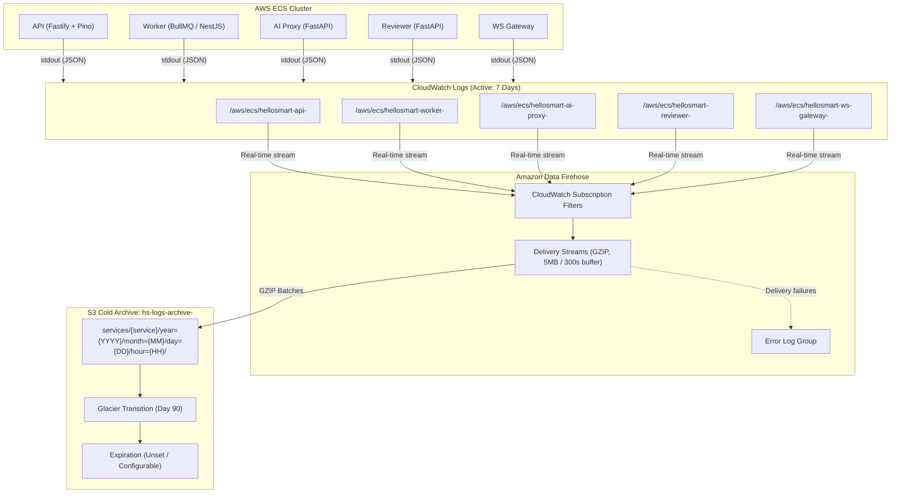

# Central Log Retention and Archival Policy — HelloSmart.ai

## 1. Executive Summary & Policy Objectives

HelloSmart.ai operates high-stakes hiring simulations where technical diagnostic data must be preserved securely, efficiently, and compliantly. This document defines the infrastructure architecture and operational policy for storing, retaining, and archiving backend application and container logs.

### Policy Invariants

| Dimension | Policy Specification | Architectural Implementation |
|---|---|---|
| **Active Retention** | Exactly 7 days (168 hours) | AWS CloudWatch Log Groups with `retention_in_days = 7` |
| **Cold Archival** | High-durability S3 storage | Amazon Data Firehose streaming to dedicated encrypted S3 bucket |
| **Compression & Format** | GZIP compressed JSON | Native Firehose GZIP compression of structured log batches |
| **Partitioning Layout** | Hive-compliant date partitioning | `services/<service>/year=YYYY/month=MM/day=DD/hour=HH/` |
| **Data Separation** | Dedicated archive bucket | Strictly isolated from candidate work (`hs-candidate-*`) and business audit events (`app.audit_log`) |
| **Archive Expiration** | Unset (Indefinite pending legal approval) | Configurable Terraform parameter `archive_retention_days = null` |
| **Cost Optimization** | Glacier transition at 90 days | S3 Lifecycle configuration moving cold logs to `GLACIER` storage |
| **Monitoring & Alarms** | Real-time delivery health checks | CloudWatch Metric Alarms on Firehose delivery freshness and error streams |

---

## 2. Architecture & Data Flow



---

## 3. Scope of Backend Services

The retention and archival pipeline captures all backend container services across all deployed environments (`staging`, `prod`):

1. **`api` (`apps/api`):** HTTP request completions, authentication events, lifecycle operations, and caught exceptions.
2. **`worker` (`apps/worker`):** Background jobs, email delivery tasks, session timeouts, and scheduled maintenance.
3. **`ai-proxy` (`services/ai-proxy`):** Token quotas, model routing, upstream LLM latency, and rate-limiting enforcement.
4. **`reviewer` (`services/reviewer`):** Rubric evaluation jobs, grading agent invocations, and evidence synthesis.
5. **`ws-gateway` (`services/ws-gateway`):** Candidate terminal/IDE WebSocket connections, heartbeats, and session disconnections.

Each service is provisioned with an isolated CloudWatch Log Group and a dedicated Firehose delivery stream to prevent cross-service head-of-line blocking or resource starvation.

---

## 4. S3 Archive Partition Structure & Storage Format

Archived logs are delivered to a dedicated S3 bucket:
`s3://hs-logs-archive-<account_id>-<env>/`

### Object Key Structure

```
services/<service>/year=!{timestamp:yyyy}/month=!{timestamp:MM}/day=!{timestamp:dd}/hour=!{timestamp:HH}/hs-logs-<service>-<env>-<stream_id>-<timestamp>.gz
```

For failed delivery records:
```
errors/services/<service>/!{firehose:error-output-type}/year=!{timestamp:yyyy}/month=!{timestamp:MM}/day=!{timestamp:dd}/hour=!{timestamp:HH}/
```

### Format Details
- **Compression:** Standard GZIP (`.gz`).
- **Payload:** Batched newline-delimited JSON objects wrapped in the standard CloudWatch Logs subscription envelope:
  ```json
  {
    "messageType": "DATA_MESSAGE",
    "owner": "123456789012",
    "logGroup": "/aws/ecs/hellosmart-api-prod",
    "logStream": "ecs/api/1234567890",
    "subscriptionFilters": ["hs-sub-api-prod"],
    "logEvents": [
      {
        "id": "39564812345678901234567890",
        "timestamp": 1792995301402,
        "message": "{\"level\":30,\"time\":1792995301402,\"name\":\"hellosmart-api\",\"reqId\":\"9b1deb4d-3b7d-4bad-9bdd-2b0d7b3dcb6d\",\"method\":\"POST\",\"url\":\"/api/v1/auth/login\",\"statusCode\":200,\"responseTime\":12.45,\"msg\":\"request completed\"}"
      }
    ]
  }
  ```

---

## 5. Security & Access Controls

The storage architecture enforces defense-in-depth across storage, delivery, and identity layers:

1. **S3 Block Public Access:** All four public access block settings (`block_public_acls`, `block_public_policy`, `ignore_public_acls`, `restrict_public_buckets`) are set to `true`.
2. **In-Transit Encryption:** S3 Bucket Policy explicitly denies any request where `aws:SecureTransport` is `false`, enforcing TLS 1.2+.
3. **At-Rest Encryption:** 
   - CloudWatch Log Groups are encrypted using AWS-managed KMS or a customer-managed key (`kms_key_arn`).
   - S3 Log Archive bucket uses SSE-KMS (`s3_kms_key_arn`) or SSE-S3 AES-256 with S3 Bucket Keys enabled to optimize KMS request costs.
   - Firehose delivery streams enforce server-side encryption.
4. **Versioning:** S3 object versioning is enabled (`status = "Enabled"`) to protect against accidental overwrites or malicious deletion.
5. **Least-Privilege IAM:**
   - **CloudWatch to Firehose Role:** Can only assume `logs.amazonaws.com` and invoke `firehose:PutRecord`/`firehose:PutRecordBatch` on the specific delivery streams in the module.
   - **Firehose to S3 Role:** Can only assume `firehose.amazonaws.com` and perform scoped S3 object operations (`s3:PutObject`, `s3:AbortMultipartUpload`) on the archive bucket ARN prefix.
6. **Separation from Candidate & Audit Data:**
   - Candidate work artifacts are stored in `hs-candidate-<env>` with 90-day assessment-bound retention (BR-27).
   - Business audit events are stored immutably in PostgreSQL (`app.audit_log`).
   - The log archive bucket stores strictly operational and diagnostic container logs (Internal classification).

---

## 6. Lifecycle Management & Retention Rules

### Active Tier (CloudWatch)
- **Retention:** Explicitly set to 7 days (`retention_in_days = 7`).
- **Enforcement:** Automated CloudWatch TTL expiration permanently purges log streams older than 7 days from active search.

### Cold Tier (S3 Archive)
- **Incomplete Multipart Uploads:** Automatically aborted after 7 days to eliminate orphaned upload charges.
- **Glacier Transition:** Objects automatically transition from S3 Standard to `GLACIER` (Glacier Flexible Retrieval) after 90 days (`archive_transition_glacier_days = 90`) to reduce long-term storage costs by over 70%.
- **Cold Expiration Policy:**
  - `archive_retention_days` is parameterized in Terraform with default value `null`.
  - The Terraform module utilizes a dynamic `expiration` block that remains omitted while the parameter is `null`.
  - **No cold logs will be automatically deleted** until the compliance and legal teams approve a specific retention duration.

---

## 7. Querying and Verifying Archived Logs

### Method 1: Amazon Athena (High-Throughput Analytics)

Archived logs can be queried directly in Amazon Athena using partition projection.

```sql
CREATE EXTERNAL TABLE IF NOT EXISTS hellosmart_observability.api_logs (
  messageType STRING,
  owner STRING,
  logGroup STRING,
  logStream STRING,
  subscriptionFilters ARRAY<STRING>,
  logEvents ARRAY<STRUCT<
    id: STRING,
    timestamp: BIGINT,
    message: STRING
  >>
)
PARTITIONED BY (
  service STRING,
  year STRING,
  month STRING,
  day STRING,
  hour STRING
)
ROW FORMAT SERDE 'org.openx.data.jsonserde.JsonSerDe'
LOCATION 's3://hs-logs-archive-<account_id>-prod/services/'
TBLPROPERTIES (
  'projection.enabled' = 'true',
  'projection.service.type' = 'enum',
  'projection.service.values' = 'api,worker,ai-proxy,reviewer,ws-gateway',
  'projection.year.type' = 'date',
  'projection.year.format' = 'yyyy',
  'projection.year.range' = '2026,2030',
  'projection.month.type' = 'integer',
  'projection.month.range' = '1,12',
  'projection.month.digits' = '2',
  'projection.day.type' = 'integer',
  'projection.day.range' = '1,31',
  'projection.day.digits' = '2',
  'projection.hour.type' = 'integer',
  'projection.hour.range' = '0,23',
  'projection.hour.digits' = '2',
  'storage.location.template' = 's3://hs-logs-archive-<account_id>-prod/services/${service}/year=${year}/month=${month}/day=${day}/hour=${hour}'
);
```

#### Querying by Correlated Request ID
```sql
SELECT 
  event.timestamp,
  json_extract_scalar(event.message, '$.level') AS level,
  json_extract_scalar(event.message, '$.reqId') AS reqId,
  json_extract_scalar(event.message, '$.method') AS method,
  json_extract_scalar(event.message, '$.url') AS url,
  json_extract_scalar(event.message, '$.statusCode') AS statusCode,
  json_extract_scalar(event.message, '$.responseTime') AS responseTime,
  json_extract_scalar(event.message, '$.msg') AS msg
FROM hellosmart_observability.api_logs
CROSS JOIN UNNEST(logEvents) AS t(event)
WHERE service = 'api'
  AND year = '2026'
  AND month = '10'
  AND day = '26'
  AND json_extract_scalar(event.message, '$.reqId') = '9b1deb4d-3b7d-4bad-9bdd-2b0d7b3dcb6d';
```

### Method 2: AWS CLI & Local Decompression

To retrieve and inspect logs from a specific hour using the AWS CLI:

```bash
# 1. Download logs for a given service and hour
aws s3 sync s3://hs-logs-archive-123456789012-prod/services/api/year=2026/month=10/day=26/hour=13/ ./tmp-logs/

# 2. Decompress and inspect
gzip -dc ./tmp-logs/*.gz | jq '.logEvents[].message | fromjson'
```

---

## 8. Monitoring & Delivery Alarms

Each service's delivery stream is monitored by a dedicated CloudWatch Metric Alarm:

- **Alarm Name:** `hs-firehose-delivery-errors-<service>-<env>`
- **Metric:** `DeliveryToS3.DataFreshness` (Namespace: `AWS/Firehose`)
- **Evaluation:** Triggers if data freshness age exceeds 900 seconds (15 minutes).
- **Notification:** Dispatches alerts to `alerts_topic_arn` (SNS connected to on-call engineers).
- **Error Logs:** Delivery errors (such as IAM permission issues or S3 bucket policy rejections) are logged directly to:
  `/aws/kinesisfirehose/hellosmart-errors-<env>` with separate streams for each service.

---

## 9. Local & QA Environment Strategy

| Environment | Mechanism | Archival Behavior |
|---|---|---|
| **Local Development** (`docker compose`) | Standard output via terminal / Docker logs | Ephemeral; destroyed on `docker compose down`. LocalStack emulates S3/SQS/KMS; Firehose is not emulated locally to preserve developer system resources. |
| **QA VPS** (`infra/qa-vps`) | Docker daemon `json-file` log driver with local rotation | Rotates locally (`max-size: 50m`, `max-file: 5`). No cloud storage egress to prevent test data pollution. |
| **Staging** (AWS ECS) | `awslogs` driver → CloudWatch (7d) → Firehose → S3 | Fully mirrors production; tests end-to-end archival and partition schemas. |
| **Production** (AWS ECS) | `awslogs` driver → CloudWatch (7d) → Firehose → S3 | Production-grade 7-day active search and cold partitioned archive. |

---

## 10. Operational Runbook

### Applying Infrastructure via Terraform

```bash
# Verify formatting
terraform fmt -check -recursive infra/terraform

# Initialize and validate module
cd infra/terraform/modules/observability
terraform init -backend=false
terraform validate

# Plan staging deployment
cd ../../envs/staging
terraform init
terraform plan -out=tfplan.staging

# Apply (performed only by CI/CD with OIDC credentials)
terraform apply tfplan.staging
```

### Emergency Rollback Procedure
If a subscription filter causes unexpected throttling:
1. Disable subscription filters by temporarily commenting out `aws_cloudwatch_log_subscription_filter.firehose` in Terraform or setting `count = 0`.
2. CloudWatch Log Groups will continue ingesting and enforcing 7-day retention unimpeded.
3. Apply the rollback plan via CI/CD.
