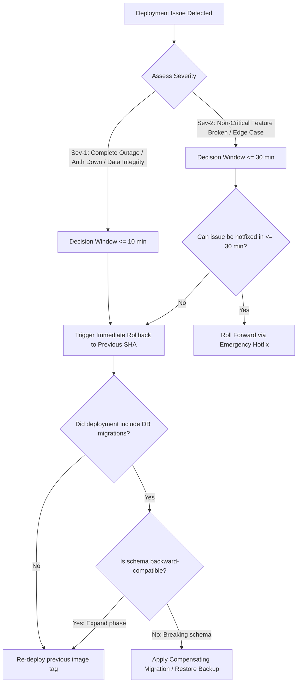

# HelloSmart.ai — Deployment, Rollback, and Operational Runbook

> **Audience:** Platform Engineers, DevOps, Site Reliability Engineers, and Engineering Leadership.  
> **Status:** Draft / Active Specification  
> **Authority:** In accordance with [AGENTS.md](../../AGENTS.md) §5 (System Architecture) & §8 (Invariants: BR-01, BR-08, BR-11, BR-13, BR-20, BR-22, BR-23, BR-31).  
> **Notice:** No production, staging, or QA cloud infrastructure was configured, modified, or connected to during the preparation of this runbook. All operational procedures have been derived through static analysis of the repository and verified local tests; all live cloud procedures are marked **NOT TESTED against real infrastructure**.

---

## 1. Purpose and Scope

This runbook defines the operational standards and procedures for releasing, verifying, troubleshooting, and rolling back HelloSmart.ai across all deployment environments:

1. **Local Development:** Multi-container developer stack powered by Docker Compose.
2. **CI Pipeline:** Automated lint, typecheck, build, and test gates on GitHub Actions.
3. **QA Environment:** Isolated single-host AWS EC2 instance running Docker Compose and Sysbox runtime.
4. **Staging Environment:** AWS ECS Fargate cluster in `ap-south-1` mirroring production _(documented from `deploy.yml` as intended design; not currently deployable)_.
5. **Production Environment:** Multi-tenant AWS ECS Fargate cluster with strict tenant isolation (BR-01) and gated release approvals _(documented from `deploy.yml` as intended design; not currently deployable)_.

Related security and environment specifications:

- Environment variable catalog and secret rules: `docs/security/environment-and-secrets.md` _(in review on separate branch `chore/env-secret-config`)_.
- GitHub Actions CI checks matrix: `docs/ci/ci-checks.md` _(in review on separate branch `ci/github-actions-checks`)_.

---

## 2. Status Summary: Verified vs Unconfirmed vs Missing

Every statement of fact in this document is grounded in verified repository artifacts. Anything not committed to `origin/dev` is explicitly categorized below:

| Area                              | Status                      | Verified in Repository                                                                                                                                         | UNCONFIRMED / Missing / Planned                                                                                                                                             |
| --------------------------------- | --------------------------- | -------------------------------------------------------------------------------------------------------------------------------------------------------------- | --------------------------------------------------------------------------------------------------------------------------------------------------------------------------- |
| **QA VPS Stack**                  | **PARTIALLY VERIFIED**      | `infra/qa-vps/docker-compose.qa.yml`, `Caddyfile`, `qa.sh`, `qa-archive.sh` exist and define the complete container topology.                                  | Remote deployment workflow (`infra/ci/github-workflows/deploy-qa.yml`) is uninstalled; Dockerfiles are missing.                                                             |
| **ECS Deployment Pipeline**       | **PLANNED / BLOCKED**       | `.github/workflows/deploy.yml` defines the target workflow structure for staging and prod.                                                                     | Missing Dockerfiles (`infra/docker/*.Dockerfile`) and deployment scripts (`infra/scripts/*.sh`). Documented from `deploy.yml` as intended design; not currently deployable. |
| **Database Migrations**           | **VERIFIED (FORWARD-ONLY)** | Custom migration engine in `apps/api/src/db/migrate.ts` applies migrations `0001` to `0009` from `packages/contracts/db/migrations/` using role `hs_migrator`. | **No rollback / down-migrations exist.** Migrations are forward-only.                                                                                                       |
| **Health Endpoints**              | **PARTIALLY VERIFIED**      | API liveness (`/api/v1/health`) and readiness (`/api/v1/health/ready`) verified in `apps/api/src/modules/health/`. Python service `/healthz` verified.         | `apps/web` has **no health endpoint**. `qa.sh:22` curls `/healthz` on API host which returns 404 (mismatch).                                                                |
| **Observability & Alarms**        | **MINIMAL**                 | CloudWatch log groups and Kinesis Firehose delivery alarm defined in Terraform (`infra/terraform/modules/observability/cloudwatch.tf:41`).                     | Defined in Terraform; not verified as applied in any AWS account. No alarms defined for application 5xx errors or crashes.                                                  |
| **GitHub Environments & Secrets** | **UNCONFIRMED**             | Repository-level query returned 0 secrets, 0 variables, and 0 environments.                                                                                    | GitHub environment protection rules, approval assignments, and OIDC IAM role ARNs are unconfigured.                                                                         |

---

## 3. Environments and Deploy Paths

```mermaid
flowchart TD
  subgraph Local["1. Local Development"]
    L_DC["docker-compose.yml"] --> L_DB["Postgres 16 + Redis 7 + LocalStack"]
    L_APP["pnpm dev (Turbo)"] --> L_SRV["apps/web (3000) + apps/api (4000)"]
  end

  subgraph CI["2. CI (GitHub Actions)"]
    CI_W["ci.yml"] --> CI_CHK["Quality + Typecheck + Build + Test + Tenancy"]
  end

  subgraph QA["3. QA Environment (AWS EC2)"]
    DEV_BR["Push to dev"] --> QA_W["deploy-qa.yml (Planned)"]
    QA_W -->|SSH| QA_SH["/srv/hellosmart/qa.sh deploy <sha>"]
    QA_SH --> QA_COMPOSE["docker-compose.qa.yml"]
    QA_COMPOSE --> QA_CADDY["Caddy (HTTPS + Basic Auth + IP Allowlist)"]
  end

  subgraph Staging["4. Staging (AWS ECS ap-south-1)"]
    MAIN_BR["Push to main"] --> DEP_STG["deploy.yml (Environment: staging)"]
    DEP_STG --> ECR_STG["Push Images to ECR"]
    DEP_STG --> MIG_STG["run-migrations.sh (Planned)"]
    DEP_STG --> ECS_STG["deploy-ecs.sh (Blue/Green Planned)"]
  end

  subgraph Production["5. Production (AWS ECS ap-south-1)"]
    MANUAL_DISP["Manual workflow_dispatch"] --> GATE_PROD["GitHub Environment 'prod' Approval"]
    GATE_PROD --> DEP_PROD["deploy.yml (Environment: prod)"]
    DEP_PROD --> ECR_PROD["Push Signed Images to ECR"]
    DEP_PROD --> MIG_PROD["run-migrations.sh (Planned)"]
    DEP_PROD --> ECS_PROD["deploy-ecs.sh (Blue/Green Planned)"]
  end
```



### 3.1 Environment Topology & Configuration Matrix

| Environment    | Hosting Infrastructure                                 | Deployment Trigger          | Deploy Mechanism                                 | Target Branch / Ref        | Approval Required?                           | Status / Deployability                                                    |
| -------------- | ------------------------------------------------------ | --------------------------- | ------------------------------------------------ | -------------------------- | -------------------------------------------- | ------------------------------------------------------------------------- |
| **Local**      | Developer workstation (Docker)                         | Manual CLI                  | `pnpm dev:up` + `pnpm dev`                       | Working branch             | None                                         | Verified functional locally                                               |
| **CI**         | GitHub-hosted Ubuntu 24.04                             | PR or Push                  | `.github/workflows/ci.yml`                       | `dev`, `main`, PR branches | None                                         | Blocked remotely by org billing limit                                     |
| **QA VPS**     | Dedicated AWS EC2 (`ap-south-1`, Ubuntu 24.04, Sysbox) | Push to `dev` or manual SSH | `qa.sh deploy <sha>` via `docker-compose.qa.yml` | `dev`                      | None (automated on merge)                    | Partially verified; Dockerfiles missing                                   |
| **Staging**    | AWS ECS Fargate (`ap-south-1`)                         | Push to `main`              | `.github/workflows/deploy.yml`                   | `main`                     | None (automatic on merge)                    | Documented from `deploy.yml` as intended design; not currently deployable |
| **Production** | AWS ECS Fargate (`ap-south-1`)                         | Manual `workflow_dispatch`  | `.github/workflows/deploy.yml`                   | `main` (pinned ref)        | **Yes** (GitHub `prod` environment approval) | Documented from `deploy.yml` as intended design; not currently deployable |

---

## 4. Roles and Approvals

| Role                       | Responsibilities                                                                                                      | Assigned Actor             | Authority Reference          |
| -------------------------- | --------------------------------------------------------------------------------------------------------------------- | -------------------------- | ---------------------------- |
| **Platform Lead**          | Authorizes production deployments, signs off on database migrations, and approves emergency rollbacks.                | Engineering Lead           | AGENTS.md §4.1               |
| **Releaser / On-Call**     | Executes deployment runbook, performs smoke testing, monitors logs, and triggers rollback if stop conditions are met. | Platform Engineer / DevOps | S0-T12                       |
| **QA Lead**                | Validates release candidate builds on QA VPS (`qa.hellosmart.ai`) during the Thursday–Friday sprint test window.      | QA Engineer                | `infra/qa-vps/README.md:3`   |
| **Database Administrator** | Reviews forward schema migrations, RLS access paths, and executes point-in-time restores if necessary.                | Platform / Database Owner  | `apps/api/src/db/migrate.ts` |

---

## 5. Pre-Deployment Checklist

Before initiating any deployment to QA, Staging, or Production, the releaser must verify each item:

- [ ] **1. CI Pipeline Status:**
  - The commit SHA to be deployed has passed all blocking checks: `pnpm typecheck`, `pnpm build`, `pnpm docs:sync-check`, `pnpm test`, and `pnpm test:tenancy`.
  - If remote GitHub Actions execution is blocked by the organization spending limit, local execution of all check commands has been verified and logged.
  - _Note:_ CI check names must be synced with `docs/ci/ci-checks.md` after the CI PR merges _(file is in review on separate branch `ci/github-actions-checks`)_.
- [ ] **2. Upstream Known Issues Acknowledged:**
  - Verified that any known non-blocking issues (e.g. `packages/contracts/openapi/openapi.yaml:174` indentation or missing `apps/web` ESLint config) do not impact runtime application behavior.
- [ ] **3. Database Migrations Reviewed:**
  - Checked `packages/contracts/db/migrations/` for new `.sql` files.
  - Confirmed all migrations follow the **expand-then-contract** pattern (no destructive `DROP COLUMN` or `DROP TABLE` without prior deprecation).
  - Confirmed forward-only execution plan; compensating SQL authored and reviewed in advance.
- [ ] **4. Target Environment Variables & Secrets Provisioned:**
  - Checked `docs/security/environment-and-secrets.md` _(in review on separate branch `chore/env-secret-config`)_ for newly introduced variables.
  - Confirmed that required secret values are provisioned in the target environment secret store (or `/srv/hellosmart/.env.qa` for QA) **before** deployment begins.
  - Verified that NO secrets are declared with the `NEXT_PUBLIC_` client prefix.
- [ ] **5. Release Artifact & Rollback Baseline Identified:**
  - Current release target commit SHA identified (e.g. `<target-sha>`).
  - Previous known-good commit SHA identified and recorded (e.g. `<rollback-sha>`).
- [ ] **6. Approver & Maintenance Window Confirmed:**
  - Release window agreed with the approver (cadence UNCONFIRMED, lead to decide; `deploy.yml:2` notes a Monday release comment, but exact cadence requires confirmation).
  - Authorized production approver is active and available.
  - Engineering team notified in deployment communications channel (`<team channel>`).

### Stop Conditions (When NOT to Deploy)

> [!CAUTION] > **ABORT DEPLOYMENT IMMEDIATELY IF ANY OF THE FOLLOWING OCCUR:**
>
> 1. Any blocking CI check fails (typecheck, build, test, tenancy isolation).
> 2. An unreviewed or non-backward-compatible database migration is included.
> 3. A newly required environment variable or secret has not been provisioned in the target environment.
> 4. The previous known-good version (`<rollback-sha>`) is unknown or cannot be identified.
> 5. Remote GitHub Actions runners are disabled/failing due to billing limits and local reproduction sign-off was not obtained.
> 6. The authorized production approver is unavailable.

---

## 6. Step-by-Step Deployment Procedures

### 6.1 Path A: QA VPS Deployment (`infra/qa-vps`)

The QA environment runs on an Ubuntu 24.04 AWS EC2 instance (`ap-south-1`) hardened via `infra/qa-vps/bootstrap.sh`.

#### Method 1: Automated Pipeline (Planned via `deploy-qa.yml`)

1. Developer merges PR into `dev` branch.
2. Workflow triggers `deploy-qa.yml` on GitHub Actions.
3. Matrix builds container images and pushes to `ghcr.io/infinitica-org/hs-<service>:<sha>`.
4. Trivy scans images for `HIGH,CRITICAL` vulnerabilities (`exit-code: 1`).
5. SSH task connects to QA host using secrets `QA_SSH_USER` and `QA_SSH_HOST` on port `vars.QA_SSH_PORT` (`2222`).
6. Executes `/srv/hellosmart/qa.sh deploy <sha>`.

#### Method 2: Manual / Emergency SSH Deployment

If the CI runner is unavailable, execute the deploy directly on the QA host:

```bash
# 1. Connect to the QA host as user deploy (key-based auth only)
ssh -p 2222 deploy@<qa-host>

# 2. Navigate to deployment directory
cd /srv/hellosmart

# 3. Verify current git SHA and configuration
grep "^TAG=" .env.qa

# 4. Execute deployment helper (pulls images, archives logs, migrates, restarts)
./qa.sh deploy <target-sha>

# 5. Verify exit status
echo $?  # Must return 0
```

#### What `qa.sh deploy` Executes Under the Hood (`infra/qa-vps/qa.sh:12-24`):

1. **Validates SHA:** Confirms `<target-sha>` matches hexadecimal pattern `^[0-9a-f]{7,40}$`.
2. **Updates Version:** Sets `TAG=<target-sha>` in `/srv/hellosmart/.env.qa`.
3. **Flushes Logs:** Executes `./qa-archive.sh` to archive active container logs prior to recreation, preventing log loss across releases (`infra/qa-vps/qa.sh:17`).
4. **Pulls Images:** Runs `docker compose -f docker-compose.qa.yml --env-file .env.qa pull`.
5. **Runs Migrations:** Executes one-off container command:
   ```bash
   docker compose -f docker-compose.qa.yml --env-file .env.qa run --rm api node dist/db/migrate.js
   ```
6. **Recreates Services:** Runs `docker compose -f docker-compose.qa.yml --env-file .env.qa up -d --remove-orphans`.
7. **Performs Smoke Probe:** Sleeps 10 seconds and probes the API health endpoint.

---

### 6.2 Path B: Staging & Production ECS Deployment (`.github/workflows/deploy.yml`)

> [!NOTE] > **Status:** Documented from `deploy.yml` as intended design; not currently deployable. Service Dockerfiles (`infra/docker/*.Dockerfile`) and deployment shell scripts (`infra/scripts/*.sh`) are uncommitted on `origin/dev`.

The production and staging deployment pipelines are designed to run via GitHub Actions `.github/workflows/deploy.yml` using AWS OIDC authentication (no long-lived credentials).

#### Step 1: Trigger Pipeline

- **Staging:** Push/merge to `main` branch triggers automatic build and deployment _(intended design)_.
- **Production:** In GitHub Actions, navigate to **deploy** workflow $\rightarrow$ click **Run workflow** $\rightarrow$ select `environment: prod` $\rightarrow$ click **Run workflow** _(intended design)_.

#### Step 2: Build, Scan, Sign, and Push Images (`deploy.yml:22-52`)

Runs on `ubuntu-24.04` matrix across all microservices:
`[web, api, worker, ai-proxy, reviewer, ws-gateway]`

1. **OIDC Auth:** Assumes `${{ vars.AWS_SHARED_CI_ROLE_ARN }}` in region `ap-south-1`.
2. **ECR Login:** Logs into Amazon ECR via `aws-actions/amazon-ecr-login@v2`.
3. **Docker Build:** _(Planned)_ Builds `infra/docker/${{ matrix.image }}.Dockerfile` tagged with git commit SHA:
   `$REG/hs-${{ matrix.image }}:${{ github.sha }}`
4. **Vulnerability Scan:** Runs Aquasecurity Trivy scanner (`severity: HIGH,CRITICAL`, `exit-code: 1`, `ignore-unfixed: true`).
5. **SBOM & Attestation:** Generates SPDX JSON SBOM via `syft`, cryptographically signs image via `cosign sign`, and creates in-toto attestation via `cosign attest`.

#### Step 3: Migration Execution (`deploy.yml:53-64`)

1. Workflow transitions to `migrate-and-deploy` job.
2. For `prod`, execution pauses until an authorized approver approves the **"prod"** environment gate.
3. Assumes deployment IAM role `${{ vars.AWS_DEPLOY_ROLE_ARN }}` in region `ap-south-1`.
4. Executes database migrations via one-off ECS Fargate task:
   ```bash
   ./infra/scripts/run-migrations.sh "${{ github.sha }}"
   ```
   - Connects using `DATABASE_MIGRATOR_URL` (database role `hs_migrator`).
   - Applies unapplied `.sql` scripts from `packages/contracts/db/migrations/` sequentially.
   - If migration fails, the task exits with code 1 and **halts deployment before containers update**.

#### Step 4: Blue/Green Service Update (`deploy.yml:65-68`)

1. Executes ECS Blue/Green deployment script _(planned)_:
   ```bash
   ./infra/scripts/deploy-ecs.sh "${{ github.sha }}"
   ```
2. Step is titled `blue/green deploy (ECS + CodeDeploy, auto-rollback on alarms)` in `deploy.yml:65`, but no CodeDeploy deployment group, AppSpec file, or ECS task definitions currently exist in version control.
3. Runs post-deployment verification script _(planned)_:
   ```bash
   ./infra/scripts/smoke.sh
   ```

---

## 7. Post-Deployment Smoke Tests

Once services are running, the releaser must execute the smoke test suite. All endpoints below represent verified application routes:

### Smoke Test Execution Matrix

| #     | Check                    | Target / Action                                                                                | Expected Result                                                               | Code Citation                                                                                                                   | Failure Diagnosis & Escalation                                                                                                                                                                 |
| ----- | ------------------------ | ---------------------------------------------------------------------------------------------- | ----------------------------------------------------------------------------- | ------------------------------------------------------------------------------------------------------------------------------- | ---------------------------------------------------------------------------------------------------------------------------------------------------------------------------------------------- |
| **1** | **API Liveness**         | `curl -fsS -i https://<api-host>/api/v1/health`                                                | HTTP 200 `{"status":"ok"}`                                                    | `apps/api/src/modules/health/health.controller.ts:14`                                                                           | API process crashed or failed Fastify bootstrap. Check ECS task / container logs. Escalation: Backend.                                                                                         |
| **2** | **API & DB Readiness**   | `curl -fsS -i https://<api-host>/api/v1/health/ready`                                          | HTTP 200 `{"status":"ok","checks":{"api":"ok","postgres":"ok","redis":"ok"}}` | `apps/api/src/modules/health/health.service.ts:27-55`                                                                           | PostgreSQL query (`SELECT 1`) or Redis ping failed (`status: degraded`). Check DB credentials & SG. Escalation: DevOps.                                                                        |
| **3** | **Web Home / SSR**       | `curl -fsS -I https://<app-host>/login`                                                        | HTTP 200 OK (with security headers)                                           | `apps/web/src/app/(auth)/login/page.tsx`<br>CSP: `apps/web/src/middleware.ts:28-36`<br>HSTS: `apps/web/src/middleware.ts:38-42` | Next.js Node.js process down or Caddy reverse proxy misconfigured. CSP and HSTS headers verified in `middleware.ts`. Escalation: Web.                                                          |
| **4** | **Synthetic Login**      | `POST https://<app-host>/api/auth/login`<br>`{"email":"<test-email>","password":"<test-pwd>"}` | HTTP 200 with session cookie (`hs_session` or `__Host-hs_session`)            | `apps/web/src/app/api/auth/login/route.ts:17`                                                                                   | Must use a dedicated test account for that environment. **Dev-login flags (`ENABLE_DEV_ACCOUNTS`, `ALLOW_DEV_LOGIN_BFF`) must NEVER be enabled to make this check pass.** Escalation: Backend. |
| **5** | **Session Verification** | `GET https://<api-host>/api/v1/auth/me`<br>`Cookie: hs_session=<token>`                        | HTTP 200 returning `{ id, email, role, org_id }`                              | `apps/api/src/modules/auth/auth.controller.ts`                                                                                  | Redis session store inaccessible or cookie signature key mismatch. Escalation: Backend.                                                                                                        |
| **6** | **AI Proxy Health**      | `curl -fsS -i https://<ai-proxy-host>/healthz`                                                 | HTTP 200 `{"status":"ok"}`                                                    | `services/ai-proxy/app/main.py:10`                                                                                              | Applies once service is deployable (Dockerfiles missing). FastAPI process failed or UV environment missing. Escalation: AI/Python.                                                             |
| **7** | **Reviewer Health**      | `curl -fsS -i https://<reviewer-host>/healthz`                                                 | HTTP 200 `{"status":"ok","reachable":true}`                                   | `services/reviewer/app/main.py:46`                                                                                              | Applies once service is deployable (Dockerfiles missing). Reviewer service down or LLM gateway circuit breaker open. Escalation: AI/Python.                                                    |
| **8** | **Error Log Watch**      | Monitor CloudWatch logs / `docker compose logs` for 15 minutes                                 | Zero unhandled rejections, zero 5xx error spikes                              | `apps/api/src/modules/observability/`                                                                                           | Application runtime exception spike. Prepare rollback if critical path affected.                                                                                                               |

---

## 8. Rollback Procedures

### 8.1 Rollback Decision Guide



### 8.2 Database Migration Reversibility Finding

> [!IMPORTANT] > **Database Migrations in this Repository are FORWARD-ONLY.**  
> An inspection of `packages/contracts/db/migrations/` and `apps/api/src/db/migrate.ts` confirms:
>
> - No `.down.sql` scripts exist in the repository.
> - `migrate.ts` contains only forward migration execution logic (`CREATE TABLE IF NOT EXISTS app.schema_migrations`).
> - **DO NOT ATTEMPT TO MANUALLY DROP COLUMNS OR SCHEMAS DURING A ROLLBACK.**
>
> **Safe Database Rollback Rules:**
>
> 1. **Backward-Compatible Schema (Expand Phase):** If the migration only added nullable columns, new tables, or new indexes, **leave the database as-is**. The previous application container version will simply ignore the new columns. Roll back application containers only.
> 2. **Breaking Schema Change:** If a breaking schema change was mistakenly applied, author a **new compensating forward migration** (e.g. `0010_revert_...sql`) and apply it using `hs_migrator`.
> 3. **Disaster Recovery (Snapshot Restore):** Point-in-time recovery (PITR) of AWS RDS PostgreSQL is a last resort and requires explicit approval from the Platform Lead and Database Owner, as all transactions committed after the snapshot will be lost.

### 8.3 Path A Rollback: QA VPS (`infra/qa-vps`)

_(Status: Mechanism defined in `qa.sh`; NOT TESTED against live remote host)_

To roll back the QA host to the previous known-good commit SHA:

```bash
# 1. Connect to QA host
ssh -p 2222 deploy@<qa-host>

# 2. Re-deploy the recorded previous good SHA
cd /srv/hellosmart
./qa.sh deploy <rollback-sha>

# 3. Confirm containers recreated with old image
docker compose -f docker-compose.qa.yml ps

# 4. Re-run post-deployment smoke tests
curl -fsS http://localhost:4000/api/v1/health
```

### 8.4 Path B Rollback: Staging & Production ECS

_(Status: PLANNED, UNCONFIRMED — deploy-ecs.sh and ECS definitions do not exist on origin/dev; NOT TESTED against live AWS ECS infrastructure)_

#### Method 1: Automated Traffic Reversion

_(PLANNED, UNCONFIRMED — deploy-ecs.sh and ECS definitions do not exist on origin/dev)_  
Step 65 of `deploy.yml` references `blue/green deploy (ECS + CodeDeploy, auto-rollback on alarms)`, but no AWS CodeDeploy configuration, AppSpec template, or target group alarm exists in the repository.

#### Method 2: Workflow Rollback by Ref

_(PLANNED, UNCONFIRMED — deploy-ecs.sh and ECS definitions do not exist on origin/dev)_  
**Current Limitation:** `.github/workflows/deploy.yml` currently accepts only a single input (`environment: [staging, prod]`); **no input exists for a specific commit SHA or image tag**. Therefore, direct rollback-by-SHA is not supported by the workflow inputs.  
**Ref-Based Execution:** To redeploy a previous version via GitHub Actions:

1. Ensure the previous known-good commit has a Git tag or branch pointing to it.
2. In GitHub Actions $\rightarrow$ **deploy** workflow $\rightarrow$ click **Run workflow**.
3. In the **"Use workflow from"** dropdown, select the Git tag or branch corresponding to `<rollback-sha>`.
4. Select `environment: prod` and trigger execution.

#### Method 3: Emergency AWS CLI Task Reversion

_(PLANNED, UNCONFIRMED — deploy-ecs.sh and ECS definitions do not exist on origin/dev)_  
If GitHub Actions is inaccessible or blocked by billing limits:

```bash
# Revert ECS service to previous task definition revision
aws ecs update-service \
  --cluster <cluster-name> \
  --service <service-name> \
  --task-definition <task-def-name>:<previous-revision> \
  --region <region>
```

---

## 9. Troubleshooting Failed Builds and Deployments

When a build or deployment fails, troubleshoot systematically in the following order:

### 9.1 Diagnostic Sequence

1. **GitHub Actions Workflow Page:** Identify which job (`security`, `quality`, `test`, `e2e`, `build`, `migrate-and-deploy`) failed. Expand the specific failing step.
2. **Organization Billing Blocker Check:** If the job failed within 4–8 seconds across all runners without running steps, check if the organization spending limit has been reached (`gh run list` shows immediate failure).
3. **Application Build Logs:** Check Turborepo cache outputs, frozen lockfile mismatches, or TypeScript compile errors (`tsc --noEmit`).
4. **Migration Logs:** Inspect output of `node dist/db/migrate.js` for SQL syntax errors, permission denial on `hs_migrator`, or transaction rollbacks.
5. **ECS / Docker Container Logs:** Inspect container runtime crashes (`Exit Code 1`, OOMKilled `Exit Code 137`, or missing environment variable validation errors from `apps/api/src/config/config.ts`).
6. **QA Host Container Logs:** Tail logs on the QA host using the helper script:
   ```bash
   ssh -p 2222 deploy@<qa-host> "cd /srv/hellosmart && ./qa.sh logs api"
   ```

### 9.2 Troubleshooting Matrix

| Symptom                                                   | Likely Cause                                                           | Investigation Location                        | Recommended First Action                                                           | Escalation Owner   |
| --------------------------------------------------------- | ---------------------------------------------------------------------- | --------------------------------------------- | ---------------------------------------------------------------------------------- | ------------------ |
| **All GitHub Actions runs fail in 4–8s**                  | Organization spending limit reached or billing payment failed          | GitHub Settings $\rightarrow$ Billing & plans | Organization owner to update payment method or increase Actions budget             | Engineering Lead   |
| **`pnpm install` fails in CI**                            | `pnpm-lock.yaml` out of date with `package.json`                       | CI `Install dependencies` step                | Run `pnpm install` locally and commit updated lockfile                             | Platform Engineer  |
| **`pnpm docs:sync-check` fails**                          | AIDLC doc drift: DB tables or OpenAPI routes added without doc updates | CI `Documentation synchronization check`      | Run `node scripts/aidlc-docs-check.mjs` locally; update Fumadocs markdown          | Developer / Author |
| **`pnpm db:migrate` fails: permission denied**            | Migration script attempting operation forbidden for `hs_migrator`      | Migration step output                         | Ensure migration DDL does not require superuser / `hs_owner` permissions           | Database Owner     |
| **API container fails to start: `Invalid configuration`** | Required environment variable missing or fails Zod schema validation   | Container startup logs                        | Check `apps/api/src/config/config.ts`; supply missing variable in secret store     | Backend Lead       |
| **API health check returns `status: degraded`**           | PostgreSQL pool connection timeout or Redis ping failure               | `GET /api/v1/health/ready`                    | Check DB host connectivity, security groups, and Redis authentication password     | DevOps / SRE       |
| **Trivy security scan fails in `build` job**              | High or Critical CVE detected in container base image or dependencies  | CI `scan image` step                          | Update base image in Dockerfile or patch vulnerable npm/pip dependency             | Security Lead      |
| **Traffic shifting rollback triggered automatically**     | CloudWatch alarm breached during deployment update                     | Deployment events                             | Inspect ECS green task logs for runtime exceptions; verify DB schema compatibility | Releaser / On-Call |

> [!WARNING] > **Log Safety Invariant:** Never copy raw container logs containing session tokens, cookie headers, or credential strings into Slack, Jira, or public tickets. Mask values before sharing.

---

## 10. Minimum Monitoring and Alerting Specification

### 10.1 Existing Observability in Repository

- `infra/terraform/modules/observability/cloudwatch.tf:14-25` declares CloudWatch Log Groups for microservices (`/aws/ecs/hellosmart-${service}-${env}`) with configurable retention (`retention_in_days`, default 7) and KMS encryption.
- `infra/terraform/modules/observability/cloudwatch.tf:41-59` declares `aws_cloudwatch_metric_alarm.firehose_delivery_errors` alerting on S3 delivery delays > 15 minutes _(defined in Terraform; not verified as applied in any AWS account)_.
- `infra/qa-vps/qa-archive.sh` handles host-level container log retention and archival.

### 10.2 Recommended Minimum Alerting Matrix

The following minimum alerts are recommended prior to general production traffic:

| Alert Name                        | Monitored Signal                             | Recommended Threshold (starting suggestion) | Alert Destination                                | Implementation Status                                                                                                       | Suggested Owner  |
| --------------------------------- | -------------------------------------------- | ------------------------------------------- | ------------------------------------------------ | --------------------------------------------------------------------------------------------------------------------------- | ---------------- |
| **1. Deployment Failure**         | GitHub Actions / CodeDeploy failure event    | 1 failure                                   | `<team channel>` + Email                         | **MISSING**                                                                                                                 | DevOps           |
| **2. Synthetic Availability**     | HTTP GET `/api/v1/health/ready`              | 2 consecutive failures (60s interval)       | `<on-call tool, UNCONFIRMED>`                    | **MISSING**                                                                                                                 | SRE / DevOps     |
| **3. API Error Rate (5xx)**       | CloudWatch `HTTPCode_Target_5XX_Count`       | $> 1\%$ of total requests over 5 min        | `<team channel>` + `<on-call tool, UNCONFIRMED>` | **MISSING**                                                                                                                 | Backend / DevOps |
| **4. Container Crash Loop**       | ECS `TaskStopCode` / Container restart count | $> 2$ restarts in 10 minutes                | `<team channel>`                                 | **MISSING**                                                                                                                 | DevOps           |
| **5. Database CPU / Connections** | RDS `CPUUtilization` & `DatabaseConnections` | CPU $> 80\%$ or Connections $> 80\%$ pool   | `<team channel>`                                 | **MISSING**                                                                                                                 | Database Owner   |
| **6. Redis Memory Exhaustion**    | ElastiCache `DatabaseMemoryUsagePercentage`  | $> 85\%$ memory usage                       | `<team channel>`                                 | **MISSING**                                                                                                                 | Backend / SRE    |
| **7. QA VPS Disk / Memory**       | Host root disk space & memory usage          | Disk $> 85\%$, Memory $> 90\%$              | Systemd alert / Email                            | **MISSING**                                                                                                                 | QA / DevOps      |
| **8. S3 Log Archive Delivery**    | CloudWatch `DeliveryToS3.DataFreshness`      | $> 900\text{ seconds}$ (15 min)             | SNS `alerts_topic_arn`                           | defined in Terraform (`infra/terraform/modules/observability/cloudwatch.tf:41`); not verified as applied in any AWS account | DevOps           |

---

## 11. Pending Infrastructure and Access Requirements

> [!IMPORTANT] > **No production infrastructure was configured or changed during this task.**  
> Everything listed below is required for end-to-end deployment readiness and requires formal approval and delivery by engineering leadership:

| Item                           | Component                                                      | Why Needed                                                                       | Current Status                             | Blocking                         | Suggested Owner   | Approval Needed?    |
| ------------------------------ | -------------------------------------------------------------- | -------------------------------------------------------------------------------- | ------------------------------------------ | -------------------------------- | ----------------- | ------------------- |
| **1. Service Dockerfiles**     | `infra/docker/*.Dockerfile`                                    | Needed by `deploy.yml:37` and `deploy-qa.yml:31` to build container images       | **MISSING** on `origin/dev`                | CI build & ECS deployments       | DevOps / Platform | Yes                 |
| **2. Deployment Scripts**      | `infra/scripts/run-migrations.sh`, `deploy-ecs.sh`, `smoke.sh` | Needed by `deploy.yml:64-68` to execute migrations and Blue/Green ECS deployment | **MISSING** on `origin/dev`                | Staging/Prod deployment workflow | DevOps / Platform | Yes                 |
| **3. GitHub Actions Billing**  | GitHub Organization Settings                                   | Remote runners fail immediately across all workflows                             | **VERIFIED BLOCKER** (runs fail in 4–8s)   | Remote CI & automated deployment | Engineering Lead  | Yes (Billing)       |
| **4. GitHub OIDC Roles**       | `vars.AWS_SHARED_CI_ROLE_ARN`, `vars.AWS_DEPLOY_ROLE_ARN`      | Needed for passwordless AWS authentication from GitHub Actions                   | **MISSING** (0 variables found)            | Remote ECR push & ECS deploy     | DevOps / Lead     | Yes                 |
| **5. GitHub Environments**     | `qa`, `staging`, `prod`                                        | Needed for environment protection rules and secret separation                    | **MISSING** (0 environments found via API) | Manual production release gate   | Engineering Lead  | Yes                 |
| **6. Production Secret Store** | AWS Secrets Manager / Parameter Store                          | Runtime secret injection for API, Redis, and database credentials                | **UNCONFIRMED** (No Terraform/ECS config)  | Production container launch      | Platform Lead     | Yes                 |
| **7. Missing Worker Service**  | `services/worker`                                              | Referenced in `deploy.yml:26` build matrix, but no service directory exists      | **MISSING** in `services/`                 | Deploy matrix build step         | Backend Lead      | Yes                 |
| **8. Missing Gateway Code**    | `services/ws-gateway`                                          | Only `CLAUDE.md` exists in `services/ws-gateway`                                 | **MISSING IMPLEMENTATION**                 | Candidate workspace proxy        | Platform Lead     | Yes                 |
| **9. QA Smoke Path Mismatch**  | `infra/qa-vps/qa.sh:22`                                        | Curles `/healthz` on API host, but `apps/api` only exposes `/api/v1/health`      | **DEFECT** (will fail smoke test)          | QA deployment verification       | DevOps / Backend  | No (Bug fix)        |
| **10. Web Health Endpoint**    | `apps/web`                                                     | No HTTP health route exists to verify web container readiness                    | **MISSING** in `apps/web`                  | ALB health check for frontend    | Frontend / Web    | No (Standard route) |

---

## 12. Open Decisions for Engineering Lead

1. **Approved Hosting Model:**  
   Confirm which hosting setup is formally approved for the HelloSmart.ai platform: QA VPS only (`infra/qa-vps`), AWS ECS Fargate (`.github/workflows/deploy.yml`), or both in a staged rollout.
2. **Dockerfiles & Deployment Scripts Authoring:**  
   Confirm priority and assignment for authoring the 6 missing Dockerfiles (`infra/docker/*.Dockerfile`) and 3 deployment shell scripts (`infra/scripts/run-migrations.sh`, `deploy-ecs.sh`, `smoke.sh`).
3. **Organization Billing Resolution:**  
   Authorize upgrading or funding GitHub Actions spending limits to re-enable remote CI runner execution.
4. **Production Secret Store Architecture:**  
   Decide between AWS Secrets Manager and SSM Parameter Store for staging and production runtime secret injection.
5. **Production Release Cadence & Approvers:**  
   Confirm the target production release window cadence and designate primary and backup approvers for the GitHub `"prod"` environment.
6. **Workflow Dispatch Rollback Input:**  
   Approve adding a `ref` input to `.github/workflows/deploy.yml` so that emergency rollbacks can target a specific git commit SHA or tag directly.
7. **Worker Service Scope:**  
   Clarify whether `services/worker` will be introduced in Sprint 1 or if it should be temporarily removed from the `deploy.yml` matrix.
8. **Health Endpoint Alignment:**  
   Approve fixing `qa.sh:22` to curl `/api/v1/health` instead of `/healthz`, and adding a lightweight `/api/health` route in `apps/web`.

---

## 13. Revision Notes

- **Date:** October 30, 2026
- **Author:** Platform Engineering & AI Pair Programmer
- **Branch:** `docs/deployment-runbook`
- **Base Commit:** `da85d95cfcc576f8ca394959fc5176e7e4c8246f` (`origin/dev`)
- **Verification Methodology:**
  - Inspected all GitHub Actions workflows in `.github/workflows/` and `infra/ci/github-workflows/`.
  - Analyzed QA VPS deployment scripts and Compose definitions in `infra/qa-vps/`.
  - Analyzed Terraform modules in `infra/terraform/modules/`.
  - Verified custom migration runner in `apps/api/src/db/migrate.ts`.
  - Verified health and readiness routes in `apps/api/src/modules/health/health.controller.ts:13-23` and `health.service.ts:27-55`.
  - Verified security headers in `apps/web/src/middleware.ts:28-42` (nonce-based CSP and production HSTS) and `infra/qa-vps/Caddyfile:9`.
  - Queried repository configuration read-only via GitHub CLI (`gh workflow list`, `gh run list`, `gh secret list`, `gh variable list`, `gh api`).
  - **Not tested against any live remote host or cloud environment.**
