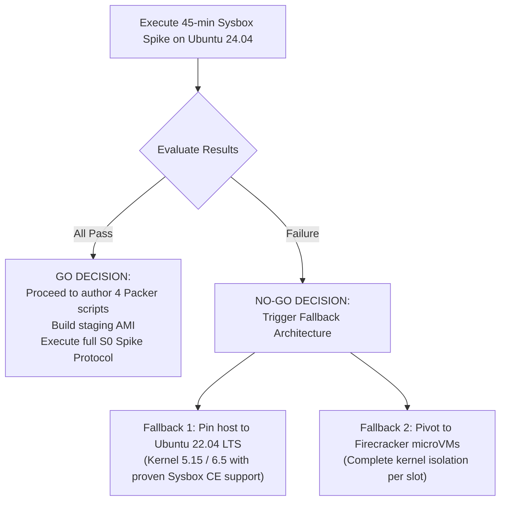

# HelloSmart.ai — Sprint 0: Workspace Feasibility & Sizing Investigation Plan

> **Document ID:** S0-WFP-001 (Rev 2)  
> **Author:** Vishal Bharath (SDE-1), AI-assisted derivation  
> **Date:** 2026-10-23  
> **Scope:** Four concurrent Sysbox candidate workspaces on a single `m7i.2xlarge` host — feasibility, sizing, isolation boundaries, security risks, minimal compatibility spike, and full spike-test protocol  
> **Related ADR:** `docs/adr/0003-shared-host-sysbox-workspaces.md`  
> **Related IaC:** `infra/terraform/modules/workspace-hosts/main.tf`, `infra/packer/ws-host.pkr.hcl`  

---

> [!CAUTION]
> **Feasibility Verdict (Sprint 0 Baseline):**
> 1. **Capacity Status:** Four concurrent medium workspaces on `m7i.2xlarge` is an **UNPROVEN HYPOTHESIS**. While mathematically balanced on paper, it operates at **zero slack** (0 GB RAM headroom, 0 vCPU headroom at simultaneous peak). It must not be considered viable until empirically verified under synthetic test loads.
> 2. **Perimeter vs. Intra-Host Isolation:** Configured AWS controls (IMDSv2 `hop_limit=1`, AWS Organization SCPs, Security Groups) protect the **AWS account and cloud perimeter**. They provide **zero inter-container isolation**. Lateral movement prevention, memory boundaries, and container escape protections rely entirely on Linux kernel primitives (user namespaces, cgroups v2, nftables) that are currently **unconfigured and untested**.
> 3. **Critical Implementation Blocker:** The four Packer provisioner scripts (`01-harden.sh`, `02-docker.sh`, `03-sysbox.sh`, `04-slot-runtime.sh`) do not exist. To prevent wasted effort, a **minimal disposable Sysbox compatibility spike** on Ubuntu 24.04 (Linux kernel 6.8) must precede authoring these scripts.

---

## 0. Executive Summary

| Dimension | Architectural Proposal | Current Repository Status | Risk Level |
|---|---|---|---|
| **Host Instance** | `m7i.2xlarge` — 8 vCPU, 32 GB RAM, 200 GB gp3 root | Implemented in Terraform (`variables.tf`) | Low |
| **Concurrency** | 4 concurrent medium workspaces per host | **Unproven Hypothesis** (Zero-slack sizing) | High |
| **Memory Allocation** | 4 slots × 6 GB hard limit + 8 GB reserved = 32 GB | Proposed (No cgroup limits configured) | High |
| **CPU Allocation** | 4 slots × 1.5 vCPU (`cpu.max`) + 2.0 vCPU reserved = 8 vCPU | Proposed (CFS quota unconfigured) | Medium |
| **Disk Allocation** | 4 slots × 25 GB quota + 100 GB OS/image reserve = 200 GB | Proposed (Backing filesystem quota unconfigured) | High |
| **Cloud Perimeter & IAM** | IMDSv2 `hop_limit=1`, SCP data deny, SG ports 20000–29999 | **Implemented & Configured in IaC** | Low |
| **Intra-Host Isolation** | Sysbox user-ns, cgroup v2, nftables inter-slot DROP | **Unconfigured & Untested** (No runtime code) | High |
| **Sysbox on Ubuntu 24.04** | Sysbox CE compatibility with kernel 6.8 | **Unverified** (Requires fast disposable spike) | Critical |
| **Packer Automation** | Automated golden AMI build | **Partially Implemented** (HCL exists; 4 scripts missing) | High |

---

## 1. Host Resource Budget & Sizing Analysis

### 1.1 Host Specification

| Parameter | Value | Source |
|---|---|---|
| Instance Type | `m7i.2xlarge` | `infra/terraform/modules/workspace-hosts/variables.tf` |
| vCPUs | 8 physical/logical vCPUs (Intel Xeon Platinum 8488C) | AWS EC2 Specification |
| Physical RAM | 32.0 GiB (approx. 31.4 GiB usable by Linux kernel) | AWS EC2 Specification |
| Root Storage | 200 GB gp3 EBS (3,000 IOPS, 125 MB/s baseline, encrypted) | `infra/terraform/modules/workspace-hosts/main.tf` L27 |
| Network Bandwidth | Up to 12.5 Gbps burst | AWS EC2 Specification |
| EBS Bandwidth | Up to 10 Gbps dedicated | AWS EC2 Specification |

> [!NOTE]
> `infra/packer/ws-host.pkr.hcl` specifies an `m7i.xlarge` (4 vCPU, 16 GB) as the AMI build instance. This is appropriate for Packer compilation, but runtime deployment uses `m7i.2xlarge`.

---

### 1.2 Hard Limits vs. Reserved Host Capacity

To prevent total host lockup or kernel panic, resource management must strictly distinguish between **Container Hard Limits** (enforced by cgroup v2 and filesystem quotas) and **Host Reserved Capacity** (unallocated buffer for kernel and system daemons).

| Resource Dimension | Slot 0 (Hard Limit) | Slot 1 (Hard Limit) | Slot 2 (Hard Limit) | Slot 3 (Hard Limit) | Combined Slot Total | Host Reserved Capacity | Total Available | Net Unallocated Slack |
|---|---|---|---|---|---|---|---|---|
| **RAM (GiB)** | 6.0 GiB | 6.0 GiB | 6.0 GiB | 6.0 GiB | **24.0 GiB** | **8.0 GiB** | 32.0 GiB | **0.0 GiB** |
| **vCPU (Quota)** | 1.5 vCPU | 1.5 vCPU | 1.5 vCPU | 1.5 vCPU | **6.0 vCPU** | **2.0 vCPU** | 8.0 vCPU | **0.0 vCPU** |
| **Disk Space** | 25.0 GB | 25.0 GB | 25.0 GB | 25.0 GB | **100.0 GB** | **100.0 GB** | 200.0 GB | **0.0 GB** |
| **Port Range** | 20000–22499 | 22500–24999 | 25000–27499 | 27500–29999 | **10,000 ports** | System (<20000) | 65,535 ports | High |

#### Breakdown of 8.0 GiB Host Reserved Memory:
1. **Ubuntu 24.04 Kernel & Core System:** ~1.5 GiB (systemd, udevd, journald, sshd, rsyslog).
2. **Container Engine & Runtimes:** ~1.2 GiB (Docker daemon `dockerd`, `containerd`, Sysbox daemons `sysbox-mgr` and `sysbox-fs`).
3. **Workspace Agent (`ws-agent`):** ~0.5 GiB (host-level monitoring, session metrics, autosave supervisor).
4. **Kernel Page Cache & Buffer Headroom:** ~2.5 GiB (essential for smooth filesystem I/O without page-reclaim stalls).
5. **Dynamic Burst Buffer:** ~2.3 GiB (safety buffer against kernel slab allocations and socket buffers).

---

### 1.3 CPU Enforcement Mechanism: `cpu.max` vs. `cpu.weight`

Enforcing CPU boundaries in cgroup v2 requires choosing between strict rate limiting and work-conserving sharing:

1. **CFS Hard Bandwidth Ceiling (`cpu.max`):**
   - **Configuration:** Set `cpu.max = "150000 100000"` (150ms quota per 100ms period $\equiv$ 1.5 vCPUs).
   - **Behavior:** Once a container consumes 150ms of CPU time within a 100ms wall-clock window, all threads in that container are suspended until the next period.
   - **Trade-off:** Completely eliminates noisy-neighbor CPU starvation. However, candidate processes running compilation (e.g. `npm run build`, `cargo test`) will experience strict execution latency even if the other 3 slots are idle.
2. **Proportional Fair-Share (`cpu.weight`):**
   - **Configuration:** Set `cpu.weight = 100` across all slots.
   - **Behavior:** Work-conserving; slots can burst to 100% of host CPU if peers are dormant. If peers become active, CPU is divided proportionally.
   - **Trade-off:** In an assessment environment, burstable sharing introduces unpredictable execution timings between candidates, potentially distorting assessment benchmarks.
3. **Recommended Enforcement Policy:**
   - Enforce hard ceiling via `cpu.max = "150000 100000"` (1.5 vCPUs baseline) with an optional burst headroom ceiling (`cpu.max = "200000 100000"` / 2.0 vCPUs) tested during the feasibility spike.
   - The host system reserve of **2.0 vCPUs** ensures that `ws-agent`, Docker, Sysbox, and kernel packet processing never stall.

---

### 1.4 Disk Quota Enforcement Mechanism & Filesystem Requirements

Setting `--storage-opt size=25g` on Docker container creation **silently fails or throws fatal runtime errors** unless the backing host filesystem is explicitly configured for project quotas.

1. **Backing Filesystem Requirement:**
   - **XFS (Recommended):** The EBS root or dedicated workspace partition must be formatted with XFS and mounted with the `pquota` (or `prjquota`) mount flag in `/etc/fstab`.
   - **ext4 Alternative:** If ext4 is used, the filesystem must have the project feature enabled via `tune2fs -O project /dev/xvda1` and mounted with `-o prjquota`.
2. **Rootfs vs. Persistent Volume Storage:**
   - **Container Rootfs:** The 25 GB limit restricts writes to the container's overlay2 writable layer (`/tmp`, `/var`, root directory).
   - **Bind Mounts & Named Volumes:** Candidate working directories (e.g. `/workspace`) are typically mounted as volumes. **Docker's `--storage-opt size` does NOT restrict bind-mounted host directories by default.**
   - **Required Mitigation:** The workspace directory `/workspace` must either:
     - Reside on a project-quota-managed tree (`xfs_quota -x -c 'project -s -p /var/lib/hellosmart/slots/0 1000'`), or
     - Mount a dedicated 25 GB loopback image or sparse block device formatted with ext4 per slot.

---

### 1.5 Concurrency Assessment: Why 4 Workspaces is an "Unproven Hypothesis"

> [!WARNING]
> Hosting four concurrent medium workspaces on an `m7i.2xlarge` is an **unverified design hypothesis**.

1. **Zero-Slack Vulnerability:** If 4 candidates simultaneously trigger full compilation, language-server indexers, and unit test suites:
   - Peak memory demand: $4 \times 5.8\text{ GiB} = 23.2\text{ GiB}$.
   - If kernel page cache is compressed below 1.5 GiB, the Linux kernel enters direct page reclaim, triggering massive latency spikes and potential OOM invocations.
2. **Explicit Fallback Strategies (If S0 Spike Fails):**
   - **Fallback Option A (Reduced Density):** Reduce density to **2 or 3 workspaces per `m7i.2xlarge`** (e.g. 3 slots $\times$ 7 GiB = 21 GiB, leaving 11 GiB host buffer).
   - **Fallback Option B (Vertical Upscale):** Upgrade the host instance type to **`m7i.4xlarge`** (16 vCPU, 64 GB RAM, 500 GB gp3 root). This allows 4 workspaces to run with generous headroom (12 GB RAM / 3 vCPU per slot + 16 GB host buffer), eliminating contention risks at modest incremental cost.

---

## 2. Security Architecture: Configured vs. Untested Controls

> [!IMPORTANT]
> **Strict Verification Boundary:** Security controls must not be conflated. Cloud-level perimeter protections do not provide intra-host container isolation.

### 2.1 Security Control Verification Classification

```
┌─────────────────────────────────────────────────────────────────────────────┐
│                        AWS CLUSTER & ACCOUNT BOUNDARY                       │
│                                                                             │
│  [CONFIGURED & VERIFIED IN IAC]                                             │
│  • AWS Organization SCPs: Blocks access to RDS, S3 prod, Secrets Manager    │
│  • Security Group: Ingress restricted to ports 20000-29999 from Gateway SG  │
│  • AWS Budget Alert: $3,000/month threshold trigger                         │
│                                                                             │
│  ┌───────────────────────────────────────────────────────────────────────┐  │
│  │                          EC2 HOST BOUNDARY                            │  │
│  │                                                                       │  │
│  │  [CONFIGURED IN IAC]                                                  │  │
│  │  • IMDSv2 enforced: http_tokens=required, hop_limit=1                 │  │
│  │                                                                       │  │
│  │  [UNCONFIGURED / UNTESTED RUNTIME CONTROLS]                           │  │
│  │  • Host OS Hardening (fail2ban, auditd, sysctl) -> Missing script     │  │
│  │  • nftables Inter-Slot DROP Rules               -> Missing config     │  │
│  │  • XFS/ext4 Project Disk Quotas                 -> Missing config     │  │
│  │                                                                       │  │
│  │  ┌───────────────────────┐             ┌───────────────────────┐      │  │
│  │  │   WORKSPACE SLOT 0    │   BLOCKED   │   WORKSPACE SLOT 1    │      │  │
│  │  │  [UNTESTED RUNTIME]   │ < - - - - > │  [UNTESTED RUNTIME]   │      │  │
│  │  │  • Sysbox user-ns     │  (nftables  │  • Sysbox user-ns     │      │  │
│  │  │  • cgroup v2 limits   │   untested) │  • cgroup v2 limits   │      │  │
│  │  └───────────────────────┘             └───────────────────────┘      │  │
│  └───────────────────────────────────────────────────────────────────────┘  │
└─────────────────────────────────────────────────────────────────────────────┘
```

| Security Layer | Specific Mechanism | Current Status | What It Protects | What It DOES NOT Protect |
|---|---|---|---|---|
| **AWS Perimeter** | Security Group: Ingress ports 20000–29999 from ws-gateway only | **Configured in IaC** (`main.tf`) | Blocks direct internet ingress to workspace ports | Does not prevent lateral traffic between slots on the same host |
| **AWS IAM / Secrets** | SCP data-services-deny | **Configured in IaC** (`scps.tf`) | Blocks workspace AWS account from accessing production databases/buckets | Does not isolate candidate workspaces from each other |
| **AWS Metadata** | IMDSv2 with `http_put_response_hop_limit = 1` | **Configured in IaC** (`main.tf`) | Prevents container from obtaining host EC2 IAM credentials | Does not prevent local container escape or memory exhaustion |
| **Kernel Containment** | Sysbox CE rootless user-ns remapping | **Proposed (Untested)** | Maps container root (UID 0) to unprivileged host UID (prevents host root takeover) | Untested on Ubuntu 24.04 / Linux kernel 6.8 |
| **Resource Isolation** | cgroup v2 `memory.max`, `cpu.max` | **Proposed (Untested)** | Prevents one slot from crashing or starving other slots | Missing configuration in runtime scripts |
| **Network Boundary** | nftables inter-slot DROP rules | **Proposed (Untested)** | Drops packets between slot port ranges to prevent local network scanning | No rules configured or authored |
| **Storage Boundary** | XFS/ext4 project quotas | **Proposed (Untested)** | Prevents one candidate from filling the host root volume | Backing filesystem not yet formatted with `pquota` |

---

## 3. Security Risk Register

| Risk ID | Threat Scenario | Impact | Mitigation Mechanism | Implementation Status |
|---|---|---|---|---|
| **R-01** | **Container Escape to Host:** Candidate exploits kernel vulnerability to escape container. | Critical | Sysbox user-ns remapping (container UID 0 = unprivileged host UID); seccomp profile. | **Proposed** (Sysbox not yet installed) |
| **R-02** | **Inter-Slot Lateral Movement:** Container 0 probes Container 1 via host network bridge. | High | Host nftables packet filter explicitly dropping inter-slot traffic; isolated netns. | **Proposed** (No nftables rules configured) |
| **R-03** | **EC2 Credential Theft:** Container queries `169.254.169.254` to steal instance role credentials. | Critical | IMDSv2 enforced with `hop_limit=1`. Container packets (TTL decrement) are dropped. | **Configured in IaC** (`main.tf`) |
| **R-04** | **Production Data Compromise:** Compromised host queries RDS or S3. | Critical | AWS Organization SCPs block data service API calls from the workspace account. | **Configured in IaC** (`scps.tf`) |
| **R-05** | **Memory Exhaustion (OOM):** Candidate launches memory stress (`fork bomb`) crashing the host. | High | cgroup v2 `memory.max = 6G` and `memory.swap.max = 0`. OOM killer targets container only. | **Proposed** (Requires `04-slot-runtime.sh`) |
| **R-06** | **CPU Starvation:** Infinite compilation loop consumes 100% CPU, starving peers. | Medium | cgroup v2 `cpu.max = "150000 100000"` (1.5 vCPUs). CFS forcibly throttles candidate. | **Proposed** (Requires `04-slot-runtime.sh`) |
| **R-07** | **Disk Exhaustion:** Candidate writes 100 GB of temporary files, exhausting host disk. | High | XFS project quota (`prjquota`) limiting overlay2 and `/workspace` to 25 GB. | **Proposed** (Requires filesystem config) |
| **R-08** | **AI Domain Egress Bypass:** Candidate bypasses domain block when AI is OFF (BR-14). | Medium | nftables DNS/IP allowlist proxying; default DROP on non-allowlisted outbound traffic. | **Proposed** (Requires network config) |
| **R-09** | **Session Hijacking / Port Overlap:** Port collision connects candidate A to candidate B's slot. | High | Strict 2,500-port block allocation per slot managed by `ws-agent`; gateway TLS routing. | **Proposed** (Port allocator not built) |
| **R-10** | **Sysbox Incompatibility with Kernel 6.8:** Sysbox fails to load on Ubuntu 24.04 LTS. | Critical | Pre-flight disposable compatibility spike before writing Packer scripts. | **Unresolved** (Subject of §4 spike) |

---

## 4. Minimal Disposable Sysbox Compatibility Spike (Pre-Packer)

> [!IMPORTANT]
> **Pre-Packer Gate:** Do NOT write the four Packer shell scripts (~4.5 engineering days) until this **45-minute disposable spike** confirms Sysbox CE functions on Ubuntu 24.04 LTS (Linux 6.8 kernel).

### 4.1 Spike Objectives
1. Verify that Sysbox CE installs cleanly on an official Ubuntu 24.04 AMI.
2. Confirm that systemd inside a Sysbox unprivileged container boots successfully.
3. Confirm that nested Docker (Docker-in-Docker) runs inside the Sysbox container without host privilege escalation.
4. Verify whether kernel 6.8 idmapped mounts work without throwing AppArmor or shiftfs errors.

### 4.2 Disposable Spike Procedure (Run via SSM / SSH)

```bash
#!/usr/bin/env bash
# Step 1: Launch a temporary, disposable EC2 instance (e.g. t3.xlarge or m7i.large)
# AMI: Ubuntu 24.04 LTS Noble Numbat (ami-04b70fa74e45c3917 or latest)

set -euo pipefail

echo "=== STEP 1: Verify Host Kernel & cgroups ==="
uname -r
# Expected: 6.8.0-xx-generic
cat /sys/fs/cgroup/cgroup.controllers
# Expected: must include 'cpu memory io pids'

echo "=== STEP 2: Install Docker Engine ==="
sudo apt-get update -y
sudo apt-get install -y ca-certificates curl gnupg
sudo install -m 0755 -d /etc/apt/keyrings
curl -fsSL https://download.docker.com/linux/ubuntu/gpg | sudo gpg --dearmor -o /etc/apt/keyrings/docker.gpg
sudo chmod a+r /etc/apt/keyrings/docker.gpg

echo \
  "deb [arch=$(dpkg --print-architecture) signed-by=/etc/apt/keyrings/docker.gpg] https://download.docker.com/linux/ubuntu \
  $(. /etc/os-release && echo "$VERSION_CODENAME") stable" | \
  sudo tee /etc/apt/sources.list.d/docker.list > /dev/null

sudo apt-get update -y
sudo apt-get install -y docker-ce docker-ce-cli containerd.io

echo "=== STEP 3: Install Sysbox CE ==="
# Download latest Sysbox CE release package
SYSBOX_VERSION="v0.6.4" # Or latest verified tag
curl -LO "https://github.com/nestybox/sysbox/releases/download/${SYSBOX_VERSION}/sysbox-ce_${SYSBOX_VERSION#v}-0.ubuntu-jammy_amd64.deb" \
  || curl -LO "https://github.com/nestybox/sysbox/releases/download/${SYSBOX_VERSION}/sysbox-ce_${SYSBOX_VERSION#v}-0.linux_amd64.deb"

# Note: Check if Noble (.deb) is provided, else test standard linux binary
sudo apt-get install -y ./sysbox-ce*.deb || sudo dpkg -i --force-depends ./sysbox-ce*.deb

sudo systemctl restart docker
docker info | grep -i runtime
# Expected: 'sysbox-runc' listed as an available OCI runtime

echo "=== STEP 4: Run Nested Docker in Unprivileged Sysbox Container ==="
# Test unprivileged systemd container
docker run --runtime=sysbox-runc -d --name sysbox-test-systemd \
  nestybox/ubuntu-noble-systemd-docker || docker run --runtime=sysbox-runc -d --name sysbox-test-systemd ubuntu:24.04 sleep 60

# Test inner Docker engine
docker run --runtime=sysbox-runc --rm docker:dind-rootless docker --version

echo "=== STEP 5: Inspect Kernel Logs for Shiftfs / AppArmor Errors ==="
sudo journalctl -u sysbox -n 50 --no-pager
sudo dmesg | grep -iE "sysbox|apparmor|shiftfs|idmap" | tail -n 30

echo "=== SPIKE TEST COMPLETE: Terminate this instance immediately ==="
```

---

## 5. Explicit Go / No-Go Decision Gate

Before authorizing Sprint 1 tasks (Packer scripts, AMI generation, orchestrator wiring), evaluate the spike against these criteria:



### Go Criteria (All Must Pass):
- [ ] Sysbox CE package installs and systemd service `sysbox` enters `active (running)` state.
- [ ] `docker info` confirms `sysbox-runc` is registered and functional.
- [ ] An unprivileged container runs an inner Docker daemon without requiring `--privileged` on the host.
- [ ] No kernel panics, AppArmor denials, or fatal idmapped mount failures recorded in `dmesg`.

### No-Go Trigger & Remediation:
- **Trigger:** Sysbox fails to load on Linux 6.8 (e.g. shiftfs incompatibility, missing kernel symbols, or AppArmor blocking user namespaces).
- **Remediation Action (Choose before writing Packer code):**
  1. **Option A (Low Risk):** Downgrade host OS to **Ubuntu 22.04 LTS** (Linux 5.15 / 6.5 HWE kernel), where Sysbox CE is officially supported and battle-tested.
  2. **Option B (High Isolation):** Pivot from Sysbox containers to **Firecracker microVMs** on bare metal or `.metal` instances (provides a dedicated guest Linux kernel per candidate slot).

---

## 6. Comprehensive 4-Slot Spike Test Protocol

*(To be executed on a dedicated staging `m7i.2xlarge` instance AFTER the disposable spike achieves a GO decision and the Packer scripts are authored).*

### Test 0: Pre-Flight Environment Sanity
```bash
# Verify IMDSv2 is enforced on host
TOKEN=$(curl -s -X PUT "http://169.254.169.254/latest/api/token" -H "X-aws-ec2-metadata-token-ttl-seconds: 21600")
curl -s -H "X-aws-ec2-metadata-token: $TOKEN" http://169.254.169.254/latest/meta-data/instance-id

# Verify cgroups v2 hierarchy
cat /sys/fs/cgroup/cgroup.controllers | grep -E "cpu.*memory.*io.*pids"
```
*Acceptance:* Token returned; all four cgroup v2 controllers active.

### Test 1: Launch 4 Isolated Slots
```bash
for i in 0 1 2 3; do
  PORT_BASE=$((20000 + i * 2500))
  docker run -d \
    --name "candidate-ws-${i}" \
    --runtime=sysbox-runc \
    --memory=6g \
    --memory-swap=6g \
    --cpus=1.5 \
    --storage-opt size=25g \
    --network=bridge \
    -p "${PORT_BASE}:22" \
    ubuntu:24.04 \
    sleep infinity
done
```
*Acceptance:* All 4 containers enter `Up` state within 30 seconds; 0 allocation errors.

### Test 2: Memory Isolation & OOM Containment
```bash
# Stress Slot 0 beyond its 6.0 GiB limit
docker exec candidate-ws-0 bash -c "apt-get update && apt-get install -y stress-ng && stress-ng --vm 1 --vm-bytes 6200m --timeout 30s"
# Verify Slot 0 is OOM-killed while Slots 1-3 remain unaffected
docker inspect candidate-ws-0 --format '{{.State.OOMKilled}}'
docker ps --filter "name=candidate-ws-[123]" --format '{{.Names}}: {{.Status}}'
```
*Acceptance:* Slot 0 OOMKilled = `true`; Slots 1, 2, 3 remain `Up`; host free memory $\ge 3.0\text{ GiB}$.

### Test 3: CPU Hard Quota Throttling
```bash
# Stress Slot 0 with 4 CPU threads (allocated 1.5 vCPU)
docker exec -d candidate-ws-0 bash -c "stress-ng --cpu 4 --timeout 60s"
docker stats --no-stream --format "table {{.Name}}\t{{.CPUPerc}}"
```
*Acceptance:* Slot 0 CPU% stays bounded at $\le 19.5\%$ of 8 vCPUs ($\approx 1.56\text{ vCPUs}$); Slots 1–3 experience zero thread starvation.

### Test 4: Filesystem Quota Enforcement
```bash
# Write 26 GB into Slot 0 (25 GB quota)
docker exec candidate-ws-0 bash -c "dd if=/dev/zero of=/tmp/overflow.bin bs=1M count=26000 2>&1" || true
df -h /
```
*Acceptance:* Write aborts with `No space left on device` at $\approx 25\text{ GB}$; host root filesystem remains healthy.

### Test 5: Inter-Slot Network Isolation
```bash
C1_IP=$(docker inspect -f '{{range .NetworkSettings.Networks}}{{.IPAddress}}{{end}}' candidate-ws-1)
# Attempt port scan from Slot 0 to Slot 1
docker exec candidate-ws-0 bash -c "apt-get install -y nmap && nmap -Pn -p 1-1000 ${C1_IP}"
```
*Acceptance:* After applying host nftables inter-slot DROP rules, port scan reports `Host unreachable` or `1000 filtered ports`.

### Test 6: Container IMDSv2 Hop Limit Blocking
```bash
# Test IMDS call from INSIDE container
docker exec candidate-ws-0 bash -c "curl -s --max-time 3 http://169.254.169.254/latest/meta-data/instance-id" || echo "BLOCKED"
```
*Acceptance:* Connection times out within 3 seconds; returns exit code 28; output is `BLOCKED`.

### Test 7: Autosave Cadence & Recovery Simulation
```bash
# Simulate 30-second autosave loop
docker exec candidate-ws-0 bash -c '
  mkdir -p /workspace && \
  for i in $(seq 1 6); do
    echo "snapshot-$i at $(date)" >> /workspace/autosave.log
    sleep 5
  done
'
docker kill candidate-ws-0
docker start candidate-ws-0
docker exec candidate-ws-0 cat /workspace/autosave.log
```
*Acceptance:* Autosave writes verify $\le 30\text{ s}$ cadence; all snapshots recover upon container restart.

### Test 8: Four-Way Concurrent Saturation (Stress Test)
```bash
# Launch concurrent 4 GB memory stress across all 4 containers simultaneously
for i in 0 1 2 3; do
  docker exec -d candidate-ws-${i} bash -c "stress-ng --vm 1 --vm-bytes 4000m --timeout 60s"
done
watch -n 2 'free -h; echo "---"; docker stats --no-stream --format "table {{.Name}}\t{{.CPUPerc}}\t{{.MemUsage}}"'
```
*Acceptance:* All 4 containers complete 60s stress without host OOM; host available memory never drops below $2.0\text{ GiB}$; load average remains stable.

---

## 7. Phased Implementation Roadmap

| Phase | Milestone | Primary Deliverable | Prerequisite Gate |
|---|---|---|---|
| **Phase 0** | **Disposable Sysbox Compatibility Spike** | Spike results log (`journalctl`, `dmesg`, container nested docker test) on disposable EC2 | §5 Go / No-Go Criteria |
| **Phase 1** | **Author Missing Packer Provisioner Scripts** | `01-harden.sh`, `02-docker.sh`, `03-sysbox.sh`, `04-slot-runtime.sh` under `infra/packer/scripts/` | Phase 0 GO Decision |
| **Phase 2** | **Staging Golden AMI Generation** | AWS AMI built via Packer (`m7i.xlarge` builder) with verified XFS `pquota` | Phase 1 scripts committed |
| **Phase 3** | **Full 4-Slot Feasibility Spike** | Execution of Tests 0–8 on staging `m7i.2xlarge`; measurement against §6 criteria | Phase 2 AMI ID available |
| **Phase 4** | **ADR-0003 Update & Sizing Formalization** | Updated ADR-0003 recording empirical results, CPU jitter, and memory headroom | Phase 3 tests passed |
| **Phase 5** | **Runtime Agent Implementation** | `services/ws-agent` and `services/ws-gateway` Go/TypeScript daemon implementation | Phase 4 formal sign-off |

---

*End of S0-WFP-001 (Rev 2). Next action: Execute Phase 0 Disposable Sysbox Spike on Ubuntu 24.04.*
