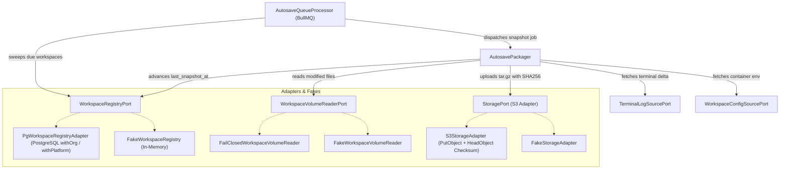

# Continuous Workspace Autosave Packager & Verified S3 Snapshot Uploader

> **Feature Ticket:** `[9.1]` Continuous RPO <= 30s Workspace Autosave Packager & S3 Snapshot Uploader  
> **Stream:** `[Stream 9]` Candidate Session Packager, S3 Storage & Orphan Workspace Reaper  
> **Business Invariants:** `BR-11` (Continuous Persistence & RPO <= 30s), `BR-01` (Tenant Isolation), `BR-18` (Untrusted Candidate Input Protection), `BR-22` (Workspace Snapshotting), `BR-23` (Cost Control & Resource Reaping)  
> **Functional Requirements:** `CA-010` (RPO <= 30s Work Persistence), `CA-011` (Candidate Session Resume & State Restoration), `NF-013` (Zero Work Loss), `T-022` (`ws-gateway`), `T-023` (`ws-agent` 15s snapshots)

---

## 1. System Overview & Hexagonal Architecture

HelloSmart assesses candidates through real engineering work performed inside controlled workspaces (Sysbox containers for Cloud VM mode, or structured Chat mode). To satisfy **BR-11** (_"Files, terminal history, editor state, chat transcript and drafts persist continuously with RPO <= 30 s and are restored on resume"_), the **Workspace Autosave Packager** executes periodic, deterministic snapshots of candidate workspaces and uploads integrity-verified archives to Amazon S3.

Because the Sysbox container runtime, orchestrator volume mounts, and final database schema migrations are developed in parallel across streams, this service is architected around strict **Ports and Adapters (Hexagonal Architecture)**:



---

## 2. Snapshot Anatomy & Manifest Schema

Each workspace snapshot produces a compressed `.tar.gz` archive containing:

1. **Incremental Modified Files**: Changed or newly created candidate files since the previous snapshot sequence.
2. **`manifest.json`**: An embedded JSON metadata record detailing the complete filesystem state, file checksums, deletions, terminal log offsets, and workspace configuration.
3. **Workspace Configuration**: Environment variables and container configuration.
4. **Terminal Log Delta**: The stream of terminal output bytes emitted since the last snapshot.

### Manifest Schema (`manifest.json`)

```json
{
  "version": "1.0",
  "workspaceId": "44444444-4444-4444-8444-444444444444",
  "orgId": "11111111-1111-4111-8111-111111111111",
  "assignmentId": "22222222-2222-4222-8222-222222222222",
  "seq": 1,
  "timestamp": "2026-11-06T10:00:00.000Z",
  "baseSnapshotKey": null,
  "isFull": true,
  "files": [
    {
      "path": "src/index.ts",
      "size": 1024,
      "sha256": "e3b0c44298fc1c149afbf4c8996fb92427ae41e4649b934ca495991b7852b855",
      "mtime": "2026-11-06T09:59:00.000Z"
    }
  ],
  "deleted": [],
  "skipped": [],
  "partial": false,
  "partialReasons": [],
  "terminalOffset": 4096,
  "terminalBytes": 128,
  "config": {
    "nodeVersion": "22.23.4"
  }
}
```

---

## 3. Full vs. Incremental Cadence & Restore Chain

To prevent unbounded delta chains while minimizing S3 storage bandwidth:

- **Sequence 1**: Always a **Full Snapshot** capturing all workspace files.
- **Sequences 2 to 9**: **Incremental Snapshots** containing only files modified or added since the previous sequence. Deleted paths are recorded in `manifest.deleted`.
- **Every $N$-th Snapshot** (configurable via `fullSnapshotInterval`, default `10`): Automatically forces a **Full Snapshot**, establishing a new base snapshot key.

### Restoration Chain Mechanics (Resume Ticket CA-011)

When a candidate resumes a disconnected session or recovers from a container failure:

1. Locate the latest snapshot for the workspace.
2. If the snapshot `isFull: true`, extract the tarball directly into the workspace root.
3. If `isFull: false`, retrieve `baseSnapshotKey` from `manifest.json`. Unpack the base full snapshot, then sequentially replay each incremental delta archive up to the target sequence.
4. Delete paths listed in `manifest.deleted`.
5. Restore terminal logs up to `manifest.terminalOffset`.

---

## 4. Storage Key Layout & Strict Tenant Scoping (BR-01)

All snapshot archives are stored under the dedicated S3 prefix:

```
snapshots/{orgId}/{assignmentId}/snap_{timestamp}_{seq}.tar.gz
```

### Isolation Guarantees:

- **UUID Validation**: Both `orgId` and `assignmentId` are strictly validated using `UUID_REGEX`.
- **Path Traversal Protection**: Rejects `..`, `\0`, backslashes, and control characters.
- **Source of Truth**: The `orgId` and `assignmentId` used to build the storage key originate **exclusively from the verified database registry record**, never from unauthenticated client inputs or untrusted job payloads.
- **Key Validation Helpers**:
  - `buildSnapshotStorageKey(orgId, assignmentId, timestamp, seq?)`: Constructs safe, normalized snapshot keys.
  - `isSnapshotKeyInOrg(key, orgId)`: Enforces that snapshot keys match `snapshots/{orgId}/` prefix and contain no traversal escapes.
  - The existing `isKeyInOrg(key, orgId)` for deliverable deliverables (`storage/{orgId}/`) remains completely unchanged.

---

## 5. Byte-for-Byte Deterministic Tarball Creation

To guarantee that identical workspace states produce identical archive checksums:

1. **Alphabetical Sorting**: All file entries and `manifest.json` are sorted lexicographically by relative POSIX path before packing.
2. **Fixed POSIX Metadata**: Every archive entry sets:
   - `mtime: new Date(0)` (Unix Epoch, UTC 1970-01-01)
   - `mode: 0o644` (or `0o755` for directories)
   - `uid: 0`, `gid: 0`, `uname: ''`, `gname: ''`
3. **Fixed Gzip Header Timestamp**: Node.js built-in `zlib.createGzip()` sets header timestamp flags; bytes 4–7 of the gzip stream (the 32-bit `MTIME` header per RFC 1952) are normalized to zero.
4. **Streamed Architecture**: Tar packing streams through zlib directly into memory/buffer without spawning external processes.

---

## 6. Hostile Workspace Defenses (BR-18)

Because workspace contents are candidate-controlled, they are treated as **untrusted data**:

- **`lstat` Exclusively**: Uses `fs.promises.lstat` instead of `stat`.
- **Never Follow Symlinks**: Symlinks are never traversed. The link destination is recorded as a skipped entry in `manifest.skipped` with reason `'symlink'`. Symlink recursion loops and directory escapes cannot occur.
- **Special Devices Skipped**: Unix domain sockets, FIFOs (named pipes), character devices (`/dev/zero`, `/dev/urandom`), and block devices are skipped.
- **Path Traversal & Control Character Rejection**: Reject paths starting with `/`, drive letters, containing `..`, `\0`, or ASCII control characters `0x00`–`0x1f`.
- **Resource Caps**:
  - `maxSingleFileSizeBytes`: 50 MB (exceeding files are skipped; `partial: true` recorded).
  - `maxTotalArchiveSizeBytes`: 50 MB total uncompressed volume.
  - `maxFileCount`: 5,000 files per workspace.
- **Concurrent Modification Resilience**: Files that disappear or change size during read are skipped gracefully and recorded in `manifest.partialReasons`.
- **Zero Shelling Out**: Absolutely no invocation of `child_process`, `rsync`, or system `tar` binaries.

---

## 7. Upload Integrity & Exponential Backoff

1. **Pre-Upload Integrity**: Calculates SHA-256 while streaming the deterministic `.tar.gz` buffer.
2. **AWS S3 ChecksumAlgorithm**: `PutObjectCommand` is issued with:
   - `ChecksumAlgorithm: 'SHA256'`
   - `ChecksumSHA256: <base64_encoded_sha256>`
3. **HeadObject Verification**: Immediately issues a `HeadObjectCommand` with `ChecksumMode: 'ENABLED'` and verifies that:
   - `headRes.ContentLength === payloadBuffer.length`
   - `headRes.ChecksumSHA256 === base64Sha256`
4. **Retry Policy**: Failed uploads or checksum verification mismatches are retried with **exponential backoff and jitter**:
   $$\text{Delay} = \text{baseDelayMs} \times 2^{\text{attempt}} + \text{jitter}(0\text{--}50\text{ ms})$$
5. **Atomic State Advancement**: `recordSnapshot` advances `last_snapshot_at` **only after a verified upload**. If all retries fail, `last_snapshot_at` is preserved at the previous good timestamp.

---

## 8. Queue Conventions & Worker Architecture

- **Queue Name**: `workspace-autosave`.
- **Redis Key Prefix**: `hs:${NODE_ENV}:autosave` (isolated across environments).
- **Sweeper Pattern**: A background timer runs every `AUTOSAVE_INTERVAL_SECONDS` (default 30s), queries `findDueWorkspaces` via `WorkspaceRegistryPort`, and enqueues snapshot jobs.
- **Deterministic Job IDs**: Job IDs follow `autosave:{workspaceId}:{timestamp}`.
- **In-Flight Concurrency Guard**: An active in-flight processing Set prevents multiple concurrent snapshot runs for the same workspace.
- **Auto-Cleanup**: Jobs configured with `removeOnComplete: 10, removeOnFail: 20` to prevent Redis memory growth.
- **Graceful Shutdown**: Implements NestJS `OnApplicationShutdown` to drain workers and close BullMQ queues cleanly.

---

## 9. Configuration Schema & Feature Flag

Configured in `apps/api/src/config/config.ts` via Zod:

| Environment Variable         | Type    | Default     | Description                                              |
| ---------------------------- | ------- | ----------- | -------------------------------------------------------- |
| `WORKSPACE_AUTOSAVE_ENABLED` | boolean | `false`     | Master toggle. Must be `true` to start queue and worker. |
| `AUTOSAVE_INTERVAL_SECONDS`  | number  | `30`        | Snapshot sweep frequency in seconds.                     |
| `REDIS_URL`                  | string  | `undefined` | Mandatory when `WORKSPACE_AUTOSAVE_ENABLED=true`.        |
| `STORAGE_DRIVER`             | string  | `'local'`   | `'s3'` or `'local'`.                                     |
| `STORAGE_S3_BUCKET`          | string  | `undefined` | Required when `STORAGE_DRIVER=s3`.                       |

---

## 10. RPO Arithmetic & Recommended Interval

### Theoretical vs. Real-World RPO

The requirement specifies **RPO <= 30s** (`BR-11`, `NF-013`).  
In real-world distributed execution, the maximum data loss window is:
$$\text{Worst-Case Lag} = \text{Interval} + \text{Snapshot Packaging Duration} + \text{S3 Upload Latency} + \text{Retry Backoff}$$

For typical candidate workspaces:

- Packaging duration: $\approx 10\text{--}50\text{ ms}$
- S3 upload latency: $\approx 100\text{--}400\text{ ms}$
- A 30-second sweep interval results in a nominal lag of $\approx 30.5\text{ s}$. Under network jitter or retries, worst-case lag can reach $35\text{--}45\text{ s}$, exceeding the strict 30s RPO SLA.

### Recommended Cadence:

We recommend reducing `AUTOSAVE_INTERVAL_SECONDS` to **15 seconds** (matching requirement `T-023` for 15-second git snapshots). At 15 seconds:
$$\text{Worst-Case Lag} = 15\text{ s} + 0.5\text{ s} = 15.5\text{ s} \ll 30\text{ s}$$
This provides a safe buffer against network latency and transient retries.

### Metric Pure Helper:

The pure function `calculateRpoLagSeconds(now, lastSnapshotAt)` calculates:

```typescript
export function calculateRpoLagSeconds(now: Date, lastSnapshotAt: Date | null): number {
  if (!lastSnapshotAt) return -1;
  const diffMs = now.getTime() - lastSnapshotAt.getTime();
  return Math.max(0, Math.floor(diffMs / 1000));
}
```

---

## 11. Structured Logging & Zero Audit Bloat

Snapshots run every 15–30 seconds per active candidate. Per the core architecture invariants:

- **Zero Audit Events**: Snapshot operations **MUST NOT** append rows to `audit.events` (audit rows are append-only and immutable; high-frequency jobs would permanently bloat the database).
- **Structured JSON Logs**: Logs emit IDs, durations, counts, and sizes only. **Zero secrets, zero file content, zero signed URLs**.

Example log entry:

```json
{
  "event": "workspace_snapshot_created",
  "workspaceId": "44444444-4444-4444-8444-444444444444",
  "orgId": "11111111-1111-4111-8111-111111111111",
  "assignmentId": "22222222-2222-4222-8222-222222222222",
  "seq": 1,
  "isFull": true,
  "partial": false,
  "fileCount": 14,
  "archiveSize": 145020,
  "sha256": "370aba8fcc3bcdf214620963a7a1b1a381b4b1f936869f49b8c03383eb4cf8a5",
  "durationMs": 42
}
```

---

## 12. Proposed Schema Columns for Migration Owner (Vishal V)

The current `app.workspaces` table (created in migration `0014_candidate_assessment_lifecycle.sql`) contains:

- `id`, `org_id`, `assignment_id`, `candidate_id`, `mode`, `status`, `runtime_ref`, `started_at`, `last_activity_at`, `ended_at`, `snapshot_ref`, `created_at`, `updated_at`.

To support continuous snapshot state tracking, the following columns are proposed for the next database migration:

```sql
ALTER TABLE app.workspaces
  ADD COLUMN IF NOT EXISTS last_snapshot_at timestamptz,
  ADD COLUMN IF NOT EXISTS last_snapshot_key text,
  ADD COLUMN IF NOT EXISTS last_snapshot_sha256 text,
  ADD COLUMN IF NOT EXISTS snapshot_seq integer NOT NULL DEFAULT 0;

CREATE INDEX IF NOT EXISTS idx_workspaces_autosave_due
  ON app.workspaces (org_id, status, last_snapshot_at)
  WHERE status IN ('connected', 'disconnected');
```

---

## 13. Retention Gap for `snapshots/` Root (Open Architecture Question)

The Ticket 4.4 `RetentionPurgeWorker` (`apps/api/src/modules/jobs/retention-purge.worker.ts`) purges candidate files using:

```typescript
const prefix = `storage/${orgId}/`;
```

Because snapshots are stored under `snapshots/{orgId}/{assignmentId}/`, they **will never be cleaned up by the candidate retention worker**. A lifecycle retention rule or snapshot reaper policy must be defined by the platform data team.

---

## 14. Operations Runbook

### Enabling in Production:

1. Verify Redis cluster connectivity: `REDIS_URL="redis://..."`
2. Verify S3 storage bucket and IAM credentials: `STORAGE_DRIVER="s3"`, `STORAGE_S3_BUCKET="..."`
3. Enable flag in environment: `WORKSPACE_AUTOSAVE_ENABLED="true"`
4. Set autosave interval: `AUTOSAVE_INTERVAL_SECONDS="15"`

### Monitoring Lag & Repeated Failures:

- Filter application logs for `"event":"workspace_snapshot_created"`.
- If `durationMs > 2000` or `partial === true`, inspect `partialReasons` for large candidate files or disk I/O bottlenecks.
- Alert when `rpoLagSeconds > 60` for any active workspace.
