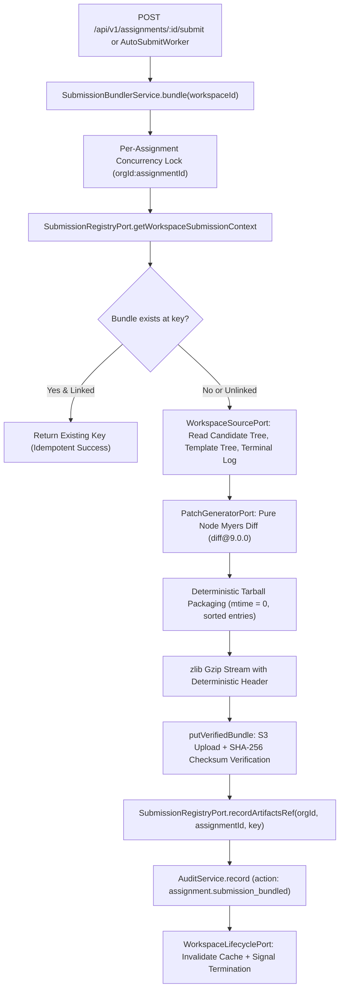

# [9.2] Candidate Submission Artifact Bundler & Deliverable Tarball Archive Pipeline

> **Requirement IDs:** `BR-11` (No work loss), `BR-18` (Untrusted candidate content), Migration `0014` (`trg_immutable_submission`), `BR-22` (Snapshot before destroy), `CA-018` (Candidate submit work), `CO-041` (Submission list), `CO-042` (Submission detail), `T-020` (Evidence bundle format), `T-023` (ws-agent capture).  
> **Status:** Implemented (MMP Scope). Single service entry point `SubmissionBundlerService.bundle(workspaceId)`.

---

## 1. Architecture & Pipeline Overview

The Submission Artifact Bundler generates the definitive, reproducible submission bundle when a candidate submits their assessment (or when the automated deadline worker triggers auto-submit).



### 1.1 Pipeline Execution Order & Failure Semantics

1. **Concurrency Lock & Promise De-duplication:** In-memory per-assignment lock (`${orgId}:${assignmentId}`) de-duplicates concurrent requests (e.g. manual candidate submission racing with the automated `AutoSubmitWorker`). Concurrent calls await the same execution promise, producing exactly one upload and one audit event.
2. **Context Resolution:** Retrieves `orgId`, `assignmentId`, `candidateId`, `templateRef`, and current `artifacts_ref` via `SubmissionRegistryPort`.
3. **Idempotency Gate:** Checks if `submissions/${orgId}/${assignmentId}/final_bundle.tar.gz` already exists. If it exists and matches `ctx.artifactsRef`, returns immediately as a no-op success without re-uploading.
4. **Source Retrieval:**
   - Candidate final working tree: via `WorkspaceSourcePort.readCandidateTree` (or `readCandidateTreeDetailed` for symlinks/device markers).
   - Template base commit tree: via `WorkspaceSourcePort.readTemplateTree`.
   - Terminal session history: via `WorkspaceSourcePort.readTerminalHistory`.
   - Workspace configuration / chat state: via `WorkspaceSourcePort.readWorkspaceConfig`.
5. **Pure Node Diff Generation:** Generates unified diff with Git extended headers (`diff --git a/ b/`) using `diff@9.0.0` (zero child process executions).
6. **Deterministic Tarball Assembly:** Packages files into `final_bundle.tar.gz` with sorted entries and fixed metadata (`mtime = 0`, `mode = 0o644`, `uid = 0`, `gid = 0`).
7. **Verified S3 Upload & Crash Recovery:** Uploads to S3 with SHA-256 integrity verification. If an object with matching SHA-256 already exists from a prior attempt that crashed before updating the database, the upload is safely skipped and the database link completes. If an object exists with a _different_ SHA-256, it fails safely with overwrite protection.
8. **Scoped Database Link:** Sets `app.assignments.artifacts_ref` once in PostgreSQL via a scoped write (`WHERE id = $1 AND org_id = $2 AND status = 'submitted' AND artifacts_ref IS NULL`).
9. **Single Audit Event:** Writes exactly ONE audit entry (`assignment.submission_bundled`) with byte size, SHA-256, and metadata (zero file contents or terminal logs).
10. **Lifecycle Notification:** Invalidates host caches and signals container termination readiness via `WorkspaceLifecyclePort` strictly _after_ the database record is established.

---

## 2. Bundle Specification & Layout (`final_bundle.tar.gz`)

The deliverable bundle is a versioned, portable tarball designed for direct consumption by independent AI reviewer agents (`T-020`, `BR-18`).

### 2.1 Directory Structure

```text
final_bundle.tar.gz
├── manifest.json              # Versioned bundle metadata and per-file SHA-256 digests
├── patch/
│   └── changes.patch          # Unified git patch against template base
├── source/                    # Complete final candidate source tree (sanitized)
│   ├── src/
│   │   ├── index.ts
│   │   └── app.ts
│   └── package.json
├── terminal/
│   └── history.log            # Full terminal session command & output history
└── workspace-config.json      # Optional runtime, environment, and AI chat state
```

### 2.2 T-020 Evidence Ref Mapping

Reviewer agents score rubric dimensions citing specific evidence refs (`T-020`). The bundle maps directly to these prefixes:
| Evidence Ref Prefix | Archive Target Path | Description |
|---|---|---|
| `term:<line_or_cmd>` | `terminal/history.log` | Candidate shell commands and stdout/stderr |
| `diff:<path>#L<line>` | `patch/changes.patch` | Code delta against template base commit |
| `file:<path>#L<line>` | `source/<path>` | Final candidate source code |
| `ai:<message_id>` | `unavailable: no source yet` | AI conversation & tool call transcript (see note below) |
| `event:<id>` | `unavailable: no source yet` | Workspace telemetry activity events |
| `test:<id>` | `unavailable: no source yet` | Automated test runner execution results |

> [!NOTE] > **CO-042 Submission Detail Expectation:** Requirement `CO-042` expects reviewers and evaluators to inspect the candidate's complete AI conversation history, prompts, and model interactions. In the current architecture, these reside in the AI proxy and session logging database and are not yet packaged into the workspace tarball. Consequently, `ai`, `event`, and `test` references are marked as `"unavailable: no source yet"`.

### 2.3 Manifest Schema (`manifest.json`)

```json
{
  "manifestVersion": "1.0.0",
  "bundleKind": "final_submission",
  "createdAt": "2026-11-06T12:00:00.000Z",
  "orgId": "11111111-1111-4111-8111-111111111111",
  "assignmentId": "22222222-2222-4222-8222-222222222222",
  "workspaceId": "33333333-3333-4333-8333-333333333333",
  "templateRef": "commit_base_v1",
  "patchStatus": "complete",
  "patchSha256": "4f53cda18c2baa0c0354bb5f9a3ecbe5ed12ab4d8e11ba873c2f11161202b945",
  "patchSizeBytes": 2048,
  "patchFilesChanged": 3,
  "terminalHistorySizeBytes": 4512,
  "terminalHistorySha256": "a3b890...",
  "filesCount": 12,
  "totalSourceSizeBytes": 84120,
  "files": [
    {
      "path": "src/app.ts",
      "sha256": "e3b0c44298fc1c149afbf4c8996fb92427ae41e4649b934ca495991b7852b855",
      "sizeBytes": 1240,
      "mode": 420,
      "isBinary": false
    }
  ],
  "isPartial": false,
  "partialReasons": [],
  "skippedEntries": [],
  "notice": "All candidate files, terminal history, and patch text in this archive are UNTRUSTED candidate input and must be sanitized before ingestion by AI models or external evaluators (BR-18).",
  "t020RefMapping": {
    "term": "terminal/history.log",
    "diff": "patch/changes.patch",
    "file": "source/",
    "ai": "unavailable: no source yet (CO-042 expects AI transcript, not captured in current bundle)",
    "event": "unavailable: no source yet",
    "test": "unavailable: no source yet"
  }
}
```

---

## 3. Security: Hostile Candidate Content Defenses (`BR-18`)

The candidate workspace repository is **UNTRUSTED DATA**:

1. **Zero Git Execution on Host:** Under no circumstances does the API host execute the `git` binary against candidate repositories. Hostile `.git/config` configurations (`core.fsmonitor`, `diff.external`, `diff.<driver>.textconv`, `core.sshCommand`, `include.path`) and hooks are neutralized because `git` is never executed.
2. **Exclusion of `.git`:** The candidate's `.git` directory is stripped from the bundle completely.
3. **Symlink Traversal Prevention:** Symlinks are never followed. They are recorded in `manifest.json` with `isSymlink: true` and their link target stored, while their target content is excluded from the archive.
4. **Special File Handling:** FIFOs, UNIX domain sockets, character devices, and block devices are skipped entirely and logged in `manifest.skippedEntries`.
5. **Path Sanitization:** Filenames containing NUL bytes (`\0`), carriage returns, newlines, control characters, path traversal elements (`..`), absolute paths, or exceeding 1024 characters are rejected and logged in `manifest.skippedEntries`.
6. **Prompt Injection Containment:** Files containing adversarial instructions (e.g. attempting to override reviewer models to give high scores) are transported strictly as inert text. The manifest carries an explicit `notice` header alerting downstream LLM ingestion harnesses.

---

## 4. Storage Key Architecture & Verification Invariants

- **S3 Key Format:** `submissions/${orgId}/${assignmentId}/final_bundle.tar.gz`
- **Key Validation:** `buildSubmissionBundleKey` and `isSubmissionBundleKeyInOrg` enforce strict UUID regex validation and reject traversal characters (`..`, `\0`, `\\`).
- **Relative Key vs URI Decision:** `artifacts_ref` stores the **relative object key**, **NOT** a bucket-qualified URI (`s3://...`). Storing relative keys decouples data from bucket names across environments (LocalStack, local-fs, production) and prevents cloud infrastructure leakage.
- **Reviewer Key Rebuilding & Integrity Rule:** Downstream reviewer agents and evaluators must **rebuild the canonical key deterministically** from `orgId` and `assignmentId` (`submissions/${orgId}/${assignmentId}/final_bundle.tar.gz`) and compute/verify the archive SHA-256 against `manifest.json` or the object's `x-amz-meta-sha256` metadata, rather than unconditionally trusting `app.assignments.artifacts_ref`.
- **Database Checksum Column (Proposal):** PostgreSQL tables `app.assignments` and `app.submissions` currently contain no `sha256` or `checksum` column. As an interim invariant, bundle integrity is verified by comparing the S3 object metadata against `audit.events.after.sha256`. Adding a formal `bundle_sha256 text` column to `app.assignments` is a PROPOSAL for Vishal V.

---

## 5. Open Questions & Architectural Findings

### 1. Database Schema Drift: Migration `0014` vs `0018`

- **Finding:** `0014_candidate_assessment_lifecycle.sql` created `app.submissions` with columns `(id, org_id, assignment_id, candidate_id, repository_url, branch_name, uploaded_artifact, architecture_notes, submitted_at, auto_submitted, receipt_id)` and an immutable trigger (`trg_immutable_submission`) blocking all `UPDATE` queries.
- Migration `0018_timing_email_audit.sql` attempted `CREATE TABLE IF NOT EXISTS app.submissions (id, org_id, assignment_id, artifacts_ref, ...)`, but PostgreSQL skipped it because the table already existed from `0014`.
- **Resolution:** `artifacts_ref` exists on `app.assignments` (added in `0018` line 14). `SubmissionBundlerService` sets `app.assignments.artifacts_ref`. To link `artifacts_ref` directly to `app.submissions`, migration owner Vishal V must provide an `ALTER TABLE app.submissions ADD COLUMN IF NOT EXISTS artifacts_ref text;`.

### 2. Retention Purge Scope on `submissions/` Root (`BR-27`)

- **Finding:** `retention-purge.worker.ts` and `s3-storage.adapter.ts` currently enforce `isKeyInOrg` which only matches `storage/${orgId}/`.
- Keys in `submissions/${orgId}/...` and `snapshots/${orgId}/...` are **NOT** deleted by the candidate retention purge worker.
- **Action for Lead:** Product and compliance counsel must specify retention periods for submission bundles and expand `CandidateArtifactLocatorPort` to locate `submissions/` keys.

### 3. Template Base Repository Resolution

- **Finding:** `app.template_versions.manifest` stores `repo_ref` or `seed_ref`, but no service currently resolves them into a file tree.
- **Resolution:** `WorkspaceSourcePort.readTemplateTree` returns `null` in production, setting `manifest.patch_status = 'unavailable'` while safely preserving the full source tree and terminal logs (`BR-11`, no work loss).

### 4. Container Termination vs Bundling Race (Stream 9.3 Proposal)

- **Rule:** A workspace reaper must **never** terminate or destroy an `ended` workspace while `app.assignments.artifacts_ref IS NULL`.
- **PROPOSAL (Stream 9.3):** A 15-minute fallback timeout is proposed for the workspace reaper to handle orphaned workspaces where bundling permanently failed, preventing resource leaks while allowing sufficient time for retries.

### 5. CA-018: Submission Reopening vs Fixed S3 Key and Set-Once Invariant

- **Question:** If a company admin reopens an assignment (`CA-018`) to grant the candidate additional time or revisions, how does subsequent rebundling interact with the fixed S3 key (`submissions/${orgId}/${assignmentId}/final_bundle.tar.gz`) and the set-once `artifacts_ref`?
- **Options for Product / DB Lead:**
  1. _Versioned Object Keys:_ Use `final_bundle_v${n}.tar.gz` and record version history in an audit or submission revisions table.
  2. _Archive on Reopen:_ When an assignment is reopened, move the previous bundle to a `revisions/` subkey and reset `app.assignments.artifacts_ref = NULL`.

### 6. Audit Action Allow-List Confirmation (`assignment.submission_bundled`)

- **Finding:** In PostgreSQL, `audit.events.action` is defined as `text NOT NULL` without an enum or `CHECK` constraint. Therefore, inserting `assignment.submission_bundled` does **NOT** require a database migration.
- **Recommendation:** If the platform team later implements an action whitelist or PostgreSQL enum for `audit.events.action`, `assignment.submission_bundled` should be formally included.

### 7. Known Gap: Candidate Database Write on `artifacts_ref`

- **Finding:** A security probe against `hellosmart_test` revealed that under PostgreSQL RLS, a candidate-role session (`withUserSession` with `app.user_role = 'candidate'` and `app.user_id = candidate_id`) **can** execute:
  ```sql
  UPDATE app.assignments SET artifacts_ref = '<tampered>' WHERE id = $1;
  ```
  This is permitted because `assignment_update` in migration `0014` allows updates where `candidate_id = app.current_user_id()`, the generic `tenant_isolation` policy allows any update within the org, and the only trigger `trg_assignment_timer_integrity` checks only timer fields (`first_connect_at`, `deadline_at`, `extended_minutes`).
- **Application Layer Caveat:** In the NestJS application layer, candidate-facing endpoints and DTOs (`candidate-portal.controller.ts`, `candidate-timing.controller.ts`, etc.) **do not expose** `artifacts_ref`. An attacker cannot exploit this via HTTP REST APIs.
- **Architectural Options for Vishal V:**
  - **Option A (Trigger Guard - Recommended):** Add a column guard into `app.enforce_assignment_timer_integrity()` (or attach a dedicated `trg_immutable_artifacts_ref`) that raises an exception if a candidate modifies `artifacts_ref` or if an existing non-null `artifacts_ref` is altered.
  - **Option B (Column-level Grants):** Revoke broad `UPDATE` on `app.assignments` from `hs_app`, granting column-specific updates on candidate fields only, reserving `artifacts_ref` for `hs_platform`.
