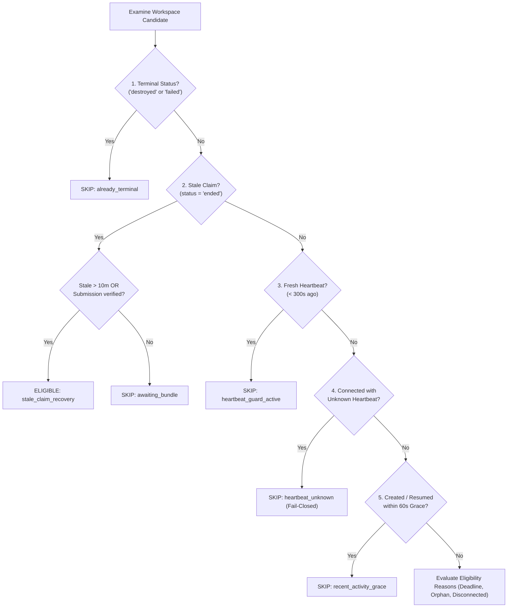
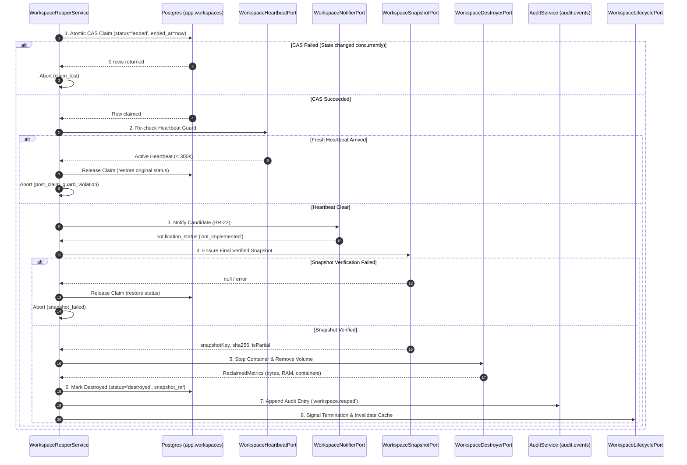

# Workspace Orphan Reaper & Compute Resource Garbage Collector (Stream 9.3)

> **Requirement Traceability:** `BR-22`, `BR-23`, `BR-09`, `BR-11`, `NF-014`, `AD-019`, `CO-044`  
> **Status:** Implementation Complete (Dry Run by Default)  
> **Module Path:** `apps/api/src/modules/workspaces/`

---

## 1. Purpose & Core Invariants

The **Workspace Orphan Reaper** is an automated background daemon responsible for identifying inactive, disconnected, expired, or orphaned candidate workspaces and safely reclaiming compute resources (Docker containers and host volumes) without data loss (`BR-23`, `NF-014`, `AD-019`).

### Critical Safety Invariants

1. **Never Destroy Unsnapshotted Work:** A workspace is **never** destroyed unless a verified final snapshot exists in S3 (via Stream 9.1 packager) or a verified deliverable bundle exists (via Stream 9.2 bundler).
2. **Dry Run by Default:** Destruction cannot happen by accident. `REAPER_DRY_RUN=true` is the default. Real destruction requires `WORKSPACE_REAPER_ENABLED=true AND REAPER_DRY_RUN=false` and an explicit non-production override if not in production.
3. **Never Auto-Submit Directly:** The reaper **never** auto-submits an assessment. If an assessment deadline has expired but `AutoSubmitWorker` has not finalized it, the reaper reports `awaiting_auto_submit` and retries later.
4. **Active Heartbeat Hard Guard:** A fresh WebSocket heartbeat within the last 5 minutes (`300 seconds`) strictly prevents reaping, even if the candidate's last activity timestamp appears old.
5. **Fail-Closed Unknown Heartbeat:** If a workspace is in `'connected'` status and no heartbeat signal is available, the reaper **fails closed** and never destroys the container.
6. **No Real Cloud or Real Docker Execution in API Host:** Real container/volume teardown belongs to the workspace orchestrator. The production destroyer adapter in this repository is fail-closed.

---

## 2. Classification Matrix & Thresholds

| Reason Identifier            | Condition / Trigger                                                                                      | Threshold Value       | Status / Source                                                 |
| ---------------------------- | -------------------------------------------------------------------------------------------------------- | --------------------- | --------------------------------------------------------------- |
| `deadline_expired_submitted` | Assessment `deadline_at <= now` AND assignment status is `submitted` AND verified bundle/snapshot exists | `0s` after submission | **Documented** (`BR-23`, `CO-028`, `EX-08`)                     |
| `orphan_candidate_deleted`   | Candidate user record soft-deleted (`deleted_at IS NOT NULL`)                                            | Immediate upon scan   | **Documented** (`BR-26`, `CO-016`)                              |
| `orphan_submitted`           | Assignment status is `submitted` AND verified bundle/snapshot exists                                     | Immediate upon scan   | **Documented** (`BR-23`, `CO-044`)                              |
| `orphan_expired`             | Assignment status is `expired` (window closed unstarted)                                                 | Immediate upon scan   | **Documented** (`BR-23`, `EX-07`)                               |
| `orphan_revoked`             | Assignment status is `revoked` by company admin                                                          | Immediate upon scan   | **Documented** (`BR-23`, `CO-044`)                              |
| `disconnected_timeout`       | Workspace status is `disconnected` AND `last_activity_at < now - 60m`                                    | `60 minutes`          | **Proposed** (Ticket text; to be confirmed by Vishal V)         |
| `idle_timeout`               | Workspace status is `connected` AND `last_activity_at < now - 15m`                                       | `15 minutes`          | **Proposed** (Disabled by default: `REAPER_IDLE_ENABLED=false`) |
| `stale_claim_recovery`       | Workspace status is `ended` AND `ended_at < now - 10m`                                                   | `10 minutes`          | **Documented** (Stream 9.3 crash recovery)                      |

---

## 3. Hard Guards & Evaluation Precedence

Guards are evaluated in strict order **before** any reap eligibility reason, and re-evaluated **immediately post-claim**:



1. **Terminal Guard:** If `status IN ('destroyed', 'failed')` -> skip (`already_terminal`).
2. **Stale Claim Handling:** If `status = 'ended'` and assignment is concluded, eligible for `stale_claim_recovery` once bundle/snapshot exists or age exceeds 10 minutes.
3. **Heartbeat Guard (300s):** If `now - lastHeartbeatAt < 300s` -> skip (`heartbeat_guard_active`).
4. **Fail-Closed Heartbeat:** If `status = 'connected'` and `lastHeartbeatAt IS NULL` -> skip (`heartbeat_unknown`).
5. **Recent Activity Grace Window (60s):** If started or resumed within 60s -> skip (`recent_activity_grace`).

---

## 4. Teardown Execution Pipeline



---

## 5. Circuit Breaker & Safety Configuration

The reaper includes an automated circuit breaker to prevent catastrophic mass-deletion in the event of clock skew, misconfigured thresholds, or database anomalies:

- **Maximum Eligible Ratio (`circuitBreakerMaxRatio`):** If the eligible workspaces exceed `50%` of the active workspace pool (default), the sweep **aborts immediately**, destroys zero containers, logs a critical error, and sets `circuitBreakerTriggered=true`.
- **Batch Limit:** Each sweep evaluates at most `REAPER_BATCH_LIMIT=50` candidates per invocation to maintain bounded transaction durations.

---

## 6. Audit & Observability

### Audit Event Specification

- **Action Name:** `'workspace.reaped'` (follows `<entity>.<past_tense_action>` convention).
- **Target Entity:** `entity: 'workspace'`, `entityId: workspaceId`.
- **Payload (`after`):**
  ```json
  {
    "workspaceId": "uuid",
    "assignmentId": "uuid",
    "reason": "disconnected_timeout | deadline_expired_submitted | orphan_submitted | ...",
    "thresholds": {
      "disconnectedTimeoutMinutes": 60,
      "idleTimeoutMinutes": 15,
      "heartbeatGuardSeconds": 300
    },
    "snapshotKey": "submissions/org/asg/final_bundle.tar.gz",
    "snapshotSha256": "sha256-hash",
    "isPartial": false,
    "notificationStatus": "not_implemented | notified | failed",
    "reclaimedMetrics": {
      "bytesReclaimed": 52428800,
      "memoryBytesReclaimed": 1073741824,
      "containersRemoved": 1,
      "volumesRemoved": 1,
      "runtimeSeconds": 3600
    },
    "dryRun": false
  }
  ```
- **PII Prohibition:** Audit payloads **never** include candidate names, candidate email addresses, source file contents, or terminal session logs.
- **Audit Volume:** Exactly **one** audit event per destroyed workspace. Zero audit events for dry runs, scans finding zero candidates, or skipped workspaces.

---

## 7. Open Questions & Migration Inputs for Vishal V

1. **`last_heartbeat_at` Column:**
   - Currently, `app.workspaces` has only `last_activity_at`. A dedicated `last_heartbeat_at timestamptz` column should be added to `app.workspaces` when `ws-gateway` (T-022) is implemented.
2. **`destroy_reason` Column:**
   - Currently, the destroy reason is preserved in `audit.events`. Adding `destroy_reason text` to `app.workspaces` would simplify reporting and admin queries without requiring audit log joins.
3. **Idle vs Disconnected Disparity:**
   - The ticket proposed a 15-minute idle rule alongside a 60-minute disconnect rule. In live exams, quiet candidates could be penalized if idle timeout is too aggressive. We have set `REAPER_IDLE_ENABLED=false` by default until confirmed by product leadership.
4. **Candidate Notification Implementation (BR-22, CO-044):**
   - No email template currently exists for `workspace-destroyed`. Product and legal must confirm if an email or in-app modal is preferred for reaped sessions.

---

## 8. Operational Runbook

### Running in Dry Run Mode (Default)

In staging and local development, the reaper logs planned actions without modifying workspaces or volumes:

```env
WORKSPACE_REAPER_ENABLED=true
REAPER_DRY_RUN=true
```

Logs will output structured lines:
`[DRY RUN] Would reap workspace {id} (org={orgId}, reason=disconnected_timeout)`

### Enabling Real Destruction

Real destruction requires all of the following:

```env
WORKSPACE_REAPER_ENABLED=true
REAPER_DRY_RUN=false
REAPER_ALLOW_DESTRUCTION_IN_NON_PROD=true # Only needed if NODE_ENV !== 'production'
```

### Stopping the Reaper

Set `WORKSPACE_REAPER_ENABLED=false` or restart the API worker. BullMQ repeatable schedules are gracefully removed on application shutdown.
