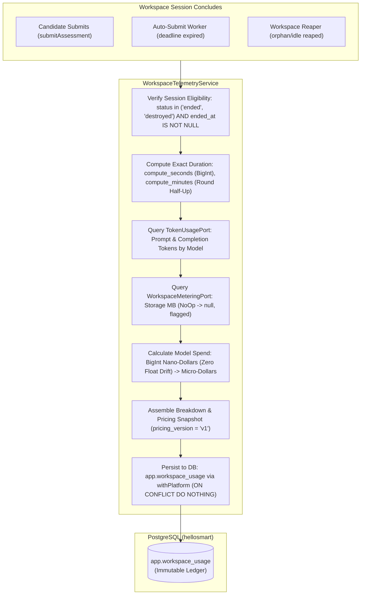

# Workspace Compute & AI Token Spend Cost Aggregation Telemetry (Stream 9.4)

> **Requirement Traceability:** `BR-23`, `BR-13`, `BR-15`, `CO-035`, `CO-037`, `AD-018`, `AD-019`, `AD-025`, `NF-014`  
> **Source Schema:** `packages/contracts/db/migrations/0020_workspace_usage_telemetry.sql`  
> **Service Implementation:** `apps/api/src/modules/workspaces/workspace-telemetry.service.ts`  
> **Test Suite:** `apps/api/test/workspace-telemetry.spec.ts`

---

## 1. Overview & Architecture

Stream 9.4 introduces an itemized, append-only compute and AI token spend aggregation service for candidate workspace sessions. It measures session compute duration, queries token consumption from the AI proxy, applies a versioned model pricing matrix, and durably records finalized telemetry in PostgreSQL (`app.workspace_usage`).



---

## 2. Requirements & Invariant Traceability

- **`BR-23 Cost control` (`AGENTS.md:345`):**
  > _"Idle, expired and orphaned workspaces are destroyed automatically. Hard spend limits exist per session and per org."_  
  > _Telemetry Role:_ Provides the immutable session spend measurement basis required to track and enforce per-session and per-org spend caps.
- **`BR-13 AI proxy is the only path` (`AGENTS.md:349`):**
  > _"All AI calls are policy-checked, capped and logged by the proxy."_  
  > _Telemetry Role:_ Token consumption is aggregated from records emitted by the AI proxy (`TokenUsagePort`).
- **`BR-15 Caps` (`AGENTS.md:351`):**
  > _"Per-candidate and per-assessment caps (tokens or currency) and requests-per-minute."_
- **`CO-035 Usage caps per candidate and per assessment` (`AGENTS.md:491`):**
  > _"Caps in tokens or currency plus requests-per-minute; behaviour at cap configurable (warn then block); candidate sees remaining budget."_
- **`CO-037 AI usage and cost visibility` (`AGENTS.md:496`):**
  > _"Per-assessment and org-wide tokens/cost by candidate and model."_
- **`AD-018 Oversee all workspaces across orgs` (`AGENTS.md:706`):**
  > _"Global list with org, candidate, mode, status, age, resource usage and cost; filters and search."_
- **`AD-025 Platform-wide analytics` (`AGENTS.md:727`):**
  > _"Org growth, trial conversion, template usage, candidate volume, cost/revenue estimates."_
- **`NF-014 Automatic VM cleanup and spend limits` (`AGENTS.md:855`):**
  > _"Idle, expired and orphaned VMs destroyed automatically; hard per-session and per-org spend limits."_

---

## 3. Database Schema (`app.workspace_usage`)

Defined in `packages/contracts/db/migrations/0020_workspace_usage_telemetry.sql`.

| Column              | Type            | Nullable | Constraints & Defaults                                                                          | Purpose                               |
| ------------------- | --------------- | -------- | ----------------------------------------------------------------------------------------------- | ------------------------------------- |
| `id`                | `uuid`          | NO       | `PRIMARY KEY DEFAULT gen_random_uuid()`                                                         | Unique record identifier              |
| `workspace_id`      | `uuid`          | NO       | `UNIQUE REFERENCES app.workspaces(id) ON DELETE RESTRICT`                                       | Scoped session run (1:1)              |
| `org_id`            | `uuid`          | NO       | `REFERENCES app.organizations(id) ON DELETE CASCADE`                                            | Tenant owner                          |
| `assignment_id`     | `uuid`          | NO       | `FOREIGN KEY (org_id, assignment_id) REFERENCES app.assignments(org_id, id) ON DELETE RESTRICT` | Candidate assignment                  |
| `assessment_id`     | `uuid`          | NO       | `FOREIGN KEY (org_id, assessment_id) REFERENCES app.assessments(org_id, id) ON DELETE RESTRICT` | Configured assessment task            |
| `candidate_id`      | `uuid`          | NO       | `FOREIGN KEY (org_id, candidate_id) REFERENCES app.users(org_id, id) ON DELETE RESTRICT`        | Candidate user reference              |
| `compute_seconds`   | `bigint`        | NO       | `CHECK (compute_seconds >= 0)`                                                                  | Exact elapsed seconds                 |
| `compute_minutes`   | `integer`       | NO       | `CHECK (compute_minutes >= 0)`                                                                  | Derived minutes (round half up)       |
| `storage_mb`        | `integer`       | YES      | `CHECK (storage_mb IS NULL OR storage_mb >= 0)`                                                 | Storage footprint (null if unmetered) |
| `prompt_tokens`     | `bigint`        | NO       | `DEFAULT 0 CHECK (prompt_tokens >= 0)`                                                          | Sum of input tokens across models     |
| `completion_tokens` | `bigint`        | NO       | `DEFAULT 0 CHECK (completion_tokens >= 0)`                                                      | Sum of output tokens across models    |
| `total_cost_usd`    | `numeric(14,6)` | NO       | `DEFAULT 0.000000 CHECK (total_cost_usd >= 0)`                                                  | Micro-dollar precision total spend    |
| `breakdown`         | `jsonb`         | NO       | `DEFAULT '[]'::jsonb`                                                                           | Itemized model spend objects          |
| `pricing_version`   | `text`          | NO       | `DEFAULT 'v1'`                                                                                  | Pinned pricing matrix version         |
| `status`            | `text`          | NO       | `CHECK (status IN ('complete', 'partial'))`                                                     | Telemetry completeness state          |
| `flags`             | `text[]`        | NO       | `DEFAULT '{}'::text[]`                                                                          | Anomaly/degradation markers           |
| `started_at`        | `timestamptz`   | NO       |                                                                                                 | Session start timestamp               |
| `ended_at`          | `timestamptz`   | NO       | `CHECK (ended_at >= started_at)`                                                                | Session completion timestamp          |
| `created_at`        | `timestamptz`   | NO       | `DEFAULT now()`                                                                                 | Record creation timestamp             |

### Immutability & Security Enforcement

1. **Immutability Trigger (`trg_block_workspace_usage_update`):**  
   `BEFORE UPDATE ON app.workspace_usage` executes `app.prevent_workspace_usage_update()`, raising a fatal exception. Historical billing records cannot be altered.
2. **Restricted Grants:**  
   Application roles (`hs_app`, `hs_platform`) are granted **`SELECT, INSERT` ONLY**. No `UPDATE` or `DELETE` grants exist for runtime roles. Admin cleanup is restricted to `hs_owner`.
3. **Row-Level Security (Forced):**
   - **`workspace_usage_select`:**
     ```sql
     USING (
       app.is_platform()
       OR (org_id = app.current_org_id() AND app.current_user_role() = 'company_admin')
     )
     ```
     Candidate sessions are strictly prevented from viewing billing/usage data. Cross-tenant reads return 0 rows.
   - **`workspace_usage_insert`:** `WITH CHECK (app.is_platform())`. All mutations require elevated platform context via `withPlatform`.

---

## 4. Money & Duration Calculation Rules

### Financial Arithmetic: Zero Floating-Point Drift

Financial operations never use JavaScript `number` (IEEE-754 binary floating point). All calculations are performed in native **`BigInt` integer micro-dollars** ($1.00 = 1,000,000\text{ micro-dollars}$):

1. **Token Cost Formula:**
   $$\text{microDollars} = \frac{\text{tokens} \times \text{pricePerMillionMicro} + 500,000\text{n}}{1,000,000\text{n}}$$
2. **Database Representation:**  
   Converted to string formatted as `numeric(14,6)` (e.g. `2500000n` $\to$ `"2.500000"`).

### Model Pricing Matrix (`pricing/model-pricing.config.ts`)

| Model                  | Input Price / 1M USD | Output Price / 1M USD | Status                                     |
| ---------------------- | -------------------- | --------------------- | ------------------------------------------ |
| `gpt-4o`               | $\$5.00$             | $\$15.00$             | **PLACEHOLDER (Ticket 9.4 specification)** |
| `test-cheap-model`     | $\$1.00$             | $\$2.00$              | Test Fixture                               |
| `test-expensive-model` | $\$100.00$           | $\$200.00$            | Test Fixture                               |

- **Unknown Models:** Token counts are retained in full; cost is computed as $\$0.000000$; record is tagged with flag `'unknown_model'` and status `'partial'`.

### Compute Duration Policy

- **Formula:** $\text{compute\_seconds} = \text{floor}((\text{ended\_at} - \text{started\_at}) / 1000)$.
- **Derived Minutes:** $\text{compute\_minutes} = \text{round}(\text{compute\_seconds} / 60)$.
- **Boundary Policy:** $0\text{ seconds} = 0\text{ minutes}$ (zero stays zero; no arbitrary 1-minute minimum). Negative or reversed times are clamped to $0$ with flag `'negative_duration_adjusted'`.

---

## 5. Integration Call Sites & Idempotency

`WorkspaceTelemetryService.recordSessionUsage(workspaceId)` is strictly idempotent (`ON CONFLICT (workspace_id) DO NOTHING`):

1. **Candidate Submission (`apps/api/src/modules/candidates/candidate-assessments.service.ts:604`):**  
   Executes upon manual candidate submit when `workspaces.status` transitions to `'ended'`.
2. **Auto-Submit Deadline Worker (`apps/api/src/modules/submissions/submissions.service.ts:48`):**  
   Executes upon deadline expiry when `workspaces.status` transitions to `'ended'`.
3. **Workspace Reaper Teardown (`apps/api/src/modules/workspaces/workspace-reaper.service.ts:474`):**  
   Executes upon container destruction when `workspaces.status` transitions to `'destroyed'`.

_First completed call wins._ If submission already recorded usage, subsequent calls by the reaper or backfill daemons perform a clean no-op.

---

## 6. Read-Side Query Capabilities

`WorkspaceTelemetryService` provides typed read-side service queries fulfilling `CO-037`, `AD-018`, and `AD-025`:

- `getUsageByWorkspace(workspaceId)`: Single session lookup.
- `getUsageByOrganization(orgId, filter)`: Paginated tenant usage history.
- `getUsageByAssessment(orgId, assessmentId, filter)`: Aggregated usage by assessment task.
- `getUsageByCandidate(orgId, candidateId, filter)`: Aggregated candidate consumption.
- `getSpendTotals(filter)`: Summary metric card data (total sessions, compute seconds/minutes, prompt/completion tokens, total spend USD).

_(Note: Per API contract rules, no HTTP endpoints were added as `openapi.yaml /admin/metrics` only defines aggregate company/candidate counts)._

---

## 7. Open Questions & Architectural Risks (For Vishal V & Product Lead)

1. **Billable Window Ambiguity (Candidate Time vs. Container Lifecycle):**
   - _Observation:_ When a candidate submits, `ended_at` is set to submission time (`T0`). If the workspace reaper later claims and destroys the container at `T1` (`pg-workspace-reaper-registry.adapter.ts:204-209`), it updates `ended_at` to `T1`.
   - _Question:_ Should customers be billed for candidate active time ($T_0 - \text{start}$) or total provisioned container compute time ($T_1 - \text{start}$)?
2. **Foreign Key `ON DELETE RESTRICT` vs. 4.4 Retention Purge:**
   - _Observation:_ `app.workspace_usage` uses `ON DELETE RESTRICT` on `workspace_id`, `assignment_id`, and `candidate_id` to guarantee billing immutability.
   - _Question:_ `RetentionPurgeWorker` currently hard-deletes candidates via `DELETE FROM app.users`. This delete will fail for candidates with usage records. A dedicated billing data archival/anonymization path is required before candidate hard-deletion.
3. **`app.ai_messages` Migration Coordination:**
   - _Observation:_ `app.ai_messages` is not yet created. `PgTokenUsageAdapter` falls back to empty token lists until Stream 10 (AI Proxy) provisions the ingestion table.
4. **Retroactive Pricing Adjustments:**
   - _Observation:_ Because `app.workspace_usage` is immutable, price renegotiations or custom provider rebates cannot mutate existing records. We recommend introducing an `app.billing_adjustments` ledger in Phase 2.
